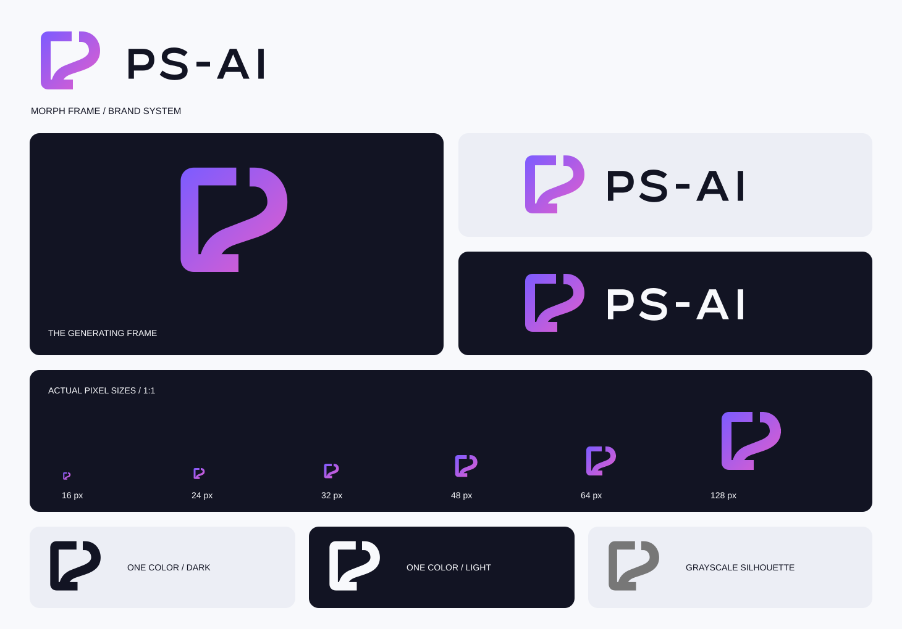

<p align="center"></p>
<h1 align="center">PS-AI brand assets</h1>
<p align="center"><a href="BRAND.md">简体中文</a> · <strong>English</strong> · <a href="README.en.md">README</a></p>

Morph Frame joins an open editing frame to a turning surface. Straight edges establish a boundary; the curve unfolds from within it, suggesting an image being generated again. The opening at the top and the internal negative space are structural. Keep both in one-color artwork.



## Pick a file

| Use | File |
| --- | --- |
| Main symbol, transparent | [mark.svg](assets/brand/mark.svg) |
| Light / dark background plate | [Light](assets/brand/mark-on-light.svg) · [Dark](assets/brand/mark-on-dark.svg) |
| One-color symbol | [Dark](assets/brand/mark-mono-dark.svg) · [Light](assets/brand/mark-mono-light.svg) |
| Horizontal lockup | [Light interface](assets/brand/lockup-on-light.svg) · [Dark interface](assets/brand/lockup-on-dark.svg) |
| One-color lockup | [Dark](assets/brand/lockup-mono-dark.svg) · [Light](assets/brand/lockup-mono-light.svg) |
| Outlined wordmark | [wordmark.svg](assets/brand/wordmark.svg) |
| Social avatar | [512px PNG](assets/brand/avatar.png) |
| Browser icon | [favicon.ico](assets/brand/favicon.ico), with 16 /32 /48px PNG images |

Transparent symbol PNGs: [16](assets/brand/icons/mark-16.png) · [24](assets/brand/icons/mark-24.png) · [32](assets/brand/icons/mark-32.png) · [48](assets/brand/icons/mark-48.png) · [64](assets/brand/icons/mark-64.png) · [128](assets/brand/icons/mark-128.png) · [256](assets/brand/icons/mark-256.png) · [512](assets/brand/icons/mark-512.png).

Application icons use the dark plate: [48](assets/brand/icons/app-48.png) · [96](assets/brand/icons/app-96.png) · [512](assets/brand/icons/app-512.png). The Photoshop sidebar uses 23 / 46px monochrome exports selected by the host theme. The panel header uses a 32px symbol with a 2× PNG.

## Size and clear space

- The symbol uses a 128×128 canvas, a main band width of 16 units and a 12-unit opening. At 24px these become about 3px and 2.25px. The opening also remains visible at 16px.
- Keep at least 12 units of clear space outside the visible outline, roughly one tenth of the canvas width. Apply the same rule to lockups; keep buttons, rules and neighboring graphics outside this area.
- Prefer 24px or larger for interface symbols. Reserve 16px for favicons and similar constraints. Horizontal lockups should be at least 112px wide.
- Choose a PNG large enough for the display scale: use 48px artwork for a 24px display. Do not enlarge a 16px file for a large placement.
- The geometric sans-serif wordmark is drawn as vector outlines, with no external font dependency. Preserve its weight and spacing rather than substituting a similar font.

## Colors

| Color | Value | Use |
| --- | --- | --- |
| Electric Violet | `#7C5CFF` | First gradient stop |
| Creative Magenta | `#E35DCC` | Second gradient stop |
| Digital Cyan | `#49CFFF` | Small accents in extended artwork; absent from the main logo |
| Deep Space | `#121423` | Dark plates and dark monochrome artwork |
| Soft White | `#F8F9FC` | Light plates and reversed artwork |

The gradient runs from upper left to lower right. Both shapes share its coordinates. Use monochrome artwork or the supplied plates on busy photos, high-contrast interfaces and restricted print processes. The panel retains its existing dark layout; light assets do not imply a complete light UI theme.

## Avoid

Do not stretch, skew, rotate, close the opening or alter the proportions. Add no outlines, shadows or glow. Keep green out of the main identity. Do not place the symbol inside Adobe's blue Ps square or combine it with Adobe's official marks as one product.

Historical screenshots remain unchanged and identify their version. This update preserves image workflows, plugin IDs, panel ID and installation directory. The 0.3.0 identity remains available in Git history.

## Edit and export

`mark.svg` and `wordmark.svg` are the geometry sources. The script derives color variants, lockups, PNGs, ICO and the overview:

```sh
npm ci
npm run brand:export
npm run brand:check
npm run package
```

SVG export uses [resvg-js](https://github.com/thx/resvg-js) as a development tool; it never enters Photoshop's runtime bundle. Normal builds copy the committed PNGs, so the host need not render SVG. After a change, inspect 24 / 32 / 48px, monochrome, light/dark backgrounds and the actual panel, then commit sources and exports together.
