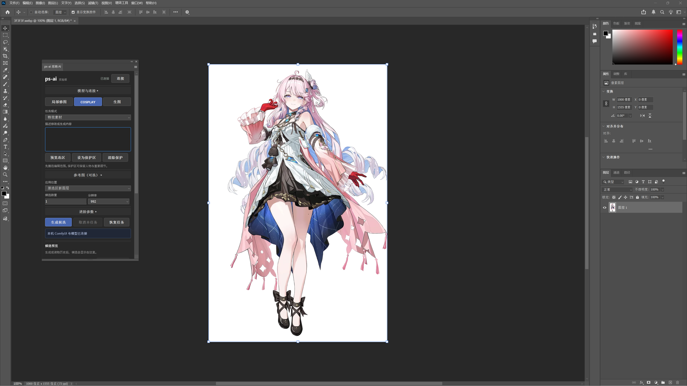
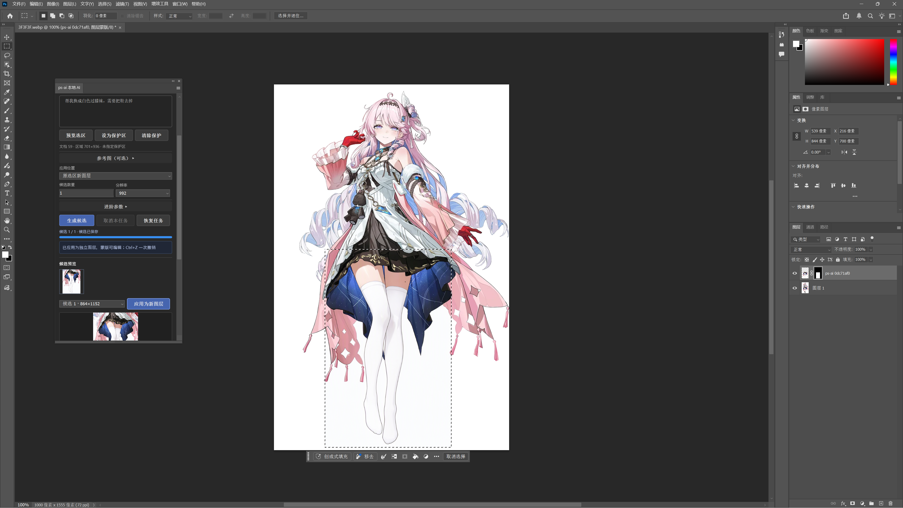

# PS-AI FOR ME

[简体中文](README.md) · **English**

Connect ComfyUI to Photoshop: select an area, describe a change, generate candidates, then bring one back as a new layer with an editable mask. Built for local edits, COSPLAY outfits and props, image generation, and effect or atmosphere assets.

**0.3.0 is experimental.** Expect to review results and finish the composite yourself. Routine skin smoothing, blemish removal and portrait retouching are outside the project scope.

## Example

Real Photoshop screenshots supplied by a user. This example changes part of an outfit / leg material to white. The screenshots show an older panel, not a mockup of the current UI. Results vary between generations.

| Before | After |
| --- | --- |
|  |  |

## What it does

- **Local editing:** change objects and materials, remove clutter, replace backgrounds. Pixels outside the selection and inside manually protected areas are preserved.
- **COSPLAY:** repair outfits and props, edit scenes, use one character reference image. Reference guidance is experimental and does not guarantee an exact likeness or outfit.
- **Images and assets:** text to image, effects and atmosphere assets, PNG export and new documents. Generated transparency can still contain background colors or rough edges.
- **Candidates:** 1–4 sequential candidates, actual sampling-step progress, history, recovery after disconnects and cancellation by task ID. Apply with an editable mask and one-step undo.
- **Transparency and color:** preserve the source silhouette, optionally align the subject and match small context color shifts. RGB / Grayscale 8/16-bit round trips have been tested in Photoshop; model input remains sRGB 8-bit.
- **Settings and language:** save the ComfyUI host, port and model mapping, import / export JSON, switch between Simplified Chinese and English.

The plugin uses a fixed **Qwen-Image 2.1 GGUF workflow**. Selecting another filename does not add SD, SDXL or Flux support. See the [ComfyUI setup guide](COMFYUI.en.md) for the compatibility contract.

## Requirements

| Component | Requirements and tested scope |
| --- | --- |
| OS / host | Windows, Photoshop 2026 / 27.0+; only 27.0 tested. macOS is unverified. |
| Backend | Compatible ComfyUI and GGUF nodes. Tested revisions: [compatibility manifest](config/compatibility.json). |
| GPU / memory | Tested with NVIDIA RTX 5080 16 GiB and about 48 GB RAM. This is a test configuration, not a minimum requirement. |
| Storage | About 14.63 GB for preset weights, plus backend, dependencies, cache and images. |
| Source builds | Node.js 24.21.0 / npm 11.19.0 tested. Release packages need neither Node.js nor developer tools. |

ComfyUI can run here or on another reachable machine. Images and prompts go to the configured address. Use a backend you trust. Login screens, API keys and services below a URL path are not currently integrated.

## Install a release package

Download matching plugin and environment tools from [Releases](https://github.com/ImMappyJ/ps-ai/releases). If no release is available, build from source. The main branch is not a stable-release guarantee. Choose one installation method.

### Option 1: CCX

1. Install Adobe Creative Cloud desktop. Double-click `ps-ai-0.3.0-experimental.ccx` and follow Adobe's installer.
2. Restart Photoshop and open **Plugins → PS-AI FOR ME**.
3. If double-clicking does nothing, extract the matching `environment-experimental.zip`, open PowerShell there and run:

   ```powershell
   $package = Read-Host 'Full path to the CCX file'
   powershell.exe -NoProfile -File .\scripts\install-ccx.ps1 -PackagePath $package
   ```

Associating CCX files directly with UPIA does not guarantee double-click installation. The script supplies `/install` and the path, then checks the result. Photoshop **File → Open** cannot install a plugin.

### Option 2: Portable folder

1. Save your work and quit Photoshop completely.
2. Extract `ps-ai-0.3.0-portable-experimental.zip`. Copy the entire `PS-AI-FOR-ME` folder into your installed Photoshop **Plug-ins** directory.
3. Check the layout: `Plug-ins/PS-AI-FOR-ME/manifest.json`. Avoid an extra nested folder.
4. Restart and open **Plugins → PS-AI FOR ME (Portable)**.

This does not use the CCX installer. Folder loading and image round trips have been tested on Windows PS 27.0. Other versions and loading with developer mode disabled remain unverified. If the folder is not recognized, use CCX or the developer method below.

CCX and Portable keep separate data. Export settings and save PNGs before switching; history is not migrated. Quit Photoshop before replacing only this plugin folder or installing a new CCX. Remove the Portable folder to uninstall it; manage CCX through Creative Cloud. User data does not move with program files.

## Connect ComfyUI

The [ComfyUI setup guide](COMFYUI.en.md) covers installation, models, versions and troubleshooting. An existing backend does not need reinstalling:

1. Start ComfyUI and check its page in a browser.
2. Expand **Backend and models**. Enter `http://localhost:8188`, `http://localhost:8199` or an address such as `http://192.168.1.20:8188`.
3. **Scan models**, then choose a compatible diffusion model, vision / text encoder and VAE.
4. **Save settings**, then **Connect**. The address, models and language survive reloads.
5. Run **Diagnostics → Image round-trip check**, then try one generation on a saved test image.

Export settings as JSON to move them, then check the new address and model availability. Settings contain backend-relative filenames, not developer disk paths. After switching backends, recover or cancel old tasks at their original address.

## First edit

1. Work on a saved copy and select the edit area. To protect a face or hands, select them first, choose **Protect selection**, then reselect the edit area.
2. Choose a mode and describe what to change and keep. Character reference needs an extra PNG / JPEG.
3. **Generate**. Loading and text encoding may have no sampling percentage; actual step progress appears during sampling. Use **Recover task** after disconnects instead of submitting again.
4. Review structure, edges and colors, then **Apply as new layer**. Finish with Photoshop masks, opacity and adjustment layers.
5. Open generated images or assets in a new document, or **Save PNG**.

**Turn off Preserve source transparency when replacing backgrounds, removing objects or expanding silhouettes.** Alignment uses alpha bounds and may change proportions; disable it when unsuitable. Color matching only corrects small overall shifts.

## Limitations and precautions

- Test on saved copies. Do not use the only unsaved original. Keep the source unchanged during generation; capture again after edits, closing it or reloading the plugin.
- The model may alter text, faces, hands and clothing inside the selection. The guide is a visual reference; the final mask enforces pixel protection.
- CMYK, Lab, Indexed, Bitmap, Multichannel and 32-bit HDR are unsupported. Work in an RGB copy. A 16-bit source keeps its format, but generated content has no native 16-bit detail.
- Translucent multilayer composites may lack a safe clipping base. If prompted, merge visible layers in a copy and generate again, or export PNG and composite manually.
- Assign the right ICC profile to a copy of untagged images. The model also changes lighting and colors; check seams.
- Photoshop idle exits have been reproduced without this plugin. Long-term host stability is not fully validated. Another installation method is not a crash fix.
- The plugin and ComfyUI save history, inputs and outputs locally. Remove private images, prompts and paths before sharing reports. Use material you have permission to process.
- The preset Qwen 2.1 license permits non-commercial research / evaluation; commercial use needs separate permission. Open-source code does not change model licensing. [Model license](https://huggingface.co/Qwen/Qwen-Image-2.1/blob/main/LICENSE)

## Build from source

```powershell
git clone https://github.com/ImMappyJ/ps-ai.git
cd ps-ai
npm ci
npm test
npm run build
```

Enable developer mode in Photoshop **Preferences → Plugins**, then restart. Add `dist/plugin/manifest.json` in [Adobe UXP Developer Tool](https://developer.adobe.com/photoshop/uxp/2022/guides/devtool/) and choose **Load**. Backend setup is the same as for release packages.

`npm run package` tests, builds and writes CCX, Portable ZIP, environment-tool ZIP and SHA256 files to `release/`. It needs no private handoff documents, does not download models or start the backend, and does not publish a release.

Use **Actions → Build packages → Run workflow** to build on GitHub. Download the artifact, unpack its outer ZIP and attach the release files and checksums to a GitHub Release you create manually. Keep versions in `package.json`, the lockfile and `plugin/manifest.json` aligned. Actions cannot replace testing in Photoshop.

## Feedback and contributions

Open an [Issue](https://github.com/ImMappyJ/ps-ai/issues) with OS, Photoshop / plugin / ComfyUI versions, models, GPU, reproduction steps and sanitized errors. Share only comparisons you may publish. Do not upload full crash dumps or private photos.

Small PRs are welcome. Run `npm ci`, `npm test` and `npm run build`. Update compatibility and both languages when changing workflows. Use a branch per change and discuss designs in Issues / PRs. Handoff notes, debugging records and machine reports stay local. Concurrent changes to the same public guide still need normal Git conflict resolution.

## License and thanks

Code: [GNU GPL v3.0](LICENSE), GPL-3.0-only. Distributing modified versions or binaries requires corresponding source, build scripts and the license. Weights have separate terms and are not included. Screenshots do not grant rights to third-party characters or artwork.

Thanks to [Adobe UXP](https://developer.adobe.com/photoshop/uxp/), [ComfyUI](https://github.com/Comfy-Org/ComfyUI), [Qwen](https://huggingface.co/Qwen), [ComfyUI-GGUF](https://github.com/leejet/ComfyUI-GGUF), [UPNG.js](https://github.com/photopea/UPNG.js) and [pako](https://github.com/nodeca/pako). Packages include runtime dependency notices. Architecture and interaction were informed by [OpenLayer](https://github.com/MehranMarxian/OpenLayer) and [Geekatplay ComfyUI-Photoshop](https://github.com/GeekatplayStudio/ComfyUI-Photoshop); their source was not copied. This is not an official Adobe product.
