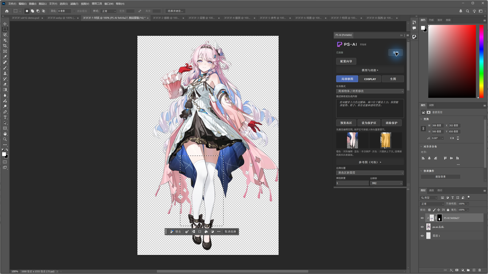

<p align="center">
  
</p>
<h1 align="center">PS-AI</h1>
<p align="center"><strong>简体中文</strong> · <a href="docs/README.en.md">English</a></p>

PS-AI 将 ComfyUI 接到 Photoshop 中，用于局部修图、COSPLAY 服装和道具处理，以及文字生图。圈选区域、描述修改要求，在面板里生成并预览候选，确认后应用为带蒙版的新图层。

当前版本为 **0.4.0（实验版）**，包含配置向导、色彩检查、编辑范围预览和可选 16 位 SDR 输出。安装时使用同版本的插件包和环境工具。生成结果可能需要手工修整，建议在已保存的副本上使用。不包含常规人像磨皮、去痘和肤色精修功能。

从 0.3.0 升级后，面板名称由 `PS-AI FOR ME` 改为 `PS-AI`，图标使用 Morph Frame 标识。插件 ID 与 `PS-AI-FOR-ME` 安装目录保持不变。

开发分支新增 [百炼](docs/providers/BAILIAN.md)、[Gemini / Nano Banana](docs/providers/GEMINI.md) 与 [OpenAI Images](docs/providers/OPENAI.md) 的平台适配服务。平台路径仍待真实 API Key 和 Photoshop 验收，**不在已发布的 v0.4.0 包中**。本页下方截图及已测能力对应 ComfyUI 路径。

## 文档导航

| 用途 | 文档 |
| --- | --- |
| 入门操作与九种模式示例 | [图文使用指南](docs/usage/USER_GUIDE.md) |
| 本地后端、模型与排错 | [ComfyUI 配置](docs/setup/COMFYUI.md) |
| 平台适配（开发中） | [百炼](docs/providers/BAILIAN.md) · [Gemini / Nano Banana](docs/providers/GEMINI.md) · [OpenAI Images](docs/providers/OPENAI.md) |
| 参与开发与服务端扩展 | [开发入口](AGENTS.md#development-zh) · [后端与持久化契约](docs/development/BACKEND.md) |

## 看看效果

下面的示例使用 `3F3F3F.webp` 的副本，在腿部选区内添加白色过膝袜。图片来自 0.4.0 的实际生成与 Photoshop 合成，棋盘格表示透明背景。

| 使用前 | 使用后 |
| --- | --- |
|  |  |



九种模式的逐步操作、选区范围、实测提示词及清晰 PNG 截图见 [图文使用说明](docs/usage/USER_GUIDE.md)。所有例子使用同一张样图，包含整张背景替换、参考辅助、独立素材合成和文字生图。

## 能做什么

- **局部修图**：物体和材质修改、移除杂物、替换背景。选区外和手动保护区保留原始像素。
- **COSPLAY**：服装／道具修复、场景修改、一张角色参考图辅助。参考功能是实验性的，不保证角色和服装细节准确复现。
- **生图与素材**：文字生图，生成特效或氛围素材，在新文档打开或导出 PNG。透明素材仍可能有底色和杂边。
- **候选与回填**：1–4 张串行候选，历史与断线恢复；ComfyUI 提供实际采样步数和按任务取消，平台适配仅显示阶段并停止后续候选。应用为独立图层和可编辑蒙版，支持一次撤销。
- **透明与颜色**：默认保留原透明轮廓，可选主体对齐和小幅上下文颜色匹配。RGB／灰度 8/16 位已在 Photoshop 中测试图像往返；模型输入仍是 sRGB 8-bit。
- **连接与语言**：保存后端地址、端口，ComfyUI 模型文件映射或平台模型 ID，导入／导出 JSON；面板可切换简体中文和 English。

ComfyUI 路径使用固定的 **Qwen-Image 2.1 GGUF 工作流**，不支持直接替换成 SD、SDXL 或 Flux。模型要求和配置方法见 [ComfyUI 配置指南](docs/setup/COMFYUI.md)。

## 系统要求

| 项目 | 要求与已测试范围 |
| --- | --- |
| 系统／宿主 | Windows，Photoshop 2026 / 27.0+；目前只实测 27.0，macOS 未验收 |
| 推理后端 | 兼容的 ComfyUI 与 GGUF 节点；已测试版本和提交见 [兼容清单](config/compatibility.json) |
| 本地推理显卡／内存 | 测试配置为 NVIDIA RTX 5080 16 GiB、约 48 GB RAM；最低硬件要求尚未确定 |
| 本地模型磁盘 | 预设三个权重约 14.63 GB，另留后端、依赖、缓存和图片空间 |
| 源码构建 | Node.js 24.21.0、npm 11.19.0 已测试；ComfyUI 插件包无需 Node.js；可选平台适配服务需要 Node.js 24+ |

后端可以在本机，也可以在可访问的另一台机器上。插件会把图像和提示词发给你填写的地址，请使用自己信任的服务。平台接入使用独立本机适配服务，Key 只放服务端；不能把平台 API 地址直接填成 ComfyUI 地址。其他带登录或子路径的服务未验证。

## 安装发行包

从 [v0.4.0 Release](https://github.com/ImMappyJ/ps-ai/releases/tag/v0.4.0) 下载同版本插件包和环境工具，选择下面任一种方式安装。需要自己构建时，按文末说明操作；发布标签对应该版本源码，主分支可能包含后续改动。

### 方式一：CCX

1. 安装 Adobe Creative Cloud 桌面应用，双击 `ps-ai-0.4.0-experimental.ccx`，按 Adobe 安装提示操作。
2. 重启 Photoshop，从“增效工具 → PS-AI”打开面板。
3. 如果双击没有反应，解压同版本 `environment-experimental.zip`，在其目录运行：

   ```powershell
   $package = Read-Host 'CCX 文件完整路径'
   powershell.exe -NoProfile -File .\scripts\install-ccx.ps1 -PackagePath $package
   ```

CCX 关联到 UPIA 后若仍无法双击安装，可使用上面的脚本传入安装参数并检查结果。Photoshop 的“打开文件”不能安装插件。

### 方式二：Portable 文件夹版

1. 保存文档并完全退出 Photoshop。
2. 解压 `ps-ai-0.4.0-portable-experimental.zip`，把整个 `PS-AI-FOR-ME` 文件夹复制到你实际安装的 Photoshop 的 `Plug-ins` 目录。
3. 确认目录结构是 `Plug-ins/PS-AI-FOR-ME/manifest.json`，不要多套一层文件夹。
4. 重启，从“增效工具 → PS-AI (Portable)”打开。

Portable 不需要 CCX 安装器，已在 Windows PS 27.0 测试文件夹加载和图像往返。其他版本及关闭开发人员模式时的加载情况尚未测试。若 Photoshop 无法识别该目录，可改用 CCX，或按文末的源码构建方式加载。

CCX 与 Portable 的设置和历史各自独立。切换前导出设置、保存需要的 PNG；历史不会自动迁移。更新时退出 PS，只替换本插件文件夹或安装新版 CCX；不要覆盖其他插件。卸载 Portable 时移除该文件夹，CCX 用 Creative Cloud 的插件管理卸载。设置、候选和历史保存在 Photoshop 的数据目录，不随程序文件夹移动。

## 连接 ComfyUI

完整的安装、模型下载、版本和排错步骤在 [ComfyUI 配置指南](docs/setup/COMFYUI.md)。已有后端不需要重装：

1. 启动 ComfyUI，先在浏览器确认服务能打开。
2. 展开面板“模型与连接”，填写地址，例如 `http://localhost:8188`、`http://localhost:8199` 或 `http://192.168.1.20:8188`。
3. 点“扫描模型”，选择兼容的生成模型、视觉／文本编码器和 VAE。
4. 点“保存配置”，再“连接”。配置会在重开面板后保留；语言也会保存。
5. 先用一张已保存的测试图运行“宿主诊断 → 图像往返验证”，再尝试一次生成。

迁移配置时，导出 JSON 并在另一台机器导入，再检查地址和模型是否可用。配置保存服务地址和模型相对文件名，不包含模型的本机绝对路径。切换后端后，旧任务需要回到原地址恢复或取消。

## 第一次使用

1. 在已保存的副本上建立编辑选区。需要保护脸、手等细节时，先圈选保护范围，点“设为保护区”，再重选编辑区。
2. 选任务模式，说明要改什么、保留什么。角色参考模式需要额外选择一张 PNG／JPEG。
3. 点“生成候选”。加载模型和文本编码阶段不一定有采样百分比，开始采样后显示实际步数。断线后用“恢复任务”，不要重复提交。
4. 检查候选的结构、边缘和颜色，再“应用为新图层”。用 Photoshop 的蒙版、不透明度和调整层完成最后合成。
5. 生图或独立素材可选“新文档”，也可“另存 PNG”。

**换背景、移除对象或扩大轮廓时，关闭“编辑保留原透明轮廓”。** 主体对齐依据透明边界，可能改变比例，不合适就关闭。颜色匹配只修正小幅整体偏色，不能代替手工调色。

## 使用前要知道

- 请用已保存的副本测试，不要拿唯一未保存的原稿试。生成期间不要修改来源文档；修改、关闭或重载插件后需重新捕获。
- 选区内的文字、面部、手和衣服结构可能被模型改变。范围辅助图只是视觉参考；最终像素保护由回填蒙版完成。
- CMYK、Lab、索引色、位图、多通道和 32 位 HDR 暂不支持。在 RGB 副本中处理；不会自动转换原稿。默认 8 位输出；16 位 SDR 输出需要安装专用保存节点，并使用 16 位目标文档。16 位文件不代表模型具有完整 16 位有效精度。
- 半透明多层合成可能无法找到安全的剪贴底层。遇到提示时，在副本合并可见层后重新生成，或先导出 PNG 手工合成。
- 未标记 ICC 的图片应先在副本指定正确配置文件。模型也会改变光线与颜色，接缝仍需检查。
- Photoshop 整体退出曾在未加载本插件时复现，相关稳定性问题仍在排查。CCX 和 Portable 都可能受到影响。
- 本机插件和 ComfyUI 会保存历史、输入和输出。反馈前检查是否包含私人图片、提示词或路径，只处理有权使用的素材。
- 预设 Qwen 2.1 的许可限定非商业研究／评估，商业使用需另行授权。插件开源与免费不改变模型的许可。[模型许可原文](https://huggingface.co/Qwen/Qwen-Image-2.1/blob/main/LICENSE)

## 从源码构建

```powershell
git clone https://github.com/ImMappyJ/ps-ai.git
cd ps-ai
npm ci
npm test
npm run build
```

在 PS“首选项 → 增效工具”启用开发人员模式并重启。通过 [Adobe UXP Developer Tool](https://developer.adobe.com/photoshop/uxp/2022/guides/devtool/) 添加 `dist/plugin/manifest.json`，点击 Load。后端配置与发行包相同。

`npm run package` 会先运行测试和构建，再在 `release/` 生成 CCX、Portable ZIP、环境工具 ZIP 和各自的 SHA256 校验文件。ComfyUI 和模型需单独准备，Release 也需手动发布。

也可以在 **Actions → Build packages → Run workflow** 手动构建。下载产物、解开外层 ZIP，将发行文件和校验文件上传到 GitHub Release。发版前保持 `package.json`、锁文件和 `plugin/manifest.json` 中的版本号一致，并在 Photoshop 中实际测试安装和生成。

## 反馈与参与开发

在 [Issues](https://github.com/ImMappyJ/ps-ai/issues) 提供系统、PS／插件／ComfyUI 版本、模型、显卡、复现步骤和脱敏错误。效果问题可以附有权公开的局部对比；不要上传完整崩溃转储或私人照片。

欢迎提交 PR，尽量让每次改动集中解决一个问题。克隆仓库后，先读根目录的 `AGENTS.md` 了解代码结构和开发约定。服务端重写与新增平台的契约见 [后端开发文档](docs/development/BACKEND.md)。提交前运行 `npm ci`、`npm test`、`npm run build`；改动工作流时，同步更新兼容清单和中英文说明。开发使用独立分支，讨论和评审放在 Issue／PR。交接笔记、调试记录和本机报告留在本地。

## 许可与鸣谢

代码采用 [GNU GPL v3.0](LICENSE)（GPL-3.0-only）。分发修改版或二进制时，应提供对应源码、构建脚本和许可证。权重另行授权，不包含在仓库或插件包中；截图也不授予其中第三方角色或素材的权利。

感谢以下项目提供的工具和参考：

| 项目名 | 项目地址 |
| --- | --- |
| Adobe UXP | <https://developer.adobe.com/photoshop/uxp/> |
| ComfyUI | <https://github.com/Comfy-Org/ComfyUI> |
| Qwen | <https://huggingface.co/Qwen> |
| ComfyUI-GGUF | <https://github.com/leejet/ComfyUI-GGUF> |
| UPNG.js | <https://github.com/photopea/UPNG.js> |
| pako | <https://github.com/nodeca/pako> |
| OpenLayer | <https://github.com/MehranMarxian/OpenLayer> |
| Geekatplay ComfyUI-Photoshop | <https://github.com/GeekatplayStudio/ComfyUI-Photoshop> |

构建包包含运行依赖的许可声明。架构与交互参考了 OpenLayer 和 Geekatplay ComfyUI-Photoshop，未复制这两个项目的源码。本项目不是 Adobe 官方产品。
