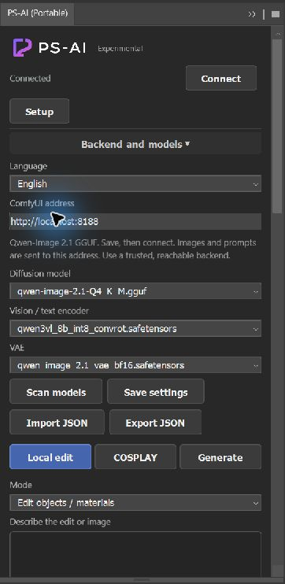
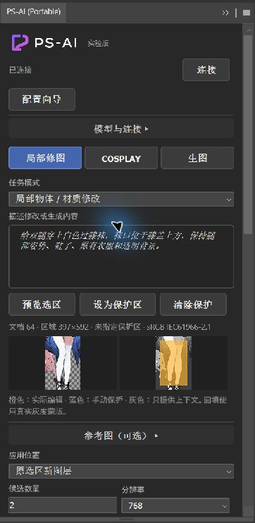
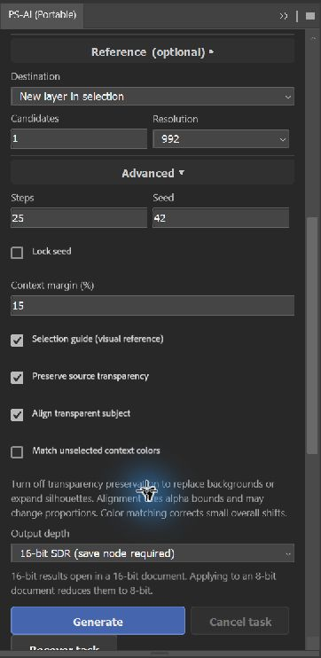
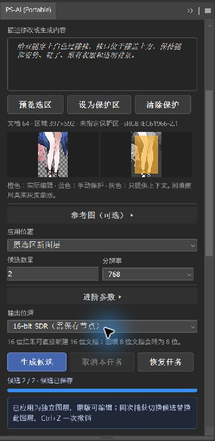
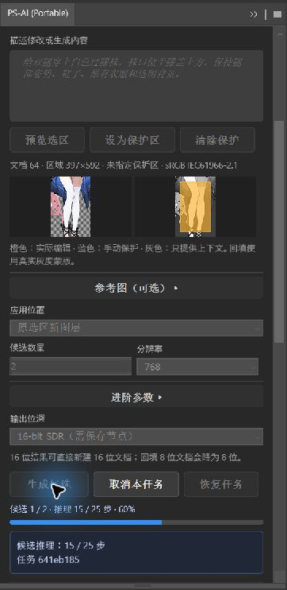
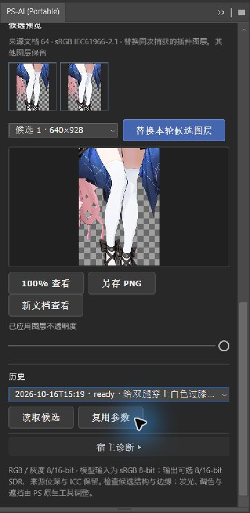

<h1 align="center">Using PS-AI</h1>

<a href="USER_GUIDE.md">简体中文</a> · <strong>English</strong>

This guide covers the **0.4.0 development version**. Published version 0.3.0 does not include guided setup, range previews or optional 16-bit output. See [installation](README.en.md#install-a-release-package) and [ComfyUI setup](COMFYUI.en.md) for packages, models and backend requirements.

## Connect first

Start ComfyUI, check that its page opens in a browser, then open PS-AI from Photoshop's **Plugins** menu. The Portable entry is **PS-AI (Portable)**.

Expand **Backend and models**. Enter a full origin such as `http://localhost:8188`. Custom ports, IP addresses and hostnames are supported. Do not include credentials, a URL path or query parameters.

**Scan models**, choose the matching Qwen 2.1 diffusion model, vision / text encoder and VAE, then **Save settings** and **Connect**. Replacing filenames does not make SDXL, Flux or another architecture compatible.

First-time setup has three steps: test the address, check the environment, run a generation example. The first two do not generate images. The third uses the backend and applies a result in its own test document. Ctrl+Z can undo that application.

Language and output depth save when changed. Save the address and models with **Save settings**. Export JSON for backup or another computer; import it there and check the address and model availability again. JSON contains neither weights nor image history. CCX and Portable have separate data directories.

## Example: white over-the-knee socks

This example uses a copy of `3F3F3F.webp` and keeps its transparent background. The source is 8-bit; the test copy was converted in Photoshop to RGB / 16-bit to demonstrate 16-bit application. Ordinary edits can stay 8-bit.

| Before | Applied result |
| --- | --- |
|  |  |

The checkerboard displays transparency. These previews come from actual generation and Photoshop compositing. Documentation previews are 8-bit and cannot demonstrate the precision of a 16-bit file.

1. Save a copy. Select the legs, allowing some room around the intended edit without cutting into details to keep.
2. Choose **Local edit → Edit objects / materials**. Enter, for example:

   > Add white over-the-knee socks to both legs, with the tops above the knees. Keep the leg pose, shoes, existing outfit and transparent background.

3. **Preview selection**. The left image shows the captured context. On the right, **amber is editable, blue is manually protected, gray is context only**. The source is captured again before submission.
4. This test used resolution 768, 25 steps, a 15% context margin, source-transparency preservation and subject alignment. Start with one candidate; two sequential candidates were also tested through the installed panel.
5. **Generate**, then inspect the sock tops, knees, shoes and transparent edges.
6. Select a candidate and **Apply as new layer**. The source layer remains, with an editable mask on the result.

Turn off **Preserve source transparency** for background replacement, object removal or a larger silhouette. Otherwise the old alpha outline limits the result. If transparent edges contain white fringes, also inspect the source edge pixels.

## Choose a mode

| Workspace / mode | Preparation and purpose |
| --- | --- |
| Local edit / Objects and materials | Select an area. Describe the object, color or material to change and the details to keep. |
| Local edit / Remove clutter | Select the object with some surrounding context. Disable source-transparency preservation to allow replacement content. |
| Local edit / Replace background | Select the subject, then invert the selection in Photoshop. Disable transparency preservation. Selecting only the subject edits the subject. |
| COSPLAY / Outfit and prop repair | Select the relevant part and describe its structure, material and pose to keep. |
| COSPLAY / Character reference | Select an edit area and import one PNG / JPEG. Choose the reference purpose. The selection guide defaults off to reduce conflicting image guidance. Exact reproduction is not guaranteed. |
| COSPLAY / Scene replacement | Select the scene area to change. Choose transparency preservation according to whether its outline should expand. |
| COSPLAY / Effect asset | Generate a separate asset, preferably with **New document** as the destination. Composite lighting and occlusion in PS. |
| COSPLAY / Atmosphere asset | Generate fog, smoke and similar assets, preferably in a new document. Inspect alpha and background remnants. |
| Generate / Text to image | No source document or selection is required. Clear reference images and describe the subject, composition and style. |

References, effects and atmosphere remain experimental. Separate assets do not automatically finish lighting, occlusion or color grading. Routine skin smoothing and blemish retouching are outside the scope.

## Protection and advanced settings

To keep a face or hands unchanged, select them first, choose **Protect selection**, then select the edit area. Protection subtracts a pixel mask; it does not use automatic face detection. Specify protection again after changing documents or reusing history.

| Setting | Practical use |
| --- | --- |
| Candidates | 1–4, generated sequentially. Seeds increase by one within the batch. |
| Resolution | 768, 992 or 1024. Editing preserves the input aspect ratio while aligning dimensions to the workflow; candidates need not be square. |
| Steps | Default 25, range 1–100. More does not guarantee better results. |
| Lock seed | Use the entered seed for comparisons. Backend and model changes can still alter results. |
| Context margin | Default 15%. Adds surrounding context without making the gray region editable. |
| Selection guide | A visual hint for the model. The final Photoshop mask enforces protection. |
| Preserve source transparency | Useful for clothing or material edits within an existing silhouette. Disable for new backgrounds or larger outlines. |
| Align transparent subject | Aligns alpha bounds, which can affect proportions. Disable if it distorts the result. |
| Match context colors | Limits small overall color shifts; cannot recover clipped gamut or replace manual grading. |

## 8-bit and 16-bit output

**8-bit (compatible)** is the default. For **16-bit SDR**, install the optional `PS_AISavePNG16` node as described in [ComfyUI setup](COMFYUI.en.md), restart the backend and select that output depth. A missing node stops submission with an error.

- Save the result as sRGB-tagged PNG16, or open it directly in a new RGB / 16-bit document.
- Application to an existing 16-bit document writes 16-bit values. An 8-bit destination reduces the result to 8-bit. The plugin does not convert the original document automatically.
- Model inputs, references and selection / protection masks remain 8-bit. The new output path quantizes VAE float results to 16-bit and avoids additional 8-bit quantization during export and compositing.
- GGUF, INT8 and BF16 models do not gain a full 16 bits of effective precision. This is SDR, not HDR or native wide-gamut generation. Source depth and ICC remain intact, but generated colors can still differ.

## Progress, cancellation and recovery

While loading models or encoding text, there may be no sampling steps to report. The panel shows the stage. Once sampling starts, it displays the candidate number, actual steps and percentage. Completion means the candidate has been saved.

**Cancel task** targets the current task ID and stops subsequent candidates. Already saved candidates remain. Wait for a confirmed backend state; a result that finished just before cancellation is retained.

After a disconnect or panel reload, select the record in history and **Recover task**. Recovery queries the original ID without resubmitting. Switch back to the original backend address for older tasks. If cancellation is unconfirmed, keep querying that task rather than repeatedly generating.

## Preview, apply and export

Use thumbnails or the candidate list to switch images. **View at 100%** expands the preview by pixels; **Fit preview** restores its size. Previews are 8-bit; export keeps the chosen output depth.

The first application creates a plugin layer. Switching candidates from the **same capture** changes the action to **Replace this capture's layer**, affecting only that result. Changes to the document size, content state or session invalidate the old snapshot. Capture and generate again to continue safely.

Adjust applied opacity or finish with Photoshop masks, blend modes and adjustment layers. One Ctrl+Z undoes one application. Opacity changes have separate undo entries. The panel slider does not follow native Photoshop undo automatically.

**Save PNG** exports the processed candidate, including the chosen alpha, alignment and color processing. Its dimensions describe the captured context, not the entire source canvas. **Open in new document** creates a separate sRGB document. Both remain available for candidates from earlier sessions.

**Load candidates** retrieves a saved image. **Reuse parameters** restores the prompt and generation settings. Select references and protection again; the next submission captures the current selection. History from before a restart can be exported or opened separately, but cannot be applied directly to a reopened original.

## Diagnostics and troubleshooting

**Diagnostics → Image round-trip check** creates its own temporary fixtures and checks selection, protection, masks, undo and rollback. **Save report** exports the result. **Export runtime log** records plugin operation stages; it does not replace a Photoshop crash dump.

| Symptom | What to check |
| --- | --- |
| Connection fails | Backend process, address, port and models; expand technical details, correct the problem and reconnect. |
| Incompatible output depth or color | Save node, workflow template and PNG format. Renaming an 8-bit image does not make it 16-bit. |
| Background color in a transparent result | Alpha-preservation setting, source edges and model output. Separate effect assets may need alpha cleanup. |
| Incorrect applied size | Actual candidate dimensions, alignment and selection bounds. Do not bypass checks by changing workflow output sizes. |
| Source state changed | Capture and generate again. Old PNGs can still be composited manually. |
| Unsafe translucent multilayer composite | Merge visible layers in a saved copy, or export PNG for manual compositing. |
| Photoshop exits entirely | Save work and record the stage. Inspect PS events / crash logs alongside GPU, driver, host and plugin behavior. One successful session does not establish a permanent fix. |

Tagged RGB / Grayscale 8/16-bit documents are supported. Prepare an RGB copy for CMYK, Lab, Indexed, Bitmap, Multichannel or 32-bit HDR. Check the backend address before processing private images; local backends also save inputs, outputs and history. Model terms in the [setup guide](COMFYUI.en.md) remain separate from the code license.

## What was tested

On 2026-10-16, with Windows Photoshop 27.0, GPU enabled and the Qwen 2.1 preset, all nine modes completed real backend inference and Photoshop application / new-document checks. The six selection-edit modes preserved source layers, pixels outside the effective mask and undo restoration exactly. An independent known-value check measured a maximum native 16-bit write error of 1/65535. The installed panel also completed two candidates, replacement, PNG16 export and cancellation by task ID.

These checks establish the functional path, not consistent final-art quality. Background and scene tests covered a selected crop, without a full-background quality rating. Reference fidelity, asset alpha, calibrated-display color matching and long-term stability need more samples. See the [compatibility manifest](config/compatibility.json) for version and color-test scope.
