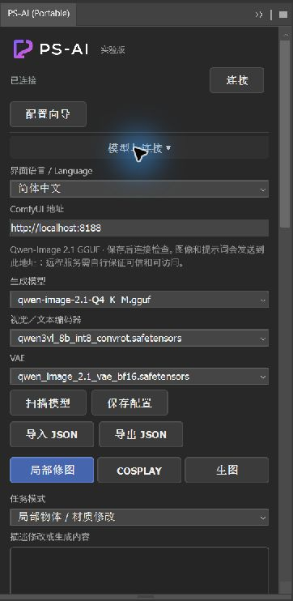

<h1 align="center">PS-AI 使用说明</h1>

<strong>简体中文</strong> · <a href="USER_GUIDE.en.md">English</a>

本文对应 **0.4.0 开发版**。公开的 0.3.0 不包含配置向导、范围预览和可选 16 位输出。安装方法见 [README](README.md#安装发行包)，后端、模型和接口要求见 [ComfyUI 配置](COMFYUI.md)。

## 从连接开始

启动 ComfyUI，在浏览器确认页面可以打开，再从 Photoshop 的“增效工具”打开 PS-AI。Portable 的菜单名为 **PS-AI (Portable)**。

展开“模型与连接”，填写完整地址，例如 `http://localhost:8188`。端口可以改；远程机器可以填 IP 或域名。地址只包含协议、主机和端口，不带账号、路径或查询参数。

点“扫描模型”，选择 Qwen 2.1 对应的生成模型、视觉／文本编码器和 VAE，然后“保存配置”“连接”。不能只换文件名就使用 SDXL、Flux 等其他架构。

首次打开可按“配置向导”的三步操作：测试地址、检查环境、运行生成示例。前两步不生成图片；第三步会占用后端，并在自己的测试文档中生成、应用结果。示例完成后可用 Ctrl+Z 检查撤销。

语言和输出位深切换后会保存，地址和模型用“保存配置”保存。“导出 JSON”适合备份或换电脑；在另一台机器“导入 JSON”后重新检查地址和模型。配置文件不包含权重，历史和图片也不会随 JSON 搬走。CCX 与 Portable 使用不同的数据目录。

## 示例：给腿部穿上白色过膝袜

下面使用 `3F3F3F.webp` 的副本演示，保留透明背景。原图是 8 位；本次先在 Photoshop 中将副本转成 RGB / 16 位，展示 16 位回填。普通编辑直接使用 8 位也可以。

| 使用前 | 应用后 |
| --- | --- |
|  |  |

棋盘格用于显示透明背景。以上是实际生成与 Photoshop 合成结果的预览图；文档中的预览图为 8 位，不能用来判断 16 位文件精度。

1. 保存副本，选中需要修改的腿部。选区稍留余量，尽量不要切到需要保留的装饰边缘。
2. 选择“局部修图 → 局部物体 / 材质修改”。输入：

   > 给双腿穿上白色过膝袜，袜口位于膝盖上方，保持腿部姿势、鞋子、原有衣服和透明背景。

3. 点“预览选区”。左边是捕获的上下文，右边是范围预览：**橙色可编辑，蓝色为手动保护，灰色只提供上下文**。生成前会重新捕获，不会直接使用过期缩略图。
4. 本例使用 768 分辨率、25 步、15% 上下文边距，保留原透明轮廓并开启主体对齐。可先生成一张；本次面板也实测了两张串行候选。
5. 点“生成候选”，等待完成，再检查袜口、膝盖、鞋子和透明边缘。
6. 选择候选，“应用为新图层”。结果附带可编辑蒙版，原图层保留。

背景替换、移除对象或扩大轮廓时，关闭“编辑保留原透明轮廓”。否则旧轮廓会限制新结果。透明边缘有杂色时，也要检查原图边缘本来是否带白色像素。

## 模式怎么选

| 工作区 / 模式 | 准备与用途 |
| --- | --- |
| 局部修图 / 物体、材质修改 | 建立选区，说明要改的物体、颜色或材质，也说明要保留的细节。 |
| 局部修图 / 移除杂物 | 选中对象及少量周边，关闭保留原透明轮廓，让模型补齐背后的内容。 |
| 局部修图 / 换背景 | 先选主体，再在 Photoshop 中反选背景；关闭保留原透明轮廓。仅选择人物会改到人物。 |
| COSPLAY / 服装、道具修复 | 选择服装或道具局部，描述结构、材质和需要保留的姿势。 |
| COSPLAY / 角色参考辅助 | 选编辑区并导入一张 PNG / JPEG。设置参考用途；默认关闭范围辅助，以减少多图提示的干扰。参考不保证精确复刻。 |
| COSPLAY / 场景替换 | 选择需要变化的场景范围。按是否扩展轮廓决定透明保留设置。 |
| COSPLAY / 特效素材 | 生成独立素材，推荐将应用位置改为“新文档”。光效、遮挡和混合方式在 PS 中合成。 |
| COSPLAY / 氛围素材 | 生成雾、烟等氛围素材，推荐新文档。透明度和残留底色仍需检查。 |
| 生图 / 文字生图 | 不需要打开来源文档或建立选区。清除参考图，描述主体、构图和风格。 |

角色参考、特效和氛围属于实验能力。独立素材不会自动完成光照、遮挡或最终调色。不提供常规人像磨皮和去痘流程。

## 保护区域与进阶参数

要保护脸或手，先选中它们，点“设为保护区”，再重新圈选编辑区域。保护按像素蒙版扣除，不依赖自动人脸识别。保护区属于当前会话和来源文档，换文档或复用历史时要重新指定。

| 参数 | 使用建议 |
| --- | --- |
| 候选数量 | 1–4 张，按顺序生成；批次中的种子依次递增。 |
| 分辨率 | 768、992、1024。编辑输入按长宽比缩放并对齐工作流尺寸，实际候选不一定是正方形。 |
| 步数 | 默认 25，范围 1–100；更高不保证更好。 |
| 锁定种子 | 开启后使用填写的种子，便于对照；后端版本和模型变化仍可能改变结果。 |
| 上下文边距 | 默认 15%；让模型看到选区周围内容。边距里的灰色区域不会因此变成可编辑区。 |
| 范围辅助图 | 向模型说明允许修改的位置。它是视觉参考，严格保护由最终 PS 蒙版完成。 |
| 保留原透明轮廓 | 适合不改变人物轮廓的衣服、材质编辑；换背景和扩大轮廓时关闭。 |
| 对齐透明主体 | 按透明边界调整大小和位置；如果比例被拉动，关闭后重试。 |
| 匹配上下文颜色 | 对整体偏色做有限校正，不能恢复丢失的色域或代替手工调色。 |

## 8 位与 16 位输出

默认选择 **8-bit（兼容）**。需要高位深输出时，先按 [16 位后端配置](COMFYUI.md) 安装 `PS_AISavePNG16` 节点，重启 ComfyUI，再选 **16-bit SDR**。缺少节点会在提交前提示。

- 16 位结果可另存为带 sRGB 标记的 PNG16，或直接新建 RGB / 16 位文档。
- 回填已有 16 位文档会以 16 位写入；写入 8 位文档会降到 8 位。插件不自动转换原文档。
- 模型输入和参考图仍是 sRGB 8 位，选区／保护蒙版也是 8 位。新输出链保留 VAE 浮点结果的 16 位量化，减少后续导出和合成的额外量化损失。
- GGUF、INT8、BF16 模型不因此获得完整 16 位有效精度；这也不是 HDR 或原生宽色域生成。来源 ICC 和位深保留，但生成区仍可能偏色。

## 进度、取消和断线

模型加载和文本编码没有采样步数时，面板显示阶段提示。采样开始后显示当前候选、实际步数和百分比；批次完成后显示候选已保存。

“取消本任务”只取消当前任务 ID，并停止后续候选，已保存候选保留。等待面板确认后端终态；如果任务恰好已完成，结果会保留。

断线或面板重开后，选择对应历史记录，点“恢复任务”。它查询原 ID，不会重新提交。旧任务必须使用原后端地址；切换地址后先切回来。遇到“取消未确认”也继续查询原任务，不要反复点生成。

## 预览、回填与导出

点击缩略图或下拉列表切换候选。“100% 查看”按像素展开预览，再点“适应预览”恢复。预览按 8 位显示，不影响导出的位深。

首次应用新增插件图层；**同次捕获**切换候选后，按钮变为“替换本轮候选图层”，只替换这一结果。文档尺寸、内容状态或会话变化时会拒绝旧快照回填，避免覆盖错误位置。需要继续编辑时重新生成并捕获。

应用后可调整图层不透明度，或用 PS 原生蒙版、混合模式和调整层修整。一次 Ctrl+Z 撤销一次应用；透明度另有自己的撤销记录。PS 原生撤销后，面板滑块不会实时跟随。

“另存 PNG”导出处理后的候选，包含所选透明保留、对齐和颜色处理；它是捕获上下文对应的候选尺寸，不是整张来源画布。“新文档查看”在独立 sRGB 文档中打开。二者也适用于旧会话候选。

“读取候选”取回已保存图片，“复用参数”恢复提示词和生成参数。参考图、保护区需要重新指定，编辑选区会在下次提交时重新捕获。重启后旧历史可以导出／新建文档，不能直接应用到重开的原稿。

## 诊断和排错

“宿主诊断 → 图像往返验证”仅创建自己的临时测试文档，验证选区、保护、蒙版、撤销和回滚。“保存报告”导出该结果；“导出运行日志”记录插件上次操作阶段，不能代替 Photoshop 崩溃转储。

| 现象 | 处理方法 |
| --- | --- |
| 连接失败 | 确认后端已启动、地址端口和模型正确；展开错误的“技术详情”。修正后重新连接。 |
| 提示输出位深／颜色不兼容 | 检查保存节点、输出模板和 PNG；不要把 8 位文件改名后当成 16 位输入。 |
| 透明图出现底色 | 检查透明保留开关、原图边缘和模型输出；独立特效不保证干净 alpha。 |
| 回填大小不对 | 确认实际候选尺寸、主体对齐和选区范围；不要手动改工作流输出尺寸绕过检查。 |
| 来源状态变化，拒绝回填 | 重新捕获并生成；旧候选仍可另存 PNG 后手工合成。 |
| 半透明多图层无法安全合成 | 保存副本，合并可见层后再试，或导出 PNG 手工合成。 |
| Photoshop 整体退出 | 保存工作，记录发生阶段；结合 PS 事件／崩溃日志检查 GPU、驱动、宿主和插件。一次测试未崩溃不代表原因已消除。 |

支持标记了 ICC 的 RGB／灰度 8/16 位。CMYK、Lab、索引色、位图、多通道、32 位 HDR 需先准备 RGB 副本。处理私人图片前检查服务地址；本地后端也会保存输入、输出和历史。模型许可见 [配置指南](COMFYUI.md)，代码开源不改变权重的使用条件。

## 本轮验证范围

2026-10-16，Windows Photoshop 27.0、GPU 开启、Qwen 2.1 预设：九种模式均完成真实后端生成及 PS 应用／新文档验证；六种选区编辑的来源图层、蒙版外像素和撤销比较无差异。16 位已用独立已知数值检查，原生写入最大误差为 1/65535；面板实际完成两张候选、切换替换、PNG16 导出和按 ID 取消。

这验证了功能链路，不代表所有模式都有稳定的成片质量。背景／场景本轮只检查选中局部的生成与回填，未完成整张背景的质量评级；参考还原、素材 alpha、校准显示器上的色彩匹配及长时间稳定性仍需更多样本。完整版本与色彩范围见 [兼容清单](config/compatibility.json)。
