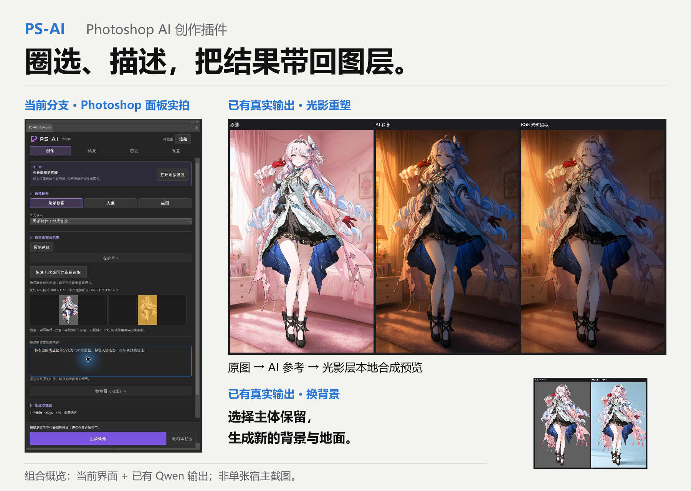

<p align="center"></p>
<h1 align="center">PS-AI</h1>
<p align="center"><a href="../README.md">简体中文</a> · <strong>English</strong></p>

**Select what to change. Bring the AI result back as Photoshop layers.**

Change a material, remove distractions, replace backgrounds or clothing, and arrange new lighting. Compare candidates before applying to a new layer with an editable mask. Original layers remain intact; one Undo reverses one application.

[Download 0.5.2 experimental](https://github.com/ImMappyJ/ps-ai/releases/tag/v0.5.2) · [Illustrated guide](usage/USER_GUIDE.en.md) · [Configure ComfyUI from zero](setup/COMFYUI.en.md#beginner) · [Connect cloud services](setup/PLATFORMS.en.md)

<p align="center"><a href="../assets/guide/workflow-overview.png"></a></p>

This composed overview pairs a native Photoshop Create panel captured during release preparation under a separate Preview demonstration identity with existing real Qwen-Image 2.1 outputs and local composite previews; it is not one host screenshot. The new interface was used for preview and a draft prompt, without submitting new generation. Relighting uses `3F3F3F.webp` and a generated room, fidelity 1 / detail protection 0.65. The output comparison is not a Photoshop apply screenshot. See [relighting](usage/USER_GUIDE.en.md#relight).

> **Version note:** This page describes the **unreleased 0.6.0 source candidate**. The currently downloadable **0.5.2 experimental remains GGUF-only**. Match the package with the version/build identity in Settings. CCX/Portable installation, complete panel regression and clean-machine installation for 0.6.0 remain unvalidated. Cloud adapters have offline coverage; generation with real API keys remains unvalidated. Screenshots retain their historical version captions.

First choose an existing or new environment, select the GGUF or native Safetensors route supported by your build, and reuse matching components for the three roles. Follow [Configure ComfyUI from zero](setup/COMFYUI.en.md#beginner). One native INT8 combination has completed real inference and PNG checks. Its real outputs also passed bounded Photoshop API checks on small RGB8/16 fixtures and one large source. Installed panels, photographic application and other combinations require separate acceptance; see the [tested scope](setup/COMFYUI.en.md#native-tested).

## Your first edit in three steps

1. **Connect.** Start your existing ComfyUI. In **Settings → Backend and models**, enter its address, scan models and connect; reuse existing model files. You can also configure your own cloud API key.
2. **Select and describe.** Open a copy, choose a mode, select a range and use **Preview selection**. Orange is editable, blue is protected, gray is context. For backgrounds, select the subject to keep without inverting.
3. **Compare and apply.** Generate 1–4 candidates, inspect structure, edges and color, then apply as a new layer or save a PNG. Keep the source unchanged during generation. Recover the original task from History after a disconnection.

Create follows **Choose a task → Source and range → Generate and output**; expand protection, references and extra settings as needed. All eleven modes are in the [user guide](usage/USER_GUIDE.en.md).

## Requirements

| Item | Requirement |
| --- | --- |
| Photoshop | Windows Photoshop 2026 / 27.0+; tested on 27.0, macOS untested |
| Local generation | Separately installed compatible ComfyUI, Qwen-Image 2.1 components and route-specific nodes; tested examples total about 14.63 GB for GGUF or 17.28 GB for native INT8. Reuse compatible encoders/VAE; assess other combinations separately |
| Test hardware | RTX 5080 with 16 GiB VRAM and about 48 GB RAM; minimum requirements are not established |
| Cloud generation | Your key and model access for Nano Banana (Gemini), GPT Image (OpenAI Images) or BaiLian; automatic relay startup needs Windows, Node.js 24+ and host permission |

The local workflow is specific to Qwen 2.1. Diffusion model, vision/text encoder and VAE are three component roles, not three fixed files; neither example filenames nor node authors form an allowlist. This source branch selects `UnetLoaderGGUF` for `.gguf` diffusion weights or built-in `UNETLoader` (`weight_dtype=default`) for `.safetensors`. The native route does not need the GGUF extension package. Format does not prove architecture compatibility: other quantizations or precision variants must meet the [model compatibility requirements](setup/COMFYUI.en.md#model-compatibility) and be validated separately. SD, SDXL, Flux and Turbo variants requiring another sampling chain are not interchangeable replacements. See the [compatibility manifest](../config/compatibility.json) for versions, tested files and validation scope.

## Install a release package

Choose one plugin package from [Releases](https://github.com/ImMappyJ/ps-ai/releases/tag/v0.5.2) and verify its matching `.sha256`:

| Format | Installation |
| --- | --- |
| **CCX** | Install Adobe Creative Cloud desktop, double-click `ps-ai-0.5.2-experimental.ccx` and follow Adobe's prompts. Restart and open **Plugins → PS-AI** |
| **Portable** | Fully quit Photoshop, extract `ps-ai-0.5.2-portable-experimental.zip`, and put the entire `PS-AI-FOR-ME` folder in Photoshop's `Plug-ins`. Check that `manifest.json` sits directly inside it, then restart |

Portable has prior loading evidence on Windows PS 27.0; this does not establish a complete 0.5.2 host regression. Other hosts and loading with developer mode disabled are untested. Do not open CCX as an image or copy it into Plug-ins. Environment tools contain scripts and instructions, without ComfyUI or weights.

<details>
<summary>CCX does not open, updating and uninstalling</summary>

Extract the matching environment-tools package and run from that folder:

```powershell
$package = Read-Host 'Full path to the CCX file'
powershell.exe -NoProfile -File .\scripts\install-ccx.ps1 -PackagePath $package
```

Quit Photoshop and back up settings and required PNGs before updating. Replace or remove only this plugin folder for Portable; manage CCX through Creative Cloud. Their data stores are separate, history is not migrated automatically, and removing program files does not clear history.

</details>

## Before you use it

- **Inspect results.** Faces, text, texture and silhouettes may change; character references do not guarantee identity. Routine skin retouching is outside scope. Relighting and blending can leave lighting patches or weaken narrow shadows; photographic blending can be subtle. Image-context effects/atmosphere have not met the visual acceptance target.
- **Color has limits.** Photoshop's current ICC takes priority. For unresolved untagged RGB8/16, 0.5.2 continues in a separate **Assumed sRGB** copy, with possible color differences. References still need verified color. Model input is sRGB8; SDR16 is not native 16-bit generation or HDR.
- **Keep originals.** RGB and profiled Grayscale 8/16-bit are supported, up to 45 million pixels and 30,000 per side; CMYK, Lab, Indexed, Multichannel and 32-bit HDR are unsupported. Changed, closed or previous-session sources cannot receive stale candidates, which remain exportable. Apply and export through Photoshop for original-size delivery.
- **Check data and licenses.** Images, references and prompts go to the chosen backend; local services may also retain them. Qwen 2.1 weights are restricted to noncommercial research/evaluation; commercial use needs separate authorization. See the [model license](https://huggingface.co/Qwen/Qwen-Image-2.1/blob/main/LICENSE).

## Documentation

| Goal | Read |
| --- | --- |
| Make an edit, choose modes, use results and history | [User guide](usage/USER_GUIDE.en.md) |
| Install a backend from zero, place models, connect and make the first image, or reuse a backend | [Configure ComfyUI from zero](setup/COMFYUI.en.md#beginner) |
| Use cloud services | [Platform setup](setup/PLATFORMS.en.md) · [BaiLian](providers/BAILIAN.en.md) · [Gemini](providers/GEMINI.en.md) · [OpenAI](providers/OPENAI.en.md) |
| Develop and understand safety contracts | [Development guide](../AGENTS.md) · [Backend contract](development/BACKEND.en.md) · [Relighting implementation](development/RELIGHT.en.md) · [Release guide](development/RELEASING.en.md) |

## Build from source

Use Node.js 24 and PowerShell 7, with `pwsh` on PATH:

```powershell
git clone https://github.com/ImMappyJ/ps-ai.git
cd ps-ai
npm ci
npm test
npm run build
```

Enable developer mode in Photoshop **Preferences → Plugins**, restart, then load `dist/plugin/manifest.json` with [UXP Developer Tool](https://developer.adobe.com/photoshop/uxp/2022/guides/devtool/). `npm run package` runs tests, type checking and builds, then produces release archives and SHA256 files. Published tags identify fixed source revisions; branch documentation may be newer.

## Feedback and license

[Report issues](https://github.com/ImMappyJ/ps-ai/issues) with your OS, Photoshop/plugin versions, backend, model, reproduction steps and redacted errors. Keep private images, keys, local logs and full crash dumps out of public reports. Code is [GPL-3.0-only](../LICENSE); distribution requires corresponding source, build scripts and license. Models, services and materials have their own terms. This is not an Adobe product.

Thanks to [Adobe UXP](https://developer.adobe.com/photoshop/uxp/), [ComfyUI](https://github.com/Comfy-Org/ComfyUI), [Qwen](https://huggingface.co/Qwen), [ComfyUI-GGUF](https://github.com/leejet/ComfyUI-GGUF), [UPNG.js](https://github.com/photopea/UPNG.js), [@noble/hashes](https://github.com/paulmillr/noble-hashes) and [pako](https://github.com/nodeca/pako). Architecture and interaction drew inspiration from [OpenLayer](https://github.com/MehranMarxian/OpenLayer) and [Geekatplay ComfyUI-Photoshop](https://github.com/GeekatplayStudio/ComfyUI-Photoshop); neither project's source was copied. Runtime notices ship with packages.
