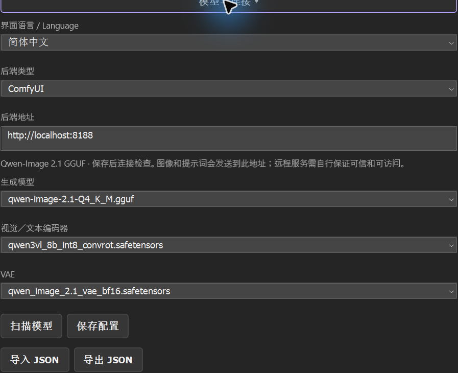

<p align="center">
  
</p>
<h1 align="center">ComfyUI setup and model compatibility</h1>
<p align="center"><a href="COMFYUI.md">简体中文</a> · <strong>English</strong> · <a href="../README.en.md">README</a></p>

PS-AI connects directly to your ComfyUI. The plugin includes no backend or weights. Reuse an existing compatible installation. For cloud APIs, see [platform setup](PLATFORMS.en.md).

<a id="backend"></a>

## 1. Prepare a working backend

Start ComfyUI and confirm its page opens in a browser. For a new installation, follow the official [Windows Portable](https://docs.comfy.org/installation/comfyui_portable_windows) or [manual installation](https://docs.comfy.org/installation/manual_install) guide. Install [ComfyUI-GGUF](https://github.com/leejet/ComfyUI-GGUF) using that backend's Python, then restart normally.

The recorded baseline is ComfyUI `0.37.4` (`8ff6dc384ba5c410266b40e137799e049459d4f2`) and GGUF commit `373048b8403a7820620065210a691263d4da0a61`. See [compatibility.json](../../config/compatibility.json) for required nodes, hashes and validation scope. Other versions must provide the same node schemas and task API.

<a id="model-files"></a>

## 2. Model files

Use ComfyUI's `models` directory or point `extra_model_paths.yaml` at existing weights. The plugin stores loader-relative filenames, never absolute weight paths.

For files placed directly under ComfyUI, use this layout. Do not put all three files in `checkpoints`:

```text
ComfyUI/
└─ models/
   ├─ diffusion_models/
   │  └─ qwen-image-2.1-Q4_K_M.gguf
   ├─ text_encoders/
   │  └─ qwen3vl_8b_int8_convrot.safetensors
   └─ vae/
      └─ qwen_image_2.1_vae_bf16.safetensors
```

| Search category | Preset file | Disk size |
| --- | --- | ---: |
| `diffusion_models` | [qwen-image-2.1-Q4_K_M.gguf](https://huggingface.co/Janchan123/Qwen-Image-2.1-Uncensored-GGUF/resolve/2a9f9f126b8cad42b48f8b1ac3c89bb884eeeee4/qwen-image-2.1-Q4_K_M.gguf) | 4.60 GB |
| `text_encoders` | [qwen3vl_8b_int8_convrot.safetensors](https://huggingface.co/Comfy-Org/Qwen-Image-2.1/resolve/df94239739eef7205973a145ffa6f441f7b64e84/text_encoders/qwen3vl_8b_int8_convrot.safetensors) | 9.35 GB |
| `vae` | [qwen_image_2.1_vae_bf16.safetensors](https://huggingface.co/Comfy-Org/Qwen-Image-2.1/resolve/df94239739eef7205973a145ffa6f441f7b64e84/vae/qwen_image_2.1_vae_bf16.safetensors) | 0.68 GB |

<p align="center">
  <a href="../../assets/guide/050-models-zh.png"></a>
</p>

This is a tested combination, not a recommendation for every use. The diffusion model is a third-party quantization. Read its model card and the upstream [Qwen license](https://huggingface.co/Qwen/Qwen-Image-2.1/blob/main/LICENSE): current terms permit non-commercial research / evaluation; commercial use requires separate permission. Weights are not distributed with the plugin.

Exact sizes, pinned sources and SHA256 values are in [compatibility.json](../../config/compatibility.json). Reuse identical existing files. The environment checker verifies preset sizes and hashes; alternate models are reported as needing your own validation.

<a id="connection"></a>

## 3. Address and settings format

### Configure the panel

1. Open **Settings → Backend and models** and choose **ComfyUI**.
2. Enter the HTTP(S) origin that opens in your browser, such as `http://localhost:8188`, `http://192.168.1.20:8188` or `https://comfy.example.com`.
3. **Scan models**, then choose the diffusion model, vision/text encoder and VAE. Use the exact relative filenames, including any subdirectories.
4. Choose **Save settings** and **Connect**. After it reports **Connected**, try one generation.

Addresses cannot contain credentials, paths or query strings. A reverse proxy must forward HTTP and WebSocket at its root; HTTPS needs a valid certificate. API-key authentication is not integrated. Remote backends receive images, references and prompts; keep unauthenticated services private.

**Connect** saves settings after checks pass; **Save settings** and **Import JSON** can save an unchecked draft. Export/import JSON to move configuration, then check the address and filenames. See the [settings example](../../config/settings.example.json). Model names cannot be absolute paths or contain `..`. Settings lock during generation; each task keeps its original backend address.

### Setup wizard

First launch walks through address testing, model scanning and environment checks. **Generate example** then submits a real job in a separate test document. Inspect its result layer and mask, then undo once. **Setup** reopens the checks later. A connection or scan alone does not confirm model compatibility.

### Color and safe editing

Use RGB/Grayscale 8/16-bit with a resolved color profile. Photoshop's loaded ICC is preserved. Supported untagged WebP/PNG may require selecting the original file and creating a tagged working copy; unknown color needs a correctly profiled copy. CMYK, Lab and 32-bit HDR are unsupported. See [source color](../usage/USER_GUIDE.en.md#source-color).

Model inputs are sRGB8, so wide-gamut colors and source precision can be lost. Results apply through the saved selection/protection mask on a new layer, with one undo step. Changed, closed or expired sources block application while keeping export available. Inspect alpha, color and edges on a saved copy.

<a id="output-depth"></a>

## Optional 16-bit SDR output

8-bit remains the default. To retain higher precision from generation:

1. Find `comfyui/ps_ai_sdr16` in the source tree or matching environment tools ZIP.
2. Copy that folder into `ComfyUI/custom_nodes/ps_ai_sdr16`. Its `__init__.py` must sit directly inside it. No core files, existing nodes or extra Python packages need replacement.
3. Wait for current jobs to finish and restart ComfyUI normally. Node search should include **PS-AI Save PNG16 (sRGB SDR)**.
4. Select **16-bit SDR** under Output depth in the plugin. A missing node stops generation before submission; select 8-bit to use the original path.
5. Apply to a 16-bit source document, or choose Open in new document to create a 16-bit sRGB document automatically. Save PNG preserves the candidate depth. Applying to an 8-bit document reduces it to 8-bit.

The node writes decoded VAE floats directly to tagged 16-bit RGB/RGBA PNG. Resizing, alpha processing and export retain 16-bit colors. Thumbnails and model inputs remain 8-bit; selection/protection masks remain 8-bit grayscale. A 16-bit container does not promise 16 bits of effective model detail. BF16/FP16 inference, sRGB gamut and model color shifts still apply; HDR is unsupported.

The optional JSON field `"outputDepth": 16` travels with settings. Old settings default to 8-bit; historical jobs retain their own output template.

<a id="model-compatibility"></a>

## 4. Adapting your own models

This version supports **model mappings within the existing workflow**. Weights must use a compatible Qwen-Image 2.1 architecture and load correctly with these options:

| Role | Node and field | Contract |
| --- | --- | --- |
| Diffusion model | `UnetLoaderGGUF.unet_name` | `.gguf`, compatible Qwen 2.1 structure and sampling chain |
| Encoder | `CLIPLoader.clip_name` | `.safetensors`, `type=qwen_image`, `device=default` |
| VAE | `VAELoader.vae_name` | `.safetensors`, matching latent format |
| Encoding / references | `TextEncodeQwenImage21` | `prompt`, `negative_prompt`, `resolution`; `images.image_1` through `images.image_3`; accepts `vae` for image inputs |
| Model wrapper | `QwenImage21Cache` | `model`, `device=auto`, `dtype=default` |
| Output | `KSampler → VAEDecode → SaveImage / PS_AISavePNG16` | `euler` / `simple`, `cfg=1`, `denoise=1`; output node ID `8` |

Also required: `LoadImage` and `JoinImageWithAlpha`. A scan proves file visibility, not internal architecture. Even after a successful node check, test both text-to-image and a local edit. Validate quantization, memory requirements, quality and licensing for every alternate combination.

Input / output rules:

- [src/generation/workflow.ts](../../src/generation/workflow.ts) builds a ComfyUI API graph, not a UI workflow JSON with node coordinates.
- Edit input is pre-scaled sRGB 8-bit RGBA PNG. `image_1` is the source. An enabled selection guide uses `image_2`; character reference uses the next slot. `JoinImageWithAlpha` restores alpha from `LoadImage`'s inverted MASK.
- Editing uses `resolution=0`; output dimensions must equal the first input. The plugin rejects mismatches. Text-to-image uses the selected resolution.
- The selection guide is a visual prompt, not a latent inpaint mask. Photoshop's final mask enforces selection and protection boundaries.
- Results come from node `8`'s `images`. The plugin then applies optional transparency, alignment and color processing; raw browser workflow output can differ.

SD, SDXL, Flux, other Qwen architectures and arbitrary workflow import are unsupported. They need separate templates, node checks, size / mask contracts and Photoshop round-trip validation. Changing a dropdown filename is insufficient.

Background/scene and blending omit the ComfyUI grayscale guide; Photoshop still applies the saved mask. Relighting reuses these models with no extra download. Image-context assets have failed visual acceptance in tested samples; inspect source residue, guide marks, transparency and edges. See the [user guide](../usage/USER_GUIDE.en.md).

<a id="api"></a>

## 5. Backend API contract

Proxies and custom servers must preserve these semantics:

| Endpoint | Requirement |
| --- | --- |
| `GET /system_stats` | System information |
| `GET /object_info/{class}` | Node schemas and model dropdowns |
| `POST /upload/image` | Multipart PNG; returns `name`, `subfolder` |
| `POST /prompt` | Accepts caller UUID `prompt_id`, `client_id`, `prompt`; returns the same `prompt_id` |
| `GET /history/{id}`, `GET /queue` | Task-specific terminal state, node `8` output and queue state |
| `GET /view` | PNG download by `filename`, `subfolder`, `type=output` |
| `POST /api/jobs/{id}/cancel` | Atomically cancels only that ID; returns boolean `cancelled` |
| `/ws?clientId=…` | WS for HTTP, WSS for HTTPS; `progress` includes `prompt_id`, `value`, `max` |

Having `/prompt` is not enough. A backend that ignores caller IDs or lacks task-specific cancellation needs upgrading / adapting. There is no global `/interrupt` fallback, which could stop someone else's work. Connect checks nodes and models without interrupting tasks to probe cancellation. Full acceptance requires submitting, recovering and cancelling a test task. See [ComfyUI server routes](https://docs.comfy.org/development/comfyui-server/comms_routes).

<a id="environment-tools"></a>

## 6. Environment tools

Run from the source root or matching extracted environment-tool directory:

```powershell
powershell.exe -NoProfile -File .\scripts\check-environment.ps1 -SettingsPath .\config\settings.example.json -ReportPath .\environment-report.json
```

Copy and edit the example first, or use exported panel settings. Add `-ModelRoot` for preset size / hash checks under `diffusion_models`, `text_encoders` and `vae`; `-SkipHash` skips hashing. `-Offline` runs local checks only. `-ComfyRoot` checks source revisions and the cancellation route. Exit codes: `0` all checks passed, `2` unverified items, `1` errors. This does not prove Photoshop acceptance.

To generate a separate launcher for an existing Python backend:

```powershell
$comfy = Read-Host 'ComfyUI directory containing main.py'
$models = Read-Host 'Model root directory'
$python = Read-Host 'Full path to this backend python.exe'
powershell.exe -NoProfile -File .\scripts\prepare-environment.ps1 -ComfyRoot $comfy -ModelRoot $models -PythonPath $python -OutputDirectory .\prepared-backend -Port 8199
```

This creates `extra_model_paths.yaml`, `start-comfyui.ps1` and importable `ps-ai-settings.json`. It refuses existing output directories, installs nothing, downloads no weights and leaves the backend untouched. Start the generated script yourself only when the service is stopped. It listens locally; if the port is already serving, reuse and check that service.

<a id="troubleshooting"></a>

## 7. Troubleshooting

| Symptom | Check first |
| --- | --- |
| Browser works, plugin cannot connect | Complete origin, proxy API forwarding, certificate and Photoshop firewall rules. A manually applied loopback-only rule blocks LAN / remote backends; its administrator must adjust it deliberately. |
| Models missing | Search categories, exact relative names and backend logs. Refresh / restart normally after path changes. |
| Missing Qwen node / field | Compare pinned commits and schemas. Same-name older nodes may differ. |
| Different task ID / cancellation 404 | The task protocol is incompatible. Keep records and check versions; do not resubmit or use global interruption. |
| Slow text encoding | Initial loading, VRAM pressure and CPU offloading take time. The plugin uses `device=default`; ComfyUI chooses the actual device. Check its logs before forcing everything onto GPU. |
| No percentage before sampling | The node has not reported sampling steps yet. The panel shows a phase, then the task's real step progress. |
| Wrong candidate dimensions | Check source scaling and first-reference dimensions. Do not bypass checks by changing output size. |
| White fringe / color shift | Check whether preserving the source silhouette is appropriate, then ICC, raw model output, alignment and color matching. Composite manually if needed. |
| Untagged source/reference | Follow the [source-color guidance](../usage/USER_GUIDE.en.md#source-color); use a correctly profiled copy when needed. |
