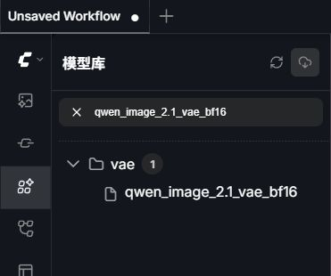
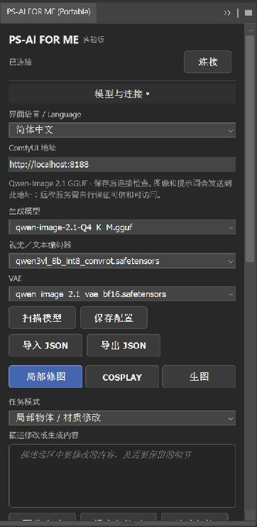
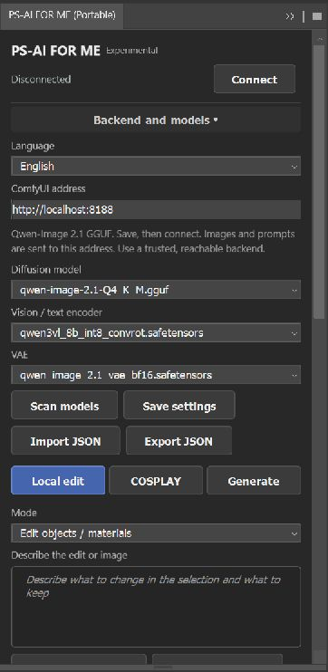

<p align="center">
  
</p>
<h1 align="center">ComfyUI setup and model compatibility</h1>
<p align="center"><a href="COMFYUI.md">简体中文</a> · <strong>English</strong> · <a href="../README.en.md">README</a></p>

The plugin includes neither the backend nor weights. Reuse an existing ComfyUI if it meets the contract below. 8-bit uses `qwen21-local-v2-rgba`; 16-bit uses `qwen21-local-v3-rgba16`. Older screenshots show 0.3.0; setup for 0.4.0 is described below.

This page covers the local ComfyUI path. Development gateways for [Bailian](../providers/BAILIAN.en.md), [Gemini / Nano Banana](../providers/GEMINI.en.md) and [OpenAI Images](../providers/OPENAI.en.md) use platform models instead. The repository’s `docs/development/BACKEND.en.md` defines server rewrites; ComfyUI graphs and platform APIs are separate contracts.

**Jump to:** [Model files](#model-files) · [Connect the panel](#connection) · [16-bit output](#output-depth) · [Troubleshooting](#troubleshooting)

<a id="output-depth"></a>

In the current development panel, choose **ComfyUI** before entering its address. The direct path never launches a platform relay. Switching back restores the saved ComfyUI address, models and depth. See [platform selection](PLATFORMS.en.md) for the other backends.

## 16-bit output (0.4.0)

8-bit remains the default. To retain higher precision from generation:

1. Find `comfyui/ps_ai_sdr16` in the source tree or matching environment tools ZIP.
2. Copy that folder into `ComfyUI/custom_nodes/ps_ai_sdr16`. Its `__init__.py` must sit directly inside it. No core files, existing nodes or extra Python packages need replacement.
3. Wait for current jobs to finish and restart ComfyUI normally. Node search should include **PS-AI Save PNG16 (sRGB SDR)**.
4. Select **16-bit SDR** under Output depth in the plugin. A missing node stops generation before submission; select 8-bit to use the original path.
5. Apply to a 16-bit source document, or choose Open in new document to create a 16-bit sRGB document automatically. Save PNG preserves the candidate depth. Applying to an 8-bit document reduces it to 8-bit.

The node writes decoded VAE floats directly to tagged 16-bit RGB/RGBA PNG. Resizing, alpha processing and export retain 16-bit colors. Thumbnails and model inputs remain 8-bit; selection/protection masks remain 8-bit grayscale. A 16-bit container does not promise 16 bits of effective model detail. BF16/FP16 inference, sRGB gamut and model color shifts still apply; HDR is unsupported.

The optional JSON field `"outputDepth": 16` travels with settings. Old settings default to 8-bit; historical jobs retain their own output template.

<a id="backend"></a>

## 1. Prepare a working backend

Already have ComfyUI? Start it, open its page in a browser and check nodes and weights. Do not overwrite existing models or workflows just to connect the plugin.

For a new installation, follow the official [Windows Portable guide](https://docs.comfy.org/installation/comfyui_portable_windows) or [manual installation guide](https://docs.comfy.org/installation/manual_install). Follow that distribution's driver, Python and PyTorch requirements. The plugin's environment tools generate configuration and run checks; they do not install the backend, dependencies or weights.

| Component | Tested baseline |
| --- | --- |
| ComfyUI | `0.37.4`, commit `8ff6dc384ba5c410266b40e137799e049459d4f2` |
| [leejet/ComfyUI-GGUF](https://github.com/leejet/ComfyUI-GGUF) | Commit `373048b8403a7820620065210a691263d4da0a61` |
| Python / PyTorch | Existing backend: `3.13.15` / `2.14.0+cu130`. Not minimum requirements for other hardware. |

Newer versions may work, but must meet the node and API requirements below. `UnetLoaderGGUF` comes from the GGUF extension. A compatible ComfyUI supplies the Qwen 2.1 and other core nodes. Follow the extension's instructions for `custom_nodes`, use the backend's own Python for dependencies and restart through your normal procedure. A matching node name alone does not prove compatibility.

<a id="model-files"></a>

## 2. Model files

Use ComfyUI's `models` directory or point `extra_model_paths.yaml` at existing weights. The plugin stores loader-relative filenames, never absolute weight paths.

For files placed directly under ComfyUI, use this layout. Do not put all three files in `checkpoints`:

```text
ComfyUI/
└─ models/
   ├─ diffusion_models/
   │  └─ qwen-image-2.1-Q4_K_M.gguf
   ├─ text_encoders/
   │  └─ qwen3vl_8b_int8_convrot.safetensors
   └─ vae/
      └─ qwen_image_2.1_vae_bf16.safetensors
```

| Search category | Preset file | Disk size |
| --- | --- | ---: |
| `diffusion_models` | [qwen-image-2.1-Q4_K_M.gguf](https://huggingface.co/Janchan123/Qwen-Image-2.1-Uncensored-GGUF/resolve/2a9f9f126b8cad42b48f8b1ac3c89bb884eeeee4/qwen-image-2.1-Q4_K_M.gguf) | 4.60 GB |
| `text_encoders` | [qwen3vl_8b_int8_convrot.safetensors](https://huggingface.co/Comfy-Org/Qwen-Image-2.1/resolve/df94239739eef7205973a145ffa6f441f7b64e84/text_encoders/qwen3vl_8b_int8_convrot.safetensors) | 9.35 GB |
| `vae` | [qwen_image_2.1_vae_bf16.safetensors](https://huggingface.co/Comfy-Org/Qwen-Image-2.1/resolve/df94239739eef7205973a145ffa6f441f7b64e84/vae/qwen_image_2.1_vae_bf16.safetensors) | 0.68 GB |

After starting ComfyUI, open **Model Library** in its sidebar and search for the main part of a filename. This screenshot uses the Chinese backend UI, where Model Library is labeled “模型库”. The preset VAE appears under `vae`, confirming that the backend can see it. The library may hide extensions; select the full filename returned by the plugin's scan.

<p align="center">
  <a href="../../assets/comfyui-model-library.jpg"></a>
  <br><sub>Model Library → vae · Click for the original capture.</sub>
</p>

This is a tested combination, not a recommendation for every use. The diffusion model is a third-party quantization. Read its model card and the upstream [Qwen license](https://huggingface.co/Qwen/Qwen-Image-2.1/blob/main/LICENSE): current terms permit non-commercial research / evaluation; commercial use requires separate permission. Weights are not distributed with the plugin.

Exact sizes, pinned sources and SHA256 values are in [compatibility.json](../../config/compatibility.json). Reuse identical existing files. The environment checker verifies preset sizes and hashes; alternate models are reported as needing your own validation.

<a id="connection"></a>

## 3. Address and settings format

Enter a complete **HTTP(S) origin** in Backend and models:

```text
http://localhost:8188
http://localhost:8199
http://192.168.1.20:8188
https://comfy.example.com
```

A local backend normally listens on `127.0.0.1`. A remote backend needs a reachable interface and a firewall configured by its administrator. The plugin changes neither. Credentials, query strings and paths such as `/comfy` are unsupported. A reverse proxy must forward HTTP and WebSocket at its root; HTTPS needs a valid certificate. API-key authentication is not integrated.

### Configure the panel

1. Expand **Backend and models**. Enter the service origin that opens in your browser under **ComfyUI address**. If you changed the backend port, change it here too.
2. With the backend running, click **Scan models**. Select the **Diffusion model**, **Vision / text encoder** and **VAE** using the table above. Scanning uses the address currently entered.
3. Click **Save settings**, then **Connect** at the top. Wait for **Connected**, then try a test generation. If connection fails, read the message and the troubleshooting table below.
4. To move settings to another machine, **Export JSON** here and **Import JSON** there, then check its address and model names. Changing language saves only the language, without submitting an unsaved address.

<details>
<summary>Connection screenshots · Chinese and English (0.3.0)</summary>

These captures show the 0.3.0 Portable panel in Photoshop 27.0 after a successful model scan and connection check. CCX has the same settings. The header shows **Connected** when the check succeeds.

<table>
  <tr>
    <th width="50%" align="center">Chinese UI</th>
    <th width="50%" align="center">English UI</th>
  </tr>
  <tr>
    <td align="center" valign="top"><a href="../../assets/setup-zh.png"></a></td>
    <td align="center" valign="top"><a href="../../assets/setup-en.png"></a></td>
  </tr>
</table>

<p align="center"><sub>Click either capture for its original resolution. The 0.4.0 setup steps are described below.</sub></p>

</details>

In 0.4.0, **Connect** saves settings only after checks pass. Failed connections keep the previous settings. **Save settings** and **Import JSON** can save an unchecked draft. Equivalent settings:

```json
{
  "schemaVersion": 1,
  "baseUrl": "http://localhost:8188",
  "language": "en-US",
  "models": {
    "unet": "qwen-image-2.1-Q4_K_M.gguf",
    "clip": "qwen3vl_8b_int8_convrot.safetensors",
    "vae": "qwen_image_2.1_vae_bf16.safetensors"
  }
}
```

`language` accepts `zh-CN` or `en-US`; older settings may omit it and default to Chinese. Model names must match the scan, including subdirectories and separators, for example `my-qwen/model.gguf`. Absolute paths and `..` are rejected. Settings are locked during generation. History records its backend origin; legacy records without one belong to `http://localhost:8188`.

To support custom hosts, the UXP manifest declares network `domains: "all"`. Runtime requests go to the configured ComfyUI; there is no telemetry. A remote server receives and may retain uploaded images, references and prompts. Do not expose an unauthenticated backend to untrusted networks.


### Setup in 0.4.0

First launch shows three steps. A valid saved configuration opens the workspace directly; **Setup** can reopen the checks.

1. Open **Backend and models**, enter the address and click **Test and save address**. The address is saved only after the connection succeeds.
2. Scan and select the three model files, then **Check environment**. This reads the host version, backend API, node fields and model inventory. It installs no dependencies and changes no models.
3. **Generate example** explicitly submits a task. It creates a separate test document, edits its central color patch and applies a masked new layer. Inspect the layer and mask, then undo with Ctrl+Z.

The preset names a tested Qwen 2.1 combination. A custom mapping passing file and API checks still needs real inference to confirm model compatibility. Saving an address does not add support for authenticated cloud platforms.

Failures include their category, effect and next action. Expand **Technical details (copyable)** for the original error. Recover or cancel an existing task by its original ID before resubmitting. A failure is classified as insufficient memory only when the backend explicitly reports it.

### Color and safe editing

Main and reference images support RGB / Grayscale 8/16-bit with a resolved color space. An existing document ICC is preserved, including color conversions made when opening or editing in Photoshop.

**Development branch only (absent from published v0.4.0):** if the document has no ICC, select its original file to read saved color declarations. Static WebP without embedded ICC uses the format's sRGB default; an explicit PNG sRGB chunk is also recognized. The file must match the current document path, dimensions and native depth, and the current document state is checked again after reading. Successful resolution creates an unmerged sRGB working copy for capture and apply, leaving the original untouched and retaining unsaved layers. All untagged edits in the copy receive the original-file color interpretation; this cannot guarantee their previous appearance. A disposable untagged WebP8 copy passed capture, identity apply (zero pixel difference), single undo and cleanup in Photoshop 27. Native PNG, reference import and new panel interactions remain pending.

Other formats fall back to Photoshop's loaded document ICC. Unknown color, gamma alone, custom declarations without a loaded ICC, and untagged documents without a verifiable original file still require the correct profile on a copy. Source-file reading is limited to 64 MB; RGB mode alone does not imply sRGB. Prepare RGB copies of CMYK, Lab and HDR documents.

| Boundary | Contract |
| --- | --- |
| Capture, reference, model input | Photoshop converts copied pixels to sRGB. Model exchange uses 8-bit RGBA PNG with straight alpha. |
| Backend output | The 8-bit template accepts sRGB8 PNG and its verified untagged convention. The 16-bit template requires tagged sRGB RGB/RGBA16 PNG. Conflicting gamma, ICC and HDR tags are rejected; the raw output is retained. |
| Preview and PNG export | Both use explicitly tagged sRGB PNG. Monitor and host color management can still affect appearance. |
| Layer application | Photoshop converts candidate sRGB into the source profile. Original layers, document profile and depth stay unchanged. 16-bit output retains its color precision in a 16-bit destination. Expanding an 8-bit result does not create extra precision. |

Downloads are also checked for PNG checksums, pixel format, decompressed length and scanlines. Text metadata is excluded from decoding. Invalid pixels cannot be applied as a candidate; the original download remains in the task record.

Native round trips and independent conversions passed on PS 27.0 for sRGB, Adobe RGB, Display P3 and ProPhoto source documents at 8/16-bit, using 8-bit model exchange. The new 16-bit output path was separately tested for actual generation, application, export and known sample values in sRGB / 16-bit documents. Model input still loses colors outside sRGB and original high-depth detail; 16-bit output avoids additional quantization, without guaranteeing a seamless color match. Optional context matching only corrects small overall shifts. See the [user guide](../usage/USER_GUIDE.en.md) for an example.

The captured range is shown during generation: amber means effective edit, blue manual protection and gray context. A real feathered Photoshop mask controls application; the visual guide is not a strict latent inpaint mask. Candidates identify their source and whether application adds a result or replaces this capture’s plugin layer. Closed, changed or expired source sessions block application while keeping candidates exportable. Investigate host crashes using logs and separate GPU/network controls. One successful run is not a long-term stability guarantee; work on saved copies.

<a id="model-compatibility"></a>

## 4. Adapting your own models

This version supports **model mappings within the existing workflow**. Weights must use a compatible Qwen-Image 2.1 architecture and load correctly with these options:

| Role | Node and field | Contract |
| --- | --- | --- |
| Diffusion model | `UnetLoaderGGUF.unet_name` | `.gguf`, compatible Qwen 2.1 structure and sampling chain |
| Encoder | `CLIPLoader.clip_name` | `.safetensors`, `type=qwen_image`, `device=default` |
| VAE | `VAELoader.vae_name` | `.safetensors`, matching latent format |
| Encoding / references | `TextEncodeQwenImage21` | `prompt`, `negative_prompt`, `resolution`; `images.image_1` through `images.image_3`; accepts `vae` for image inputs |
| Model wrapper | `QwenImage21Cache` | `model`, `device=auto`, `dtype=default` |
| Output | `KSampler → VAEDecode → SaveImage / PS_AISavePNG16` | `euler` / `simple`, `cfg=1`, `denoise=1`; output node ID `8` |

Also required: `LoadImage` and `JoinImageWithAlpha`. A scan proves file visibility, not internal architecture. Even after a successful node check, test both text-to-image and a local edit. Validate quantization, memory requirements, quality and licensing for every alternate combination.

Input / output rules:

- [src/workflow.ts](../../src/workflow.ts) builds a ComfyUI API graph, not a UI workflow JSON with node coordinates.
- Edit input is pre-scaled sRGB 8-bit RGBA PNG. `image_1` is the source. An enabled selection guide uses `image_2`; character reference uses the next slot. `JoinImageWithAlpha` restores alpha from `LoadImage`'s inverted MASK.
- Editing uses `resolution=0`; output dimensions must equal the first input. The plugin rejects mismatches. Text-to-image uses the selected resolution.
- The selection guide is a visual prompt, not a latent inpaint mask. Photoshop's final mask enforces selection and protection boundaries.
- Results come from node `8`'s `images`. The plugin then applies optional transparency, alignment and color processing; raw browser workflow output can differ.

SD, SDXL, Flux, other Qwen architectures and arbitrary workflow import are unsupported. They need separate templates, node checks, size / mask contracts and Photoshop round-trip validation. Changing a dropdown filename is insufficient.

<a id="api"></a>

## 5. Backend API contract

Proxies and custom servers must preserve these semantics:

| Endpoint | Requirement |
| --- | --- |
| `GET /system_stats` | System information |
| `GET /object_info/{class}` | Node schemas and model dropdowns |
| `POST /upload/image` | Multipart PNG; returns `name`, `subfolder` |
| `POST /prompt` | Accepts caller UUID `prompt_id`, `client_id`, `prompt`; returns the same `prompt_id` |
| `GET /history/{id}`, `GET /queue` | Task-specific terminal state, node `8` output and queue state |
| `GET /view` | PNG download by `filename`, `subfolder`, `type=output` |
| `POST /api/jobs/{id}/cancel` | Atomically cancels only that ID; returns boolean `cancelled` |
| `/ws?clientId=…` | WS for HTTP, WSS for HTTPS; `progress` includes `prompt_id`, `value`, `max` |

Having `/prompt` is not enough. A backend that ignores caller IDs or lacks task-specific cancellation needs upgrading / adapting. There is no global `/interrupt` fallback, which could stop someone else's work. Connect checks nodes and models without interrupting tasks to probe cancellation. Full acceptance requires submitting, recovering and cancelling a test task. See [ComfyUI server routes](https://docs.comfy.org/development/comfyui-server/comms_routes).

<a id="environment-tools"></a>

## 6. Environment tools

Run from the source root or matching extracted environment-tool directory:

```powershell
powershell.exe -NoProfile -File .\scripts\check-environment.ps1 -SettingsPath .\config\settings.example.json -ReportPath .\environment-report.json
```

Copy and edit the example first, or use exported panel settings. Add `-ModelRoot` for preset size / hash checks under `diffusion_models`, `text_encoders` and `vae`; `-SkipHash` skips hashing. `-Offline` runs local checks only. `-ComfyRoot` checks source revisions and the cancellation route. Exit codes: `0` all checks passed, `2` unverified items, `1` errors. This does not prove Photoshop acceptance.

To generate a separate launcher for an existing Python backend:

```powershell
$comfy = Read-Host 'ComfyUI directory containing main.py'
$models = Read-Host 'Model root directory'
$python = Read-Host 'Full path to this backend python.exe'
powershell.exe -NoProfile -File .\scripts\prepare-environment.ps1 -ComfyRoot $comfy -ModelRoot $models -PythonPath $python -OutputDirectory .\prepared-backend -Port 8199
```

This creates `extra_model_paths.yaml`, `start-comfyui.ps1` and importable `ps-ai-settings.json`. It refuses existing output directories, installs nothing, downloads no weights and leaves the backend untouched. Start the generated script yourself only when the service is stopped. It listens locally; if the port is already serving, reuse and check that service.

<a id="troubleshooting"></a>

## 7. Troubleshooting

| Symptom | Check first |
| --- | --- |
| Browser works, plugin cannot connect | Complete origin, proxy API forwarding, certificate and Photoshop firewall rules. A manually applied loopback-only rule blocks LAN / remote backends; its administrator must adjust it deliberately. |
| Models missing | Search categories, exact relative names and backend logs. Refresh / restart normally after path changes. |
| Missing Qwen node / field | Compare pinned commits and schemas. Same-name older nodes may differ. |
| Different task ID / cancellation 404 | The task protocol is incompatible. Keep records and check versions; do not resubmit or use global interruption. |
| Slow text encoding | Initial loading, VRAM pressure and CPU offloading take time. The plugin uses `device=default`; ComfyUI chooses the actual device. Check its logs before forcing everything onto GPU. |
| No percentage before sampling | The node has not reported sampling steps yet. The panel shows a phase, then the task's real step progress. |
| Wrong candidate dimensions | Check source scaling and first-reference dimensions. Do not bypass checks by changing output size. |
| White fringe / color shift | Check whether preserving the source silhouette is appropriate, then ICC, raw model output, alignment and color matching. Composite manually if needed. |
| Reference PNG is reported as untagged | v0.4.0 requires the correct ICC embedded on a copy. The development branch can read an explicit sRGB chunk and process a working copy; unknown color still needs manual confirmation. See the [reference example](../usage/USER_GUIDE.en.md#reference). |
