

<h1 align="center">PS-AI User Guide</h1>

<a href="USER_GUIDE.md">简体中文</a> · <strong>English</strong>

For **0.5.0 experimental**. [Install the plugin](../README.en.md#install-a-release-package), then connect [ComfyUI](../setup/COMFYUI.en.md) or a [cloud platform](../setup/PLATFORMS.en.md). Interface screenshots show Photoshop 27 with `3F3F3F.webp`. The mode examples below show real generated results and composed previews, separately from the interface screenshots. Configuration screens and local lighting illustrations are not model results. Click an image to view it at full size.

## Find your way around

- **Create:** choose a mode, describe a change, preview the selection and generate candidates.
- **Results:** compare candidates, inspect details, apply layers or export.
- **History:** browse saved records, load candidates, reuse parameters and recover tasks.
- **Settings:** configure models and backends, change language, transfer settings and run diagnostics.

Changing pages keeps your current text and parameters and does not stop a task. Opening the panel does not automatically start a backend or generate an image.

  <a href="../../assets/guide/050-create-zh.png">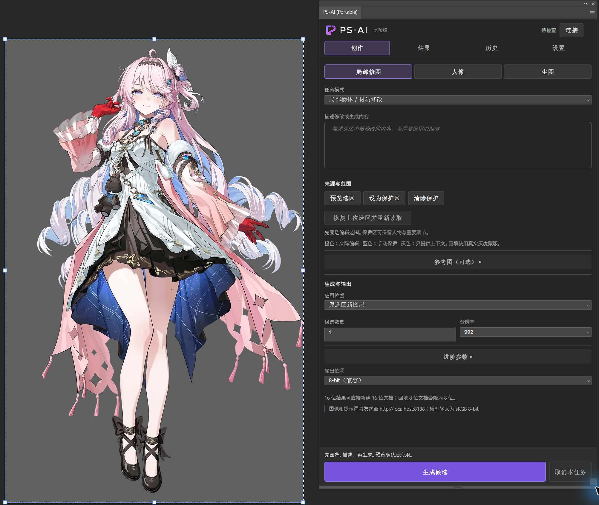</a>

## Make your first edit

1. Configure a backend under **Settings → Backend and models**, save, then connect. You can use an existing ComfyUI installation. Cloud platforms need your own key.
2. Open a saved image copy in Photoshop and choose **Create → Local edit**.
3. Choose **Objects and materials** and select the area to change. To protect a face, text or other detail, select it and choose **Set protection**, then reselect the editing area.
4. Describe the change, for example, “Make the metal ornament matte silver, keeping its shape.” Preview the selection: **orange can change, blue is protected, gray is context only**.
5. Generate candidates. Keep the source unchanged while waiting. After a disconnection, recover the original task instead of submitting again.
6. Inspect the result and choose **Apply as new layer**. Original layers remain; the result has an editable mask. Adjust opacity or press Ctrl+Z once to undo the application.

  <a href="../../assets/guide/050-settings-zh.png">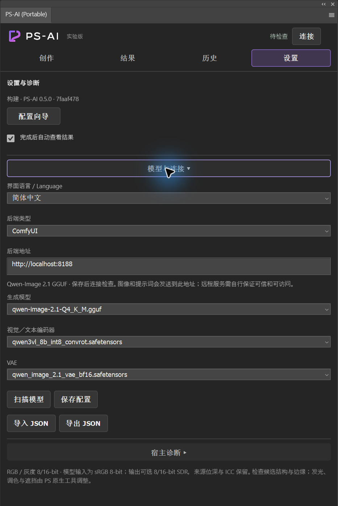</a>

  <a href="../../assets/guide/050-settings-en.png">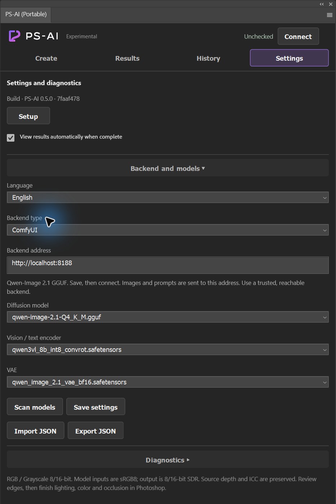</a>

Settings JSON transfers addresses, model choices and language. It contains no keys, model files or image history. CCX and Portable store their data separately.

## What to select

- **Local edits, removal, clothing and character reference:** the area to change.
- **Background and scene replacement:** the subject to keep. Do not invert the selection.
- **Image Blending:** a foreground subject already placed in a visible environment.
- **Relighting:** the current selection, or explicitly choose Entire image.
- **Image-context effects and atmosphere:** where the asset should appear.
- **Text to image and text-only assets:** no source selection is needed by default; Current selection as the destination still requires one.

Context helps the model understand the scene; it does not expand the application area. Protection is subtracted from the selection, with feathering retained. Prepare the selection and protection again after changing documents or reusing old parameters.

If Undo removes your selection, select again or use **Restore last selection and reread** in the same document and mode. This restores the range saved during the current session and reads current pixels. It does not submit a task or renew old candidates' application permissions.

  <a href="../../assets/guide/050-selection-error-zh.png">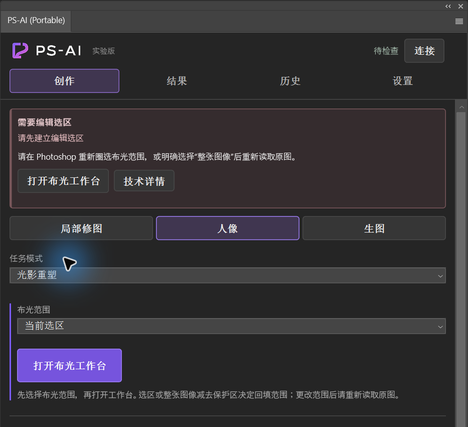</a>

For full-image relighting of a transparent cutout, add a background below it on a copy so the editing area is opaque. The demonstration copy keeps the source and background on separate layers:

  <a href="../../assets/guide/050-layers-zh.png">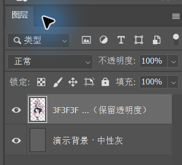</a>

## Choose a mode

These are real Qwen-Image 2.1 results using `3F3F3F.webp` and edited copies, except the text-only examples noted below. Edit previews combine the saved source, result and selection for each task; local examples are cropped, and transparency appears on gray. They are not screenshots of application in Photoshop and do not validate the installed apply flow.

### 1. Objects and materials

Choose **Local edit → Objects and materials**.

Select the object or material, describe its color, finish and the shape to retain, preview, then generate. Useful for material changes and small objects. Texture and text inside the selection may still change.

  <a href="../../assets/guide/050-result-edit.png">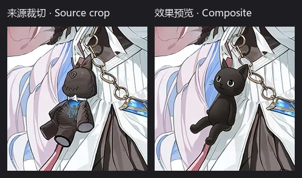</a>

Saved example: changing the doll at the waist into a black cat.

View mode controls

  <a href="../../assets/guide/050-mode-edit-zh.png">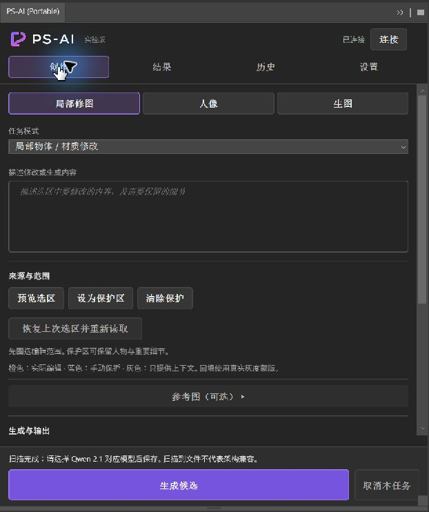</a>

### 2. Remove objects

Choose **Local edit → Remove objects**.

Select what you want removed, with enough surrounding context for filling. This mode has a built-in instruction and no prompt field. Check the filled texture. Turn off Preserve transparency if the result needs to expand beyond the original outline.

  <a href="../../assets/guide/050-result-remove.png">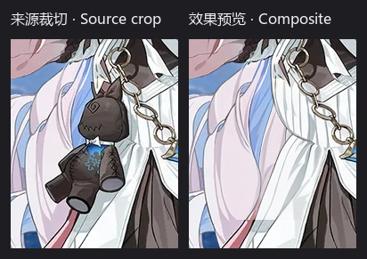</a>

Saved example: removing the same waist doll with the built-in instruction.

View mode controls

  <a href="../../assets/guide/050-mode-remove-zh.png">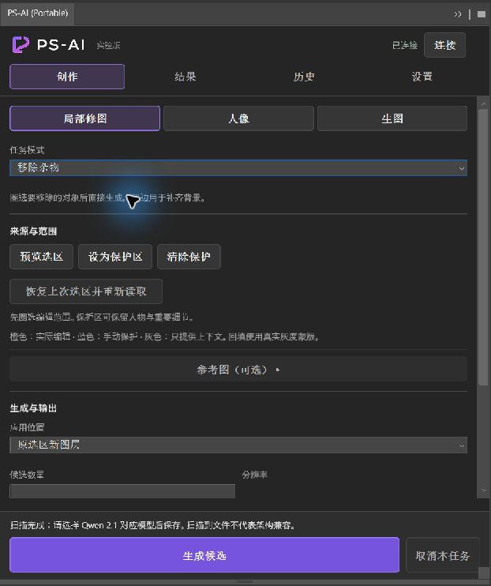</a>

### 3. Replace background

Choose **Local edit → Replace background (select subject)**.

1. Select the person or object to keep, without inverting.
2. Describe the new setting, floor and light, such as “Pale purple studio, soft side light, simple floor.”
3. Preview the subject edges and protection, then generate. Check hair, translucent edges and contact with the floor before applying.

This reads the full canvas and turns off source-transparency retention, subject alignment and color matching. ComfyUI also omits the selection guide. Ordinary preferences return when you leave. Candidates with a substantially transparent background remain exportable but cannot apply. Old candidates retain their saved range; their masks are not automatically inverted.

  <a href="../../assets/guide/050-result-background.png">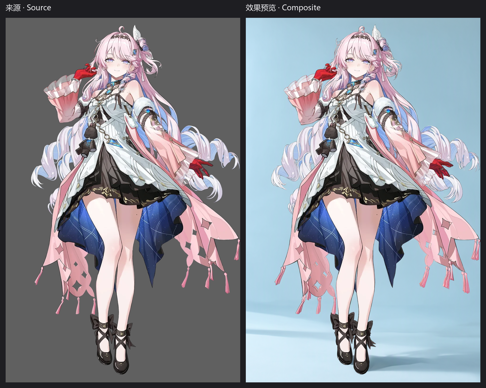</a>

New generation: replacing the background with a pale blue studio.

View mode controls

  <a href="../../assets/guide/050-mode-background-zh.png">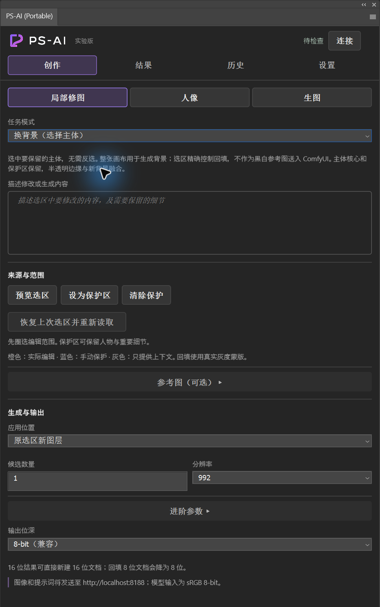</a>

### 4. Clothing and props

Choose **Portrait → Clothing and props**.

Select clothing or props, avoiding faces and hands you want to keep. Specify the part, color, material and details, for example, “Make the coat tail deep purple, preserving folds and metal ornaments.” Complex props may need manual repair.

  <a href="../../assets/guide/050-result-costume.png">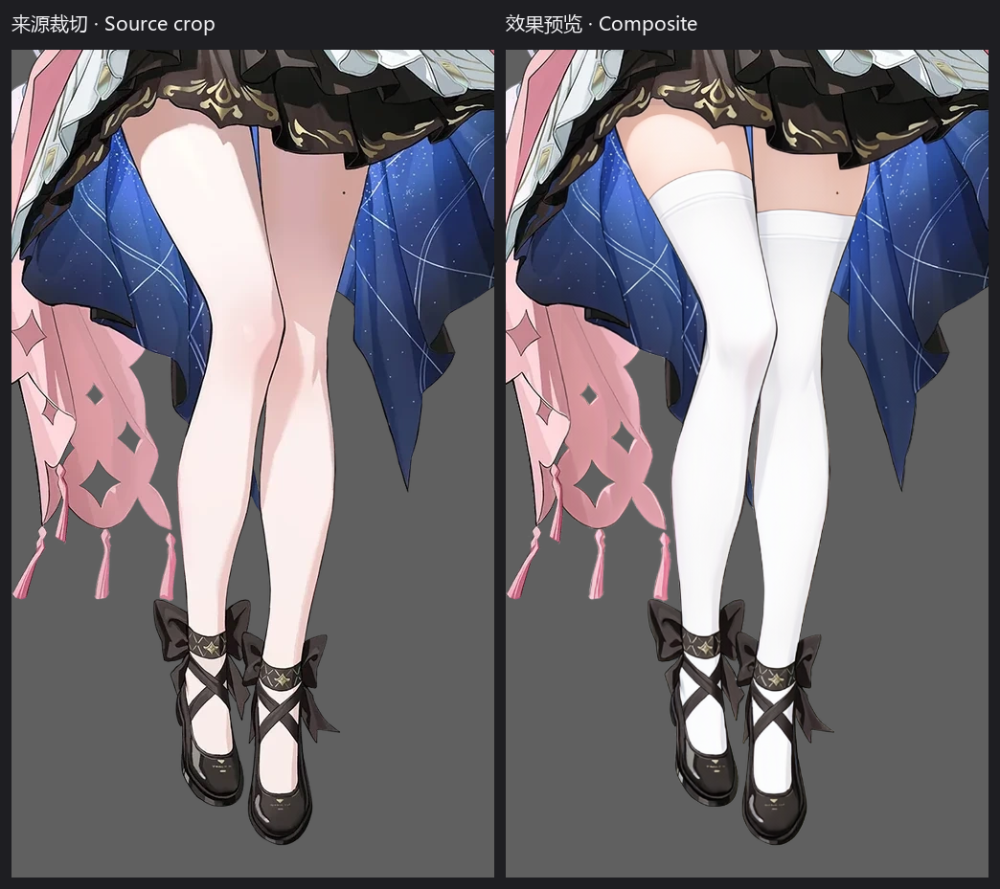</a>

Saved example: changing the socks to white over-knee socks.

View mode controls

  <a href="../../assets/guide/050-mode-costume-zh.png">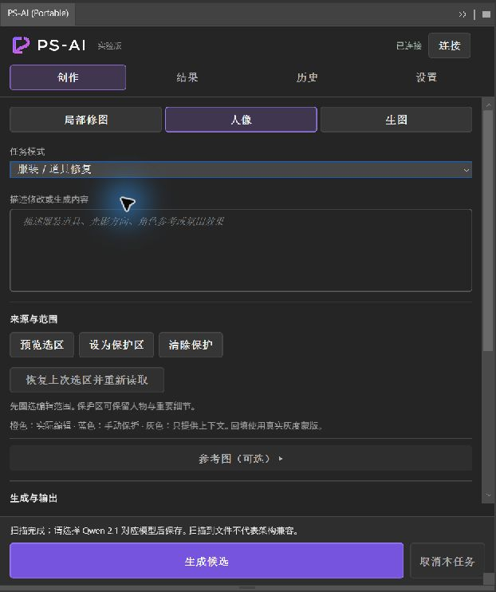</a>

### 5. Character reference

Choose **Portrait → Character reference**.

Select the editing area, import a reference image and describe the clothing, accessories or appearance to borrow. References do not guarantee identity or exact detail. If an import reports unknown color, confirm and embed the correct ICC profile on a copy, then retry.

  <a href="../../assets/guide/050-result-reference.png">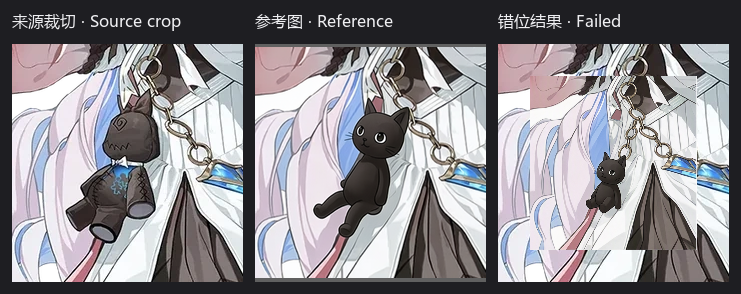</a>

**Failed example — source / black-cat reference / result:** the model shrank the image, leaving misalignment and visible seams after composition. This needs correction before use.

View mode controls

  <a href="../../assets/guide/050-mode-reference-zh.png">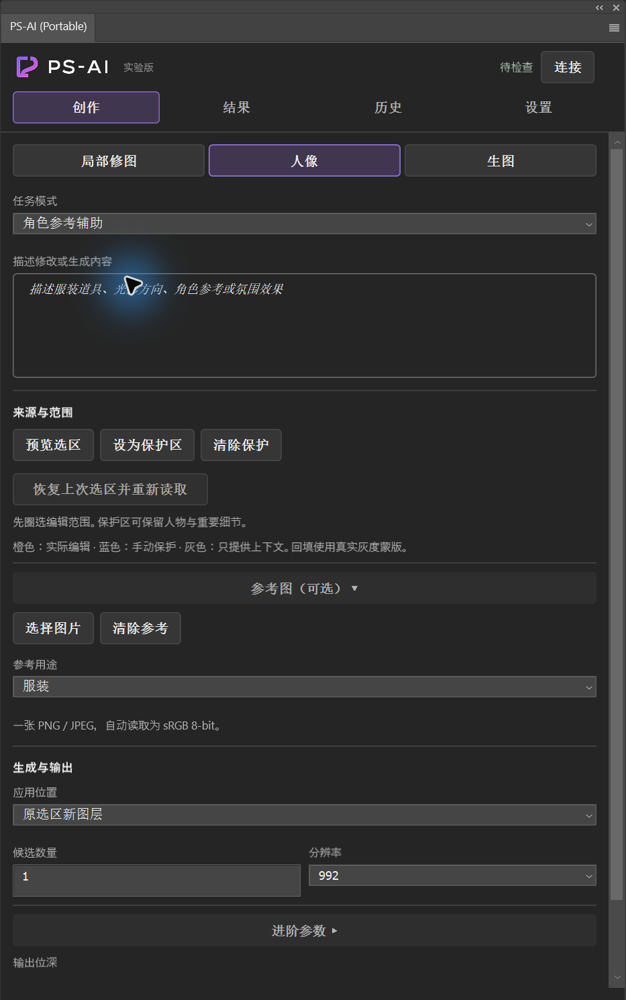</a>

### 6. Replace scene

Choose **Portrait → Replace scene**.

As with background replacement, select the subject to keep. Describe the environment, time of day, floor and lighting direction. The full canvas provides scene context. Do not import a black-and-white range guide as a scene reference.

  <a href="../../assets/guide/050-result-scene.png">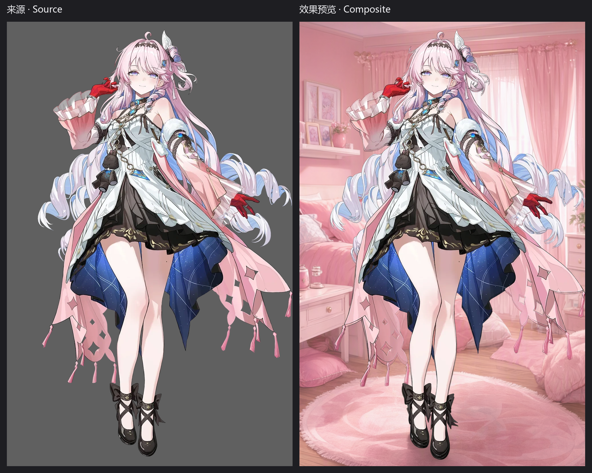</a>

Saved example: placing the subject in a pink bedroom.

View mode controls

  <a href="../../assets/guide/050-mode-scene-zh.png">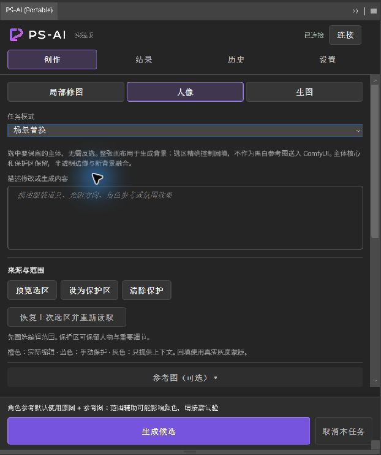</a>

### 7. Effect asset

Choose **Portrait → Effect asset**.

The default input uses the current image and selection. Select where the asset should appear, preview the source and grayscale guide, then describe its shape, direction and color, such as “A curved blue light trail beside the hand.” For an independent asset, explicitly choose text-only generation.

Input and destination are separate choices: choosing New document does not switch to text-only input. Image-context input does not use extra character references. Application retains the asset's own transparency and uses the saved selection minus protection as its mask. Fully opaque outputs can only be exported.

**Image-context asset quality does not yet meet the target.** Tested Qwen outputs may retain people, scenery or guide boundaries. Check transparency and unwanted content; transparent pixels alone do not make a usable asset.

  <a href="../../assets/guide/050-result-effect.png">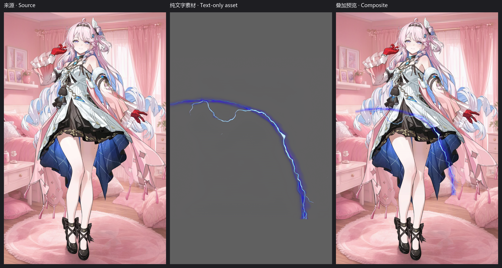</a>

**Source / asset / composition:** newly generated text-only blue arcing lightning, manually scaled and placed over the pink-bedroom copy. This does not demonstrate the default image-and-selection input.

View mode controls

  <a href="../../assets/guide/050-mode-effect-zh.png">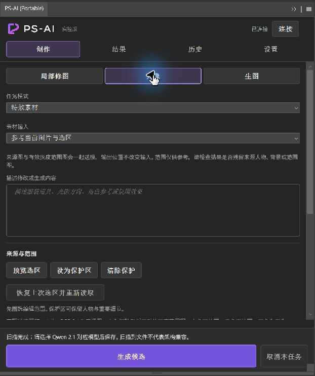</a>

### 8. Atmosphere asset

Choose **Portrait → Atmosphere asset**.

Use this for smoke, particles and haze. Input works like Effect asset: select placement when using the current image, or describe the asset directly in text-only mode. Check for retained people, scenery and guide boundaries.

  <a href="../../assets/guide/050-result-atmosphere.png">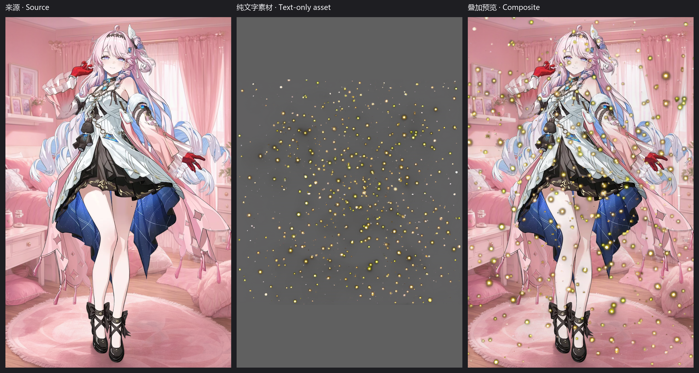</a>

**Source / asset / composition:** newly generated text-only golden particles, enlarged proportionally and cropped to overlay the same pink-bedroom copy. This does not demonstrate the default image-and-selection input.

View mode controls

  <a href="../../assets/guide/050-mode-atmosphere-zh.png">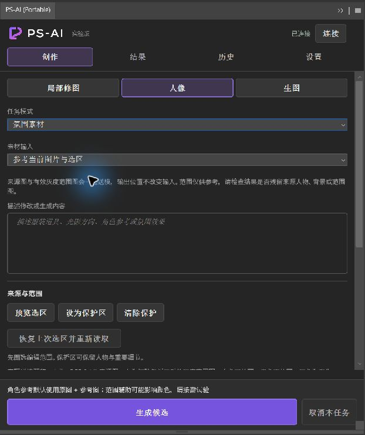</a>

### 9. Text to image

Choose **Generate → Text to image**.

Describe the subject, setting, composition and style, set resolution and candidate count, then generate. Text-to-image does not use reference images. No editing selection is needed by default; selecting Current selection as the destination still requires one. Save the result as PNG or open it in a new document.

  <a href="../../assets/guide/050-result-generate.png">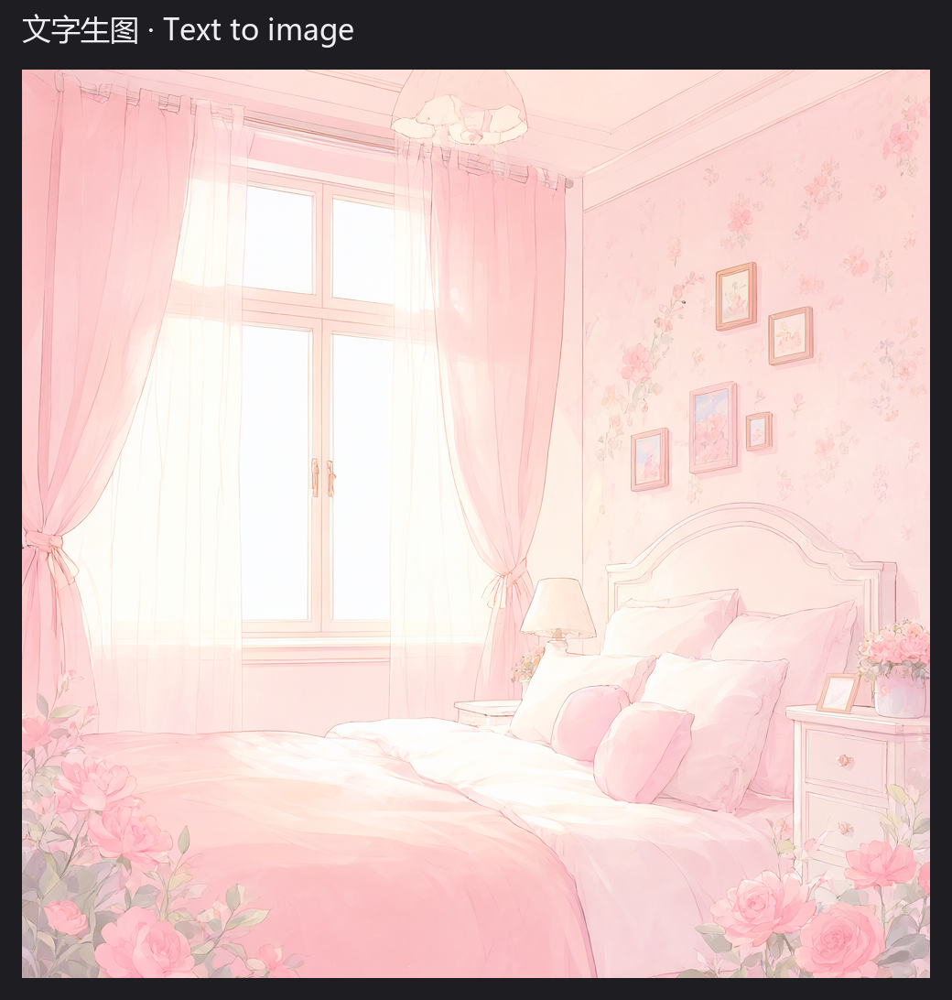</a>

Text-only generation: an independent pink-bedroom background. It does not read `3F3F3F.webp`; there is no before image.

View mode controls

  <a href="../../assets/guide/050-mode-generate-zh.png">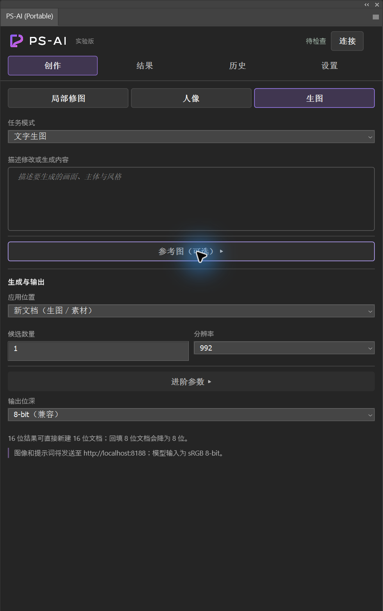</a>

### 10. Relighting

Choose **Portrait → Relighting**.

1. Choose Current selection or Entire image. Include the ground if you want cast shadows there.
2. Open the workbench and check the source. Opening while idle and choosing **Re-read current document** both read the active document's visible composite, including new backgrounds and merged layers. Your edited lights stay in place.
3. Add or drag lights and adjust type, role, intensity, color and direction. You can keep up to eight lights, duplicate, disable, lock or delete them. Hide markers only hides the overlays.
4. Use **Lighting illustration** to judge approximate coverage and color, choose an output, then select **Generate AI result**. Moving lights, typing values and workbench Undo do not send model requests. One drag is one local undo step.
5. Inspect the AI result, then apply or export. Editing lights after generation marks the old result stale.

  <a href="../../assets/guide/050-relight-zh.png">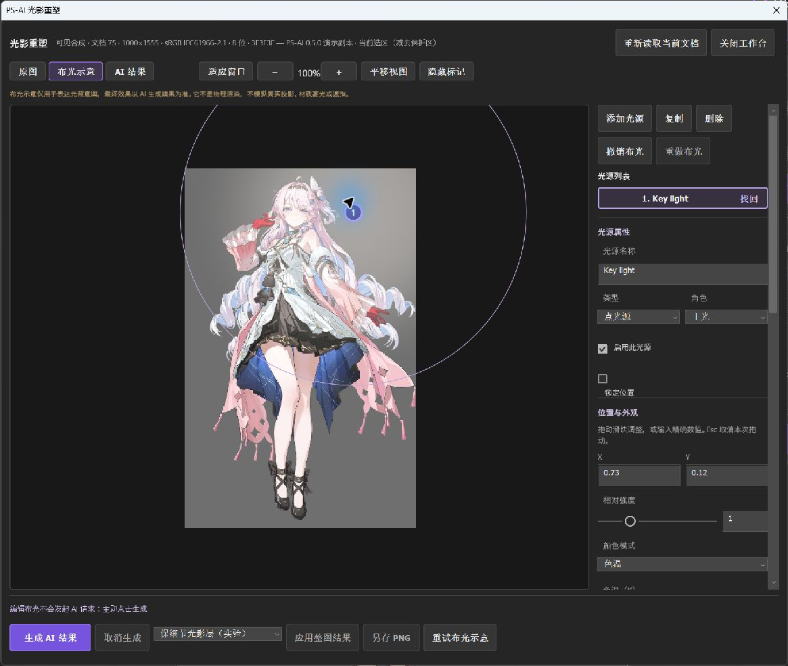</a>

**Lighting layers**, the default, estimate lighting changes from an AI reference and apply them directly to the image below through a masked Pass Through group, without copying the source. Its channels remain adjustable. **Full-image redraw** applies the model image as a masked layer; structure and texture may change.

**The lighting illustration expresses intent, not the final result.** Lighting layers estimate brightness and light-color changes from the AI reference over the original image, favoring soft overall lighting. Select a lighting-layer candidate, then adjust the controls under Selected candidate lighting layers:

| Control | How to use it |
| --- | --- |
| Light fidelity | Default 1. Lower it for a weaker effect; 0 returns to the source. Reduce it first if the result is too dark or strongly colored. |
| Detail protection | Default 0.65. Raise it to reduce fine texture changes and soften transitions; some local shadows may also fade. |

The group contains only lighting layers, and its opacity controls the overall effect. You can still edit the image below, but changing the subject, background or position may require rereading and generating matching lighting. Existing groups from older versions are not changed automatically.

Both range from 0 to 1 and accept precise numeric input. Release a slider or confirm a value to update locally, without generating again. Settings stay with the candidate and are reused when loading or applying it.

Lighting and redraw cannot be perfectly separated. Major offsets may leave lighting patches, and hard shadows or narrow rims may weaken. Sources must be tagged sRGB RGB8/16 with opaque editable pixels. The original AI reference remains separately exportable; extraction does not silently switch to redraw or generate again.

  <a href="../../assets/guide/050-result-relight.png">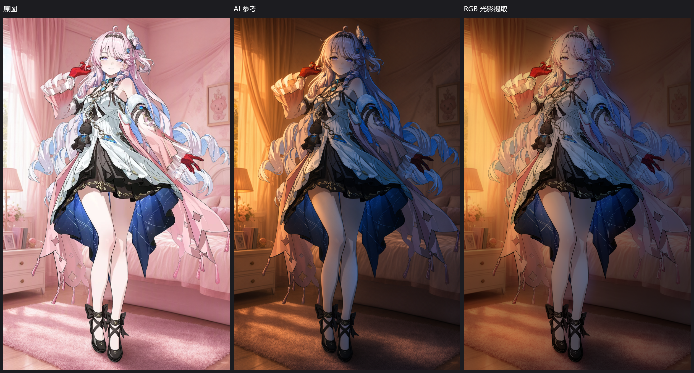</a>

This example uses warm light from the left and cool light from the right. Left: `3F3F3F.webp` combined with a previously generated room background. Center: a real Qwen-Image 2.1 reference. Right: the local lighting-layer composite over the source, at Light fidelity 1 / Detail protection 0.65. Compare the clothing lines, hair accessories and background to distinguish lighting changes from AI redraw. No extra color grading was added. This is not a Photoshop application screenshot or evidence of photographic portrait quality.

For older candidates stopped by the former similarity check, load the saved task from History to extract again without generating another image.

If opening from the main panel fails to read the source, the workbench stays closed while retaining lights and old candidates. A failed reread inside an open workbench explains why the old image is stale. A successful read clears the corresponding old error. Internal reopening after generation/application keeps that task's source; each candidate remains bound to its submitted snapshot.

The dialog briefly closes for reading or writing and then returns. Closing it does not cancel a task; use the task's Cancel button.

### 11. Image Blending

Choose **Portrait → Image Blending**.

1. Place the person or object into a background, then select that foreground subject. Do not select the whole canvas. A cutout on transparency has no environment to match.
2. Preview the range and generate directly, or add an instruction such as “Match warm window light from the left; preserve facial structure and clothing texture.”
3. Check subject lighting, color temperature, edges and style, then apply. The background is context; only the subject minus protection is edited.

Blending reads the full composite and disables subject alignment and color matching. ComfyUI omits the grayscale selection guide. Real illustration samples showed visible lighting changes; photographic portraits may still change too little. This does not provide precise lighting control or guarantee unchanged faces and texture.

  <a href="../../assets/guide/050-result-blend.png">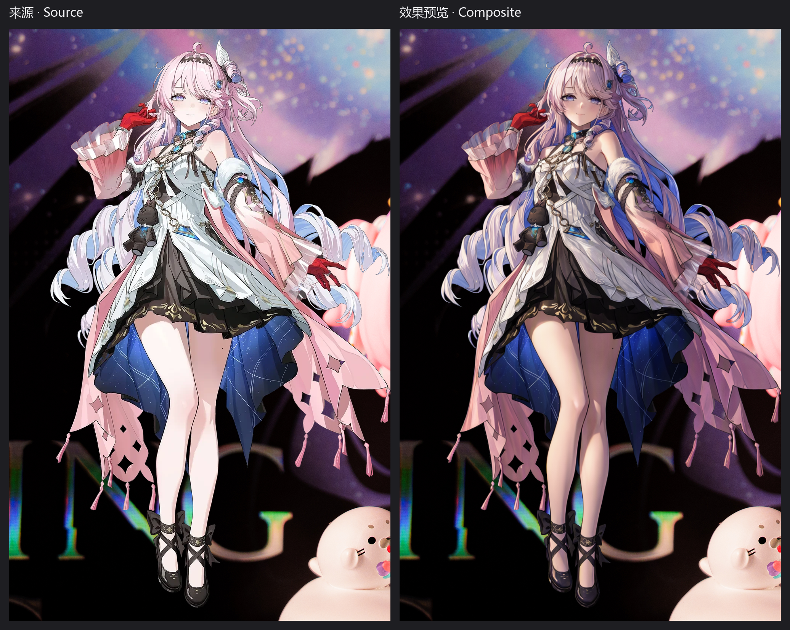</a>

Saved stage example: the subject becomes darker while the saved mask preserves the background. Check faces and clothing texture too; they can change.

View mode controls

  <a href="../../assets/guide/050-mode-blend-zh.png">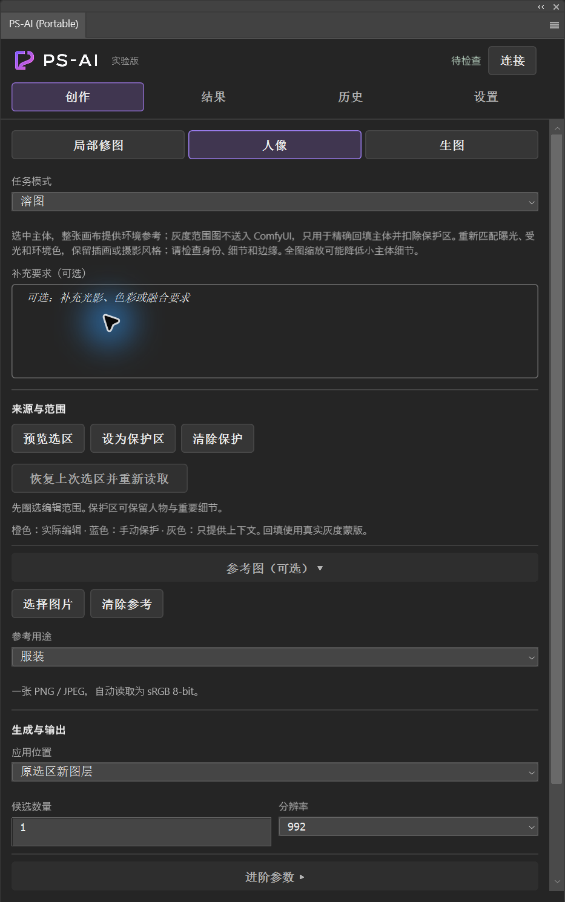</a>

## Compare, apply and export

- **Candidates:** generate 1–4 sequentially. A locked seed increments per candidate. Click thumbnails to switch; inspect details at 100%.
- **Apply:** create a masked layer first; another candidate from the same capture can replace that round's candidate layer. Lighting layers apply as a group.
- **Undo:** one Ctrl+Z reverses one application. Opacity changes have separate history entries; panel sliders do not follow native Undo in real time.
- **Export:** Save PNG saves the candidate; Open as new document creates an independent sRGB document. Exports may use working/analysis dimensions. For original-size delivery, apply to the source and save or export through Photoshop.

This candidate was loaded from History. Its source belongs to an earlier session, so it remains exportable but cannot apply directly.

  <a href="../../assets/guide/050-results-zh.png">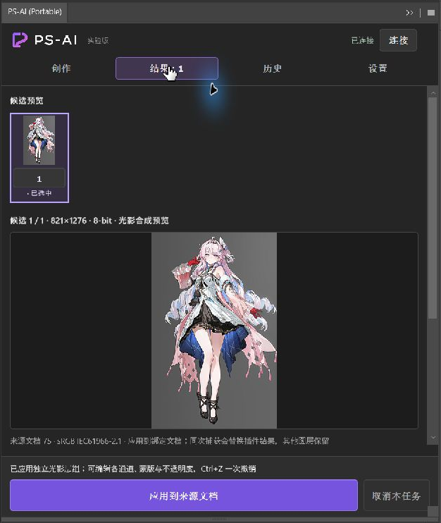</a>

Keep the source unchanged during generation. Candidates from changed, closed or previous-session sources remain exportable. **Check source** explains why a candidate cannot apply without modifying the document.

## History and task recovery

Click a record to inspect it; checkboxes independently select records for bulk clearing. Pages hold 20 records. All / Unresolved filters narrow the list, and Select all includes every page in the current filter. In a narrow panel, open details and use Back to history to return.

  <a href="../../assets/guide/050-history-zh.png">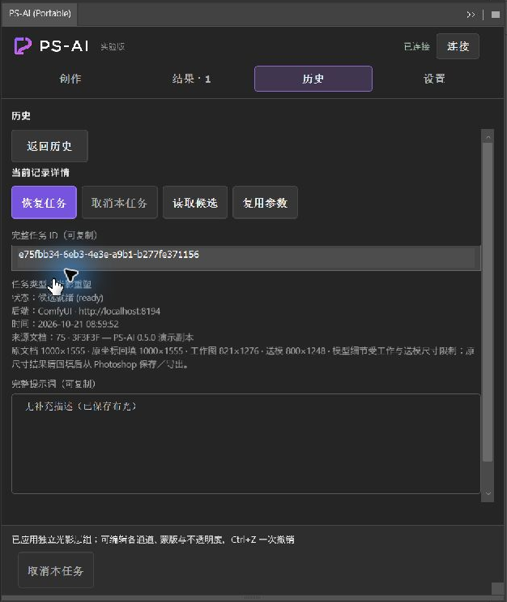</a>

- **Load candidate:** open a saved result without generating again. Application eligibility is checked against that candidate's own source.
- **Reuse parameters:** restore text and settings. Prepare selections, protection and references again.
- **Recover task:** query the original UUID at its saved backend. Switch to the original backend type and address first; avoid duplicate submissions.
- **Cancel:** during processing, cancel targets the current task and stops later candidates. A cloud request already underway may still finish and be billed.

Unresolved tasks keep a visible notice. Repeated failed queries return control while retaining the ID and unknown state; unknown does not mean remote failure. Only unknown tasks offer a two-step **Stop tracking locally** action. This does not cancel remote work or stop billing; another generation may duplicate work.

After confirmation, **Clear checked history** removes the selected local records and plugin candidate files. Photoshop documents, applied layers, exports, settings and lighting drafts remain. Clearing neither deletes backend data nor cancels tasks. Use **Retry local cleanup** if an interruption leaves cleanup pending.

## Adjust parameters

  <a href="../../assets/guide/050-advanced-zh.png">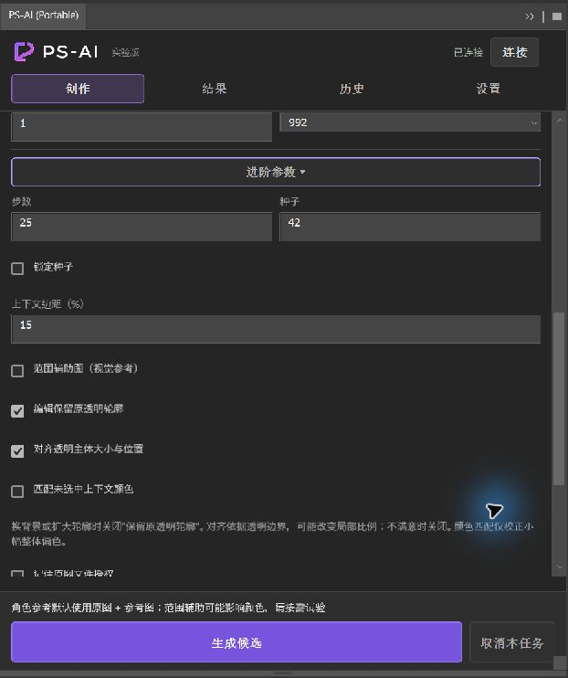</a>

- **Resolution:** common choices are 768, 992 and 1024. Edits keep the source aspect ratio; model capabilities depend on the backend.
- **Steps:** 25 by default, adjustable from 1–100. More steps do not guarantee a better image.
- **Context margin:** 15% by default; adds reference surroundings only. Background, scene and blending modes read the full canvas.
- **Selection guide:** visual guidance for the model. The Photoshop mask enforces the final range; some modes disable the guide automatically.
- **Preserve transparency:** useful for clothing and materials. Turn off when removing objects or expanding their outline.
- **Subject alignment:** adjusts size and position using alpha bounds; it can change proportions.
- **Color matching:** corrects small overall shifts; it should not counteract intentional relighting or blending.

## Color and bit depth

Sources must be RGB/Grayscale 8/16-bit with a known color space. An existing document ICC takes priority. For an untagged static WebP or explicitly sRGB PNG, authorizing inspection of the original file can allow a layered sRGB working copy. If color cannot be established, assign the correct profile on a copy rather than guessing sRGB.

If repeated Undo removes a working copy's color tag, the current session may offer **Create recovered color copy and reread** when its records prove the original assignment. This creates a new copy, preserving the old document and its redo history. Old candidates gain no permission to apply to the new source. If recovery is unavailable, check the copy's color manually.

Model inputs and references use sRGB8. ComfyUI can optionally save SDR16 with the [dedicated node](../setup/COMFYUI.en.md#output-depth); platforms currently output sRGB8. A 16-bit source or file does not mean native 16-bit model precision or HDR. Applying to an 8-bit document quantizes to 8-bit without converting the source document.

## Troubleshooting

- **No selection or fully protected area:** select again and remove unwanted protection. Relighting also offers Entire image.
- **Old image in the workbench:** choose Re-read current document and check whether it succeeds. Reopening during generation shows that task's frozen source.
- **Lighting extraction stops:** compare the saved AI reference with the source. Export the reference or explicitly choose Full-image redraw; no task is automatically resubmitted.
- **Transparent or black background:** select the subject to keep and describe a concrete scene. Switching modes does not regenerate old candidates.
- **Unsafe translucent multilayer source:** merge visible layers on a copy and generate again, or export for manual composition.
- **Source changed; application blocked:** keep or export the old candidate, reread the current image and start a new task.
- **Connection, model or depth error:** check [ComfyUI setup](../setup/COMFYUI.en.md) and expand Technical details.
- **Error remains after success:** a successful retry clears its corresponding old error; unrelated errors and failed historical records remain.
- **Photoshop exits:** save work and record reproduction steps and logs. Changing installation type does not guarantee a host-crash fix.

The document limit is 45 million pixels and 30,000 pixels per side, not the model's native output size. CMYK, Lab, Indexed, Multichannel and 32-bit HDR are unsupported. Inspect character references, lighting layers, blending and assets individually. Cloud generation with real keys remains untested.

**Settings → Host diagnostics → Image round-trip verification** checks selection, masks, undo and rollback in test documents and can save a report. Review images, prompts and paths before sharing. See the [backend contract](../development/BACKEND.en.md) and [relighting implementation](../development/RELIGHT.en.md) for technical behavior and validation scope.
