

<h1 align="center">PS-AI User Guide</h1>

<a href="USER_GUIDE.md">简体中文</a> · <strong>English</strong> · <a href="../README.en.md">Home</a>

Start with a small edit: **connect → read the range → describe and generate → inspect and apply**. [Install the plugin](../README.en.md#install-a-release-package), then [configure ComfyUI from zero](../setup/COMFYUI.en.md#beginner) for a local backend, or connect a [cloud service](../setup/PLATFORMS.en.md).

> This guide covers **0.7.0 stable**, including eight-mode navigation and 12 Portrait/Landscape prompt presets. The user authorized publication on 2026-11-04. The new layout and presets have offline validation; installed-panel operation and photographic quality remain unverified. Earlier native API/model evidence retains its recorded scope. Check the version/build identity; historical screenshots and outputs retain their original captions.

Create, Settings and Results are native PS27 screenshots captured during release preparation under a separate Preview demonstration identity: source preview, read-only model scanning and existing historical candidate loading were performed, without new generation. The Relighting interface screenshot remains historical 0.5.0. Screenshots use the Chinese interface.

Local models fill three roles: diffusion model, vision/text encoder and VAE, without fixed filenames or authors. The 0.6.0 source selects GGUF or native Safetensors loading by extension, restricted to compatible Qwen 2.1 architecture and the fixed sampling chain. Native loading needs no GGUF extension package. One INT8 combination has real inference, PNG and small RGB8/16 Photoshop API evidence; see the [tested example and limits](../setup/COMFYUI.en.md#native-tested). The read-only route label follows the selected filename. **Nodes checked** means node/file-name checks passed and still warns that the selected weights are unverified. Scanning/connecting neither inspects weight internals nor generates automatically.

## Make your first edit

1. **Connect an existing service.** Start ComfyUI, enter its address in **Settings → Backend and models**, scan models and connect. Scanning retains available choices and fills only unique preset matches; choose other files manually. The [configuration tools](../setup/COMFYUI.en.md#environment-tools) can also prepare importable settings from a running service, without reinstalling or downloading models.
2. **Prepare the range.** Open a saved copy, choose **Local edit → Objects and materials**, select a small area and use **Preview selection**. **Orange is editable, blue is protected, gray is context.**
3. **Describe the change.** Try “make the metal ornament matte silver, preserving its shape.” Review the candidate count, resolution, depth and destination summary; expand **Generate and output** when needed.
4. **Generate and inspect.** Use **Generate candidates** at the bottom. Keep the source unchanged; inspect edges, color, faces and text in Results, then apply as a new layer or save a PNG. One Ctrl+Z reverses one application.

<a href="../../assets/guide/workflow-create-zh.png">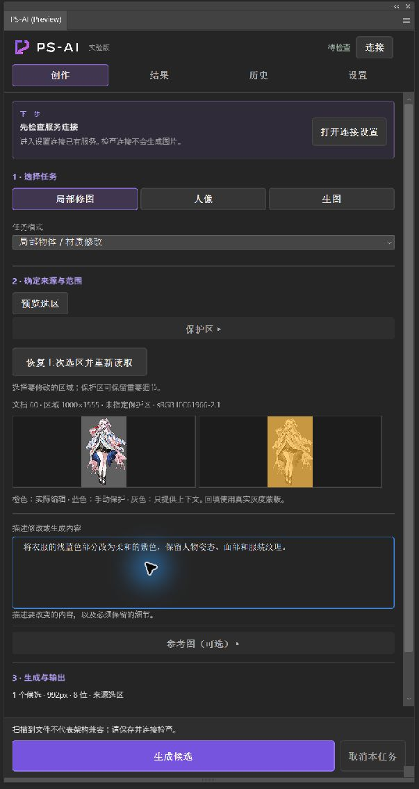</a>

**Next step** offers an action based on connection, source and input state; navigation does not submit generation. Expand protection, references and settings as needed. Switching Create / Results / History / Settings preserves drafts and running tasks. Opening the panel does not start a backend or generate.

Connection settings and practical defaults

<a href="../../assets/guide/workflow-settings-zh.png">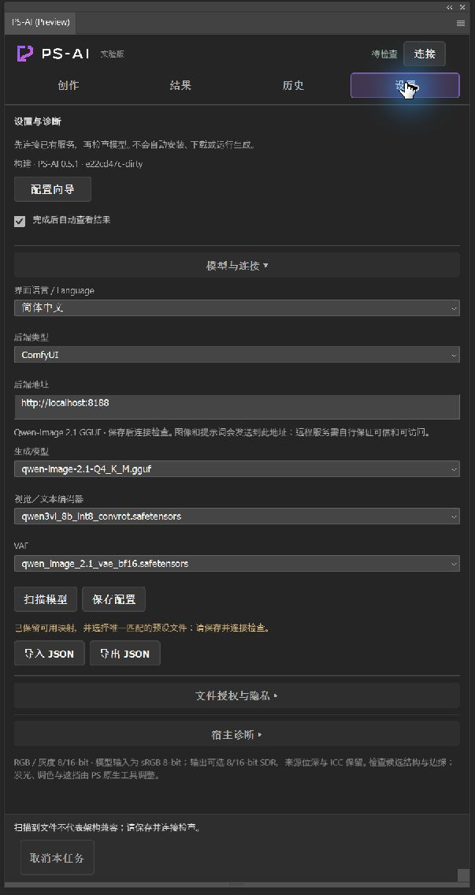</a>

| Setting | Suggestion |
| --- | --- |
| Candidates | 1–4 per batch, generated sequentially; a locked seed increments per candidate |
| Resolution / steps | Common choices are 768, 992 and 1024; default 25 steps, more is not necessarily better |
| Context margin | Default 15%, adding reference context only; background, scene and Blend read the full canvas |
| Edge blend (native pixels) | Local edits, costume repair and character references: automatic width by default; manual 0–1024, 0 disables |
| Range guide | A visual hint; Photoshop masks enforce the actual boundary. Some modes disable it |
| Preserve source transparency | Useful for clothing/material edits; disable when intentionally extending or removing silhouettes |
| Alignment / color matching | Use where appropriate; do not cancel deliberate lighting changes with color matching |

Settings JSON transfers addresses, model mappings and language, without keys, model files or image history. CCX and Portable have separate data. Follow [platform setup](../setup/PLATFORMS.en.md) for cloud keys; do not send them to arbitrary imported addresses.

## Choose a mode and selection

**0.7.0 layout:** Photo editing, Lighting & assets and Generate contain 8 modes. Replace scene is merged into Replace background; Clothing and props is replaced by local-edit presets. Character reference moves to Photo editing. Old History remains readable/applicable under its saved guards; parameter reuse opens the corresponding shared mode. Older packages and historical screenshots may still show the old layout.

| Workspace / mode | What to select and describe |
| --- | --- |
| Photo editing · Objects and materials | Select objects, clothing or props; describe material, color and shapes to retain, or use a clothing preset |
| Photo editing · Remove objects | Select the distraction with some surroundings; a built-in instruction replaces the prompt field |
| Photo editing · Replace background | **Select the subject to keep; do not invert.** Describe the new scene, ground and lighting |
| Photo editing · Character reference | Select the edit area, import a reference and name the features to borrow; identity is not guaranteed |
| Lighting & assets · AI assets | Select the reference subject, then choose placement; Objects and particles / Lighting and atmosphere share one entry, with text-only generation also available |
| Generate · Text to image | Describe subject, setting, composition and style; no references, usually no selection |
| Lighting & assets · [Relighting](#relight) | Current selection, or explicitly choose Entire image, then arrange lights |
| Lighting & assets · [Image Blending](#blend) | Select the foreground already placed in a visible environment |

### Portrait and landscape presets

Choose a category and preset under Photo presets, then preview its selection guidance and full prompt. Only **Use preset** switches tasks and replaces the prompt. Edit it as needed, preview the selection and generate. Browsing presets or changing UI language never rewrites the existing prompt; explicit use inserts the current language. Removal uses its built-in instruction and retains your prompt draft.

| Category | Presets | Existing operation |
| --- | --- | --- |
| Portrait | Clothing repair, clothing color (navy blue by default), prop surface repair | Objects and materials |
| Portrait | Soft gray studio background, soft outdoor background | Replace background; select the person to retain |
| Portrait | Match portrait to environment | Image Blending; place the person and background in Photoshop first |
| Landscape | Clear blue sky, sunset sky, distant mountain mist, autumn foliage, water reflection cleanup | Objects and materials; select the relevant area |
| Landscape | Remove distractions | Built-in removal instruction |

Presets do not create selections, read pixels or submit generation. They retain protection, references, candidate count, model, depth and edge settings; check these before generating. Sky presets edit the selected region without automatically relighting the whole image. Ordinary outward blending can still cover pixels beyond the selection: use protection or disable edge blending for precise ridgeline/building preservation. No skin smoothing, face reshaping or identity-lock algorithm is added. Presets are editable starting points; offline tests do not establish photographic quality or installed-panel acceptance.

To protect faces or text, select them and use **Set protection**, then select the edit area (the reference subject for default AI assets). Protection is subtracted with feathers retained. Ordinary editing context does not enlarge the apply boundary. After changing documents, prepare a new selection; history can restore its own range in the original document during the same plugin session.

**Edge blending in 0.7.0 (0.6.1 packages retain the older local-edit-only behavior):** local object/material editing, costume/prop repair and character reference editing share an outward gradient mask. Automatic width uses 15% of the shorter native selection side, clamped to 8–512 px. Disable automatic width to set 0–1024 px manually; 0 disables blending. Inspect the orange transition in the range preview before generating. Selection interiors retain their coverage, protection is subtracted last, and the Photoshop selection stays unchanged. The fade softens boundaries but cannot remove a color cast throughout the result; “Match unselected context colors” remains a separate preference. Blend lighting/redraw, relighting, backgrounds and assets do not use it. New tasks save the resolved width and versioned raw/effective/protection planes; old history keeps its exact saved formula. Parameter reuse restores its saved radius, or 0 for markerless tasks, with automatic width off.

If Undo loses your selection, **Restore last selection and reread** restores the saved range for this document and mode within the same session, then reads current pixels. It does not submit a task or restore old candidates' apply permission.

**Background / scene:** reads the full canvas and disables source-alpha retention, alignment and color matching; ComfyUI also disables the range guide. Inspect hair, translucent edges and ground contact. Clearly transparent backgrounds are export-only. Old tasks retain their saved ranges.

### Place butterflies around a person, not only inside them

Current source uses **Lighting & assets → AI assets** (Portrait in published 0.6.0 / 0.6.1 packages). **Objects and particles** suits butterflies, petals and arcs; **Lighting and atmosphere** suits haze and smoke. These are prompt presets, not separate models.

1. Select the person in Photoshop and keep **Reference subject · independent placement**.
2. Choose a **Rectangle around the subject**, adjust expansion (50% by default), or explicitly choose **Full canvas**. A second arbitrary hand-drawn placement region is not supported in this increment.
3. **Foreground overlay** allows assets inside and outside the subject. **Subject occludes** excludes the subject from the asset mask; it does not move the asset underneath the source layer. Front/back interleaving requires separate generations or manual layers, not automatic 3D wrapping.
4. **Read subject and preview placement**. Inspect source, subject and placement from left to right. Only white in the last guide permits placement; protection is also excluded.
5. Describe, for example, “several glowing blue butterflies around the shoulders and head, varying in size.” Inspect **Asset only**, then **Composite preview**. Do not apply a result retaining people, backgrounds or guide marks.
6. Apply as an independent layer with an editable mask; source layers are neither redrawn nor replaced. Output alpha is retained and placement is applied once. Fully opaque results remain exportable but cannot apply.

Composite preview uses the saved source, shows only the captured region and is bounded to 1280px; it is not native full-resolution acceptance. PNG export / New document still contains the **raw asset**, without the source or baked placement mask. Imported character references are unused. New document does not imply text-only. Explicit **Reference current image and selection** retains old inside-selection placement; old History never expands automatically. **Text-only independent asset** reads no current pixels.

The subject path sends 3 images and requires an explicit platform capability. An old relay or unsupported model rejects before upload, without silent fallback; update the bundled relay with the plugin. ComfyUI, Bailian Qwen 2.1 and OpenAI Images request paths have offline coverage. Gemini does not support this transparent-asset path.

Older two-image Qwen samples retained people, backgrounds or guide boundaries and **failed visual acceptance**. The new three-image subject path corrects input, placement and application logic; real-model quality and installed-panel acceptance remain pending. It cannot guarantee clean isolated butterflies. Transparency alone is not proof of isolation; the plugin does not automatically matte, subtract the source or resubmit. Gallery assets remain text-only outputs positioned manually, not evidence for this path. Existing screenshots do not show the new asset controls.

## Relight an image

1. Choose **Lighting & assets → Relighting** (Portrait in older builds), then Current selection or Entire image. Include the ground if you want shadows there.
2. Open the workbench and check the current composite. After changing the background/document, use **Reread current document**; edited lights remain. Add a background beneath cutouts in a copy so the editable area is opaque.
3. Add, move and adjust up to eight lights; duplicate, disable or lock them. The local illustration expresses intent. Dragging, workbench Undo and hiding markers do not generate images.
4. Explicitly use **Generate AI result**, inspect, then apply or export. Changing lights after generation marks the old result as outdated.

<a href="../../assets/guide/050-relight-zh.png">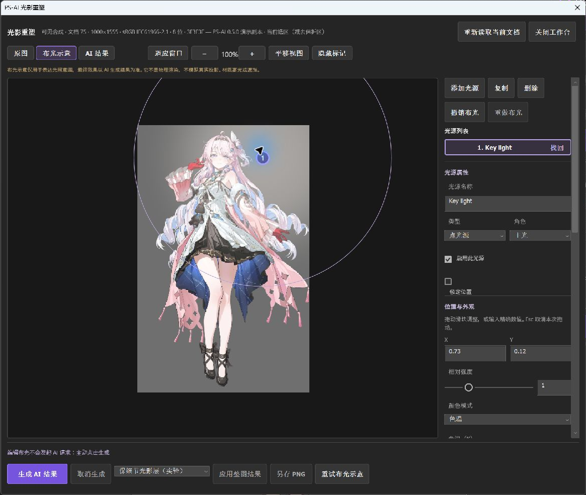</a>

| Output / control | Use |
| --- | --- |
| Lighting layers (default) | Estimate lighting from the AI reference, overlay the original, and apply a masked pass-through group without copying the base |
| Full-image redraw | Use the model image; structure and texture may change. Applies as a masked layer |
| Light fidelity | 0–1, default 1; lower to weaken the effect, 0 returns to the original |
| Detail protection | 0–1, default 0.65; higher reduces fine changes and softens local shadows |

Releasing a slider or confirming a value recalculates locally and saves with the candidate, **without generating again**. Group opacity is also adjustable. Changing the underlying content or position can make saved lighting unsuitable.

The current source supports lighting on tagged RGB8/16 originals with opaque editable coverage. Non-sRGB sources must pass actual ICC extraction and conversion checks. Lighting is calculated and applied in the original document's color space, preserving its source layers and profile. Older non-sRGB history tasks lack the required native color data and need a fresh capture and generation. Explicit AI redraw keeps its existing path; to change a non-sRGB redraw task to a lighting group, select lighting and capture/generate again. Grayscale, CMYK, Lab, 32-bit HDR and unverifiable ICC profiles remain unsupported for lighting groups.

Model input remains sRGB8, with gamut and precision loss. The original remains the content base, but lighting and redraw cannot be fully separated: large offsets can leave patches, while hard shadows and narrow rim lights can weaken. Export the raw AI reference separately if needed; the plugin does not switch to redraw automatically. Synthetic Photoshop 27 API checks passed sRGB, Adobe RGB, ProPhoto RGB and the installed image P3 profile at 8/16 bits, including application and undo; installed-panel operation, real inference and photographic quality still require separate acceptance. The published 0.6.1 retains its version-specific limits.

Read failures retain lights and old candidates but cannot authorize a new task with stale pixels. Reopening during a task shows its bound source. The workbench may briefly close during reads/writes; closing it does not cancel work. Use the task cancellation button.

## Match a subject to its environment

1. Place the subject in a background, then select the foreground. Do not select the whole canvas; an isolated transparent cutout has no environment to match.
2. Read the current image and range, set protection if needed, describe something like “match warm window light from the left,” then generate.
3. Compare source, blend preview and AI reference. Inspect the subject, edges and detail before applying. The background is context; application changes only the subject minus protection.

New tasks in 0.5.2 default to **Preserve detail · lighting only**, applying a lighting group without a base-image copy. Adjust fidelity/detail locally without resubmission, or explicitly choose **AI redraw subject**. Old history retains its original method. Lighting has the same source requirements as Relighting, with no automatic fallback.

Blend reads the full composite and disables alignment and context color matching; ComfyUI omits the grayscale guide. Weak AI lighting cannot be amplified into nonexistent light by extraction. Photographic results can be subtle, and patches/shadows need inspection. The gallery's old Blend example uses **AI redraw**, not the new lighting extraction.

Before reading a large Blend source, the plugin budgets the source, native masks, candidate and retained previews, reducing the **analysis raster** when needed. The original document, native masks and requested generation resolution stay unchanged. The source caption lists each size; lower analysis resolution can smooth fine lighting. History and local lighting reprocessing use the saved analysis grid. The three editing modes with edge blending also budget candidate validation before capture and use a bounded working raster with native strip application when needed. The 512 MB plugin working budget and document limits remain: extreme resolution/depth combinations or excessive retained buffers can still reject before upload; lower generation resolution to retry. This estimate is not total Photoshop memory or VRAM usage, and does not expand lighting color-space support.

Real outputs and limitations for all eleven modes

These use the designated `3F3F3F.webp` image and its edited copies. Local edits are composited with saved selections; gray shows transparency. These are actual generated files and local composite previews, **not Photoshop apply screenshots**. Click for full size.

**Objects and materials:** “change this doll into a black-cat doll,” shown as a waist crop.

<a href="../../assets/guide/050-result-edit.png">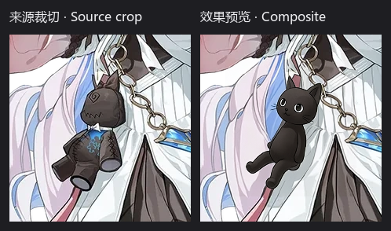</a>

**Removal:** fills the doll's area; seams and clothing linework still need inspection.

<a href="../../assets/guide/050-result-remove.png">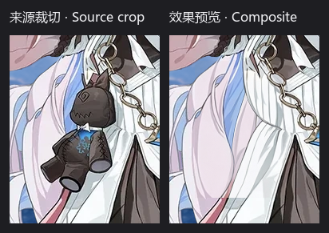</a>

**Background:** retains the subject in a pale-blue studio with contact shadows.

<a href="../../assets/guide/050-result-background.png">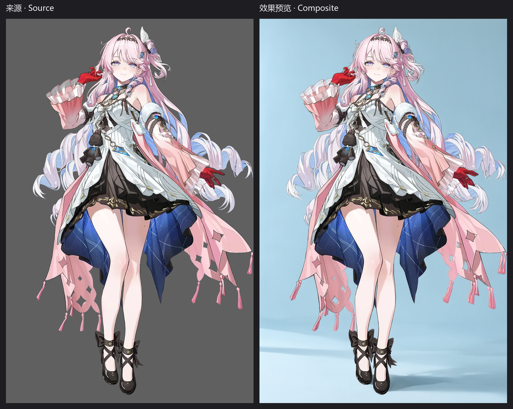</a>

**Clothing:** white over-knee socks, shown as a leg crop.

<a href="../../assets/guide/050-result-costume.png">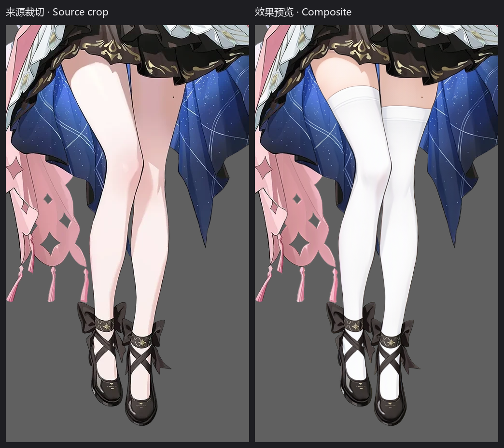</a>

**Character reference · failure:** source / reference / composite; shrinking, misalignment and seams make this unsuitable.

<a href="../../assets/guide/050-result-reference.png">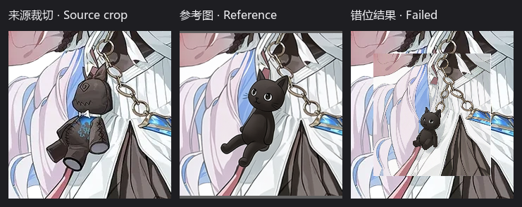</a>

**Scene:** the subject in a pink bedroom.

<a href="../../assets/guide/050-result-scene.png">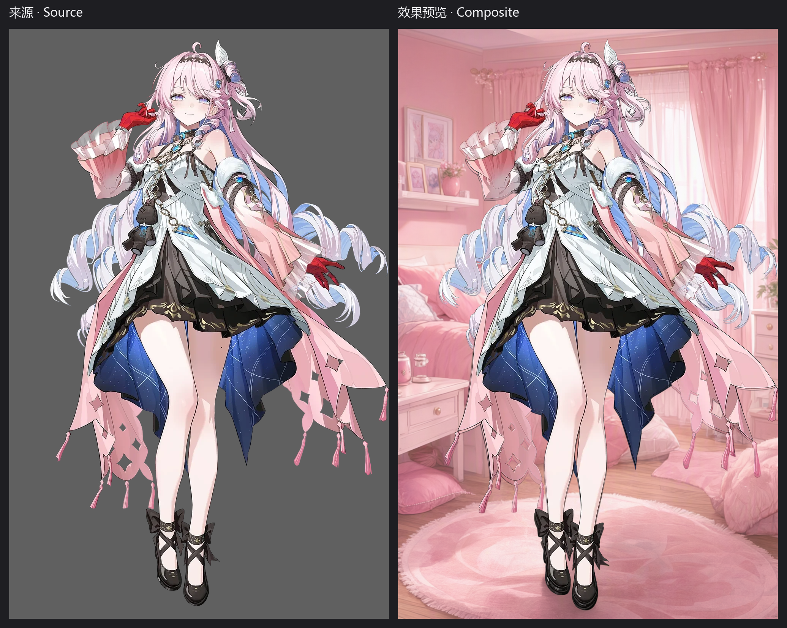</a>

**Effect · text-only manual composition:** source / blue lightning asset / manually scaled and positioned preview.

<a href="../../assets/guide/050-result-effect.png">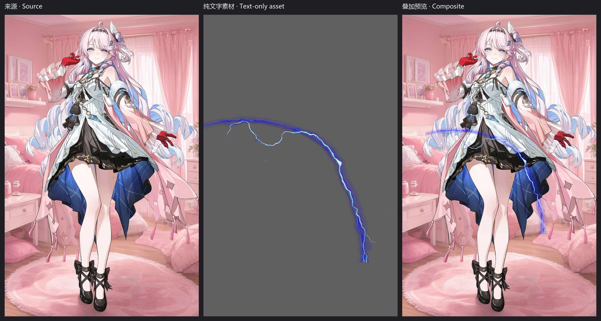</a>

**Atmosphere · text-only manual composition:** source / golden particles / proportionally scaled, cropped overlay.

<a href="../../assets/guide/050-result-atmosphere.png">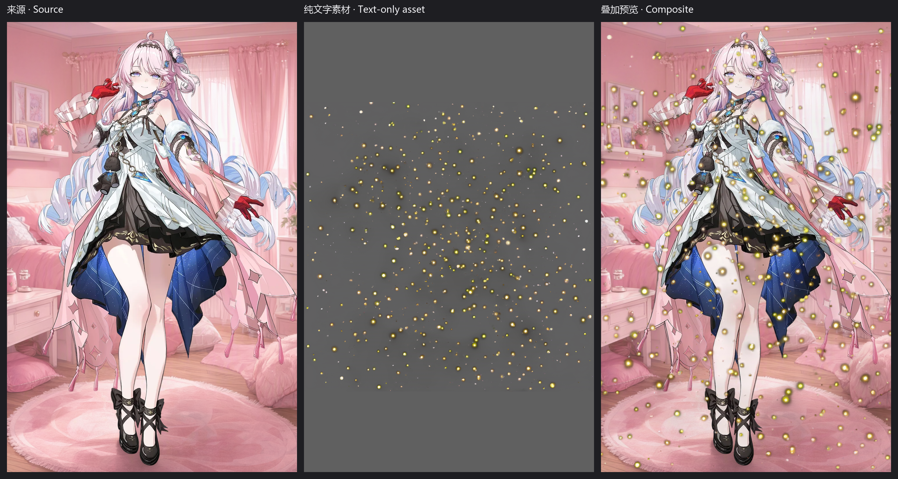</a>

**Text to image:** an independent pink bedroom, without reading or editing the character image.

<a href="../../assets/guide/050-result-generate.png">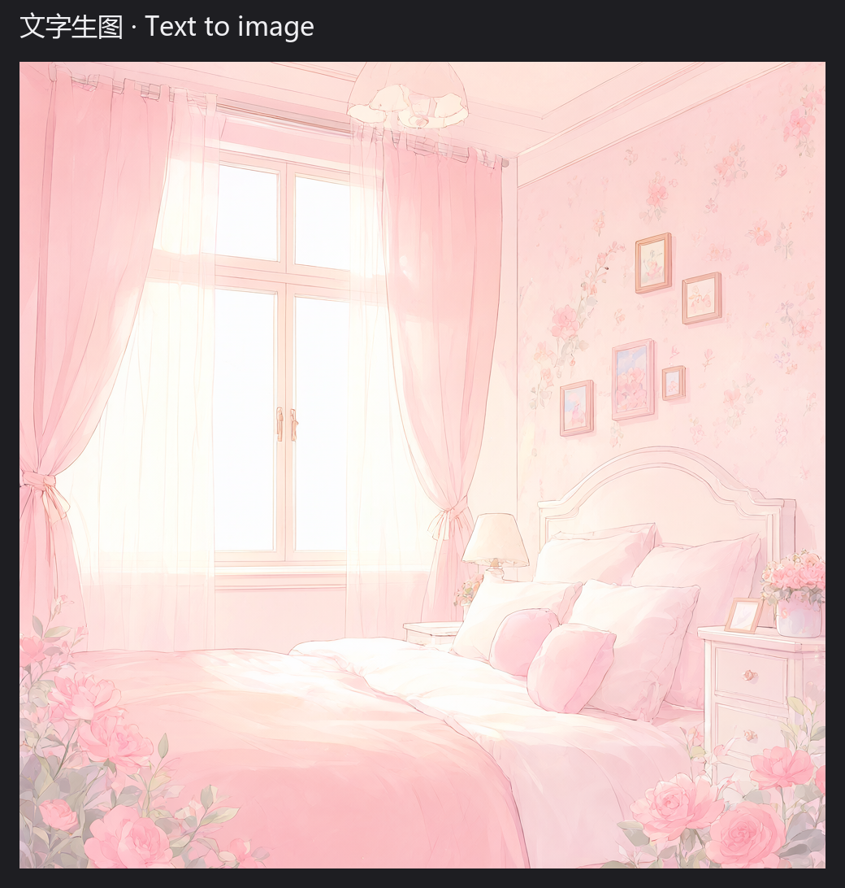</a>

**Relighting:** source / real AI reference / local lighting preview, warm left and cool right. Source combines the character and generated room; fidelity 1, detail protection 0.65. No additional grading; this does not establish photographic results.

<a href="../../assets/guide/050-result-relight.png">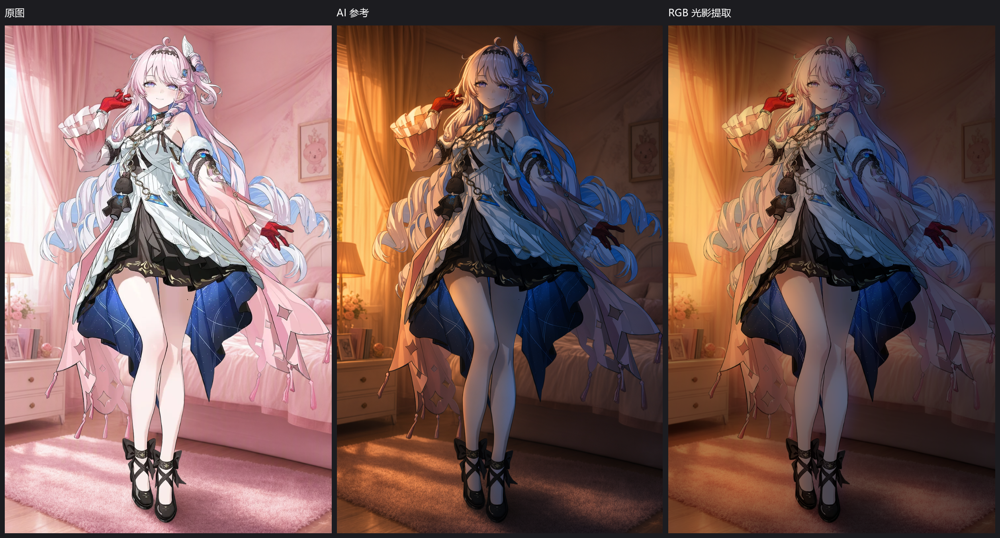</a>

**Blend · legacy AI redraw:** the subject becomes darker in a stage environment, with the saved range retaining the background; face and clothing details also change.

<a href="../../assets/guide/050-result-blend.png">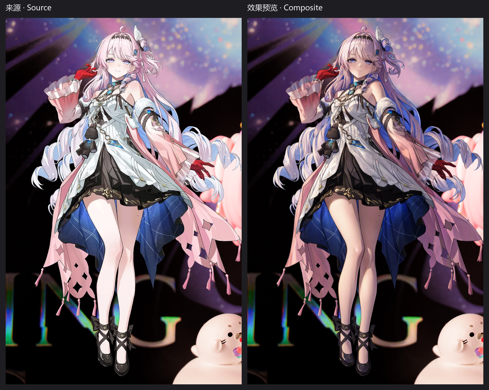</a>

## Compare, apply and export

Select thumbnails in Results and use **100% view** to inspect details. Applying creates a masked layer while retaining originals; within the same capture you can replace that round's candidate layer. Lighting output uses a group. One Undo reverses one application; opacity changes add separate history, and panel sliders do not synchronize after Photoshop Undo.

<a href="../../assets/guide/workflow-results-zh.png">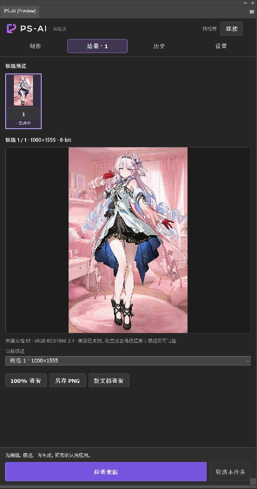</a>

This screenshot loads an existing real scene candidate in the branch's final runtime. Its source is closed or its session has ended, so only export actions are offered. No remote recovery, generation or layer application occurred, and the old candidate's source permissions were not changed.

**Save PNG** and **View in new document** remain available for export. Working/analysis rasters can be smaller than the original; apply and save through Photoshop for original-size delivery. Do not modify the source during generation. Changed, closed or previous-session sources cannot receive old candidates; export remains available, and **Check source** explains the block.

## History, disconnections and cancellation

| Action | What happens |
| --- | --- |
| Click / check records | Click for details, check for bulk clearing; 20 per page, Select all covers every page in the current filter |
| Load candidates | Read local results without generation; the original source still determines apply permission |
| Restore this saved selection | Restore that record's raw selection and protection in its original document during this plugin session; keep current parameters |
| Reuse parameters and selection | Restore descriptions/settings and the saved range, then read current pixels; inspect the preview and select reference images again before generating |
| Recover task | Switch to its saved backend type/address, then query the original UUID without resubmission |
| Cancel | Cancel the current task and stop later candidates; started cloud requests may still complete and be billed |
| Clear checked history | Confirm deletion of local records/plugin candidate files; Photoshop documents, layers, exports, settings and lighting drafts remain |

Unresolved tasks stay visible. Repeated failed status reads retain unknown state and the original ID for later recovery; unknown does not mean remote failure. Only unknown tasks allow a second confirmation to **Stop local tracking**. This does not cancel remote work or billing; generating again can duplicate it. Clearing history also does not cancel or clear the backend. Retry interrupted local cleanup with **Retry local cleanup**.

**History range reuse in 0.7.0 (not included in published 0.6.1 packages):** new captured tasks save their own native selection, feathers and protection. Browsing history does not restore anything. Whole-image relighting keeps its full-canvas scope without creating a Photoshop selection. Old records without a verifiable raw selection remain usable for parameters and export; another document or plugin session requires a new selection. Clearing a record also clears its saved planes.

If cancelling or changing the selection leaves an old candidate showing **Check source**, click it to compare the entire document against the surviving Photoshop history baseline, at native depth and ICC. When the check passes, click Apply again; the candidate uses its saved effective mask, regardless of the current selection. Actual pixel changes, missing history, a closed/reopened source or a new plugin session keep application blocked. Reuse the range to generate again where available, or export the old candidate. No automatic history rewind or inference occurs. This path passed Photoshop 27 API checks with owned sRGB8, ProPhoto RGB16 and transparent fixtures, including feathers, protection, owned-layer replacement and single Undo; installed-panel and photographic quality acceptance remain separate.

## Color, depth and originals

**Photoshop's current document ICC** takes priority, including opening-policy conversions; an imported layer's file cannot establish the whole composite's color. Reading the document never opens another original-file picker. Exact authorized files can provide verified declarations; otherwise unresolved untagged RGB8/16 uses an independent sRGB copy retaining layers, depth and range, with the original preserved.

**Assumed sRGB** means an approximation with possible color differences, not recovered ICC. Its notice survives same-session rereads and saved candidates; apply binds only to that copy. References still require current ICC or a reliable declaration from the exact selected file by default.

**Reference fix in current source (not included in published 0.6.1 packages):** For untagged RGB8/16 references, enable “Assume sRGB for this import if the reference has no usable profile” before choosing the file. This interprets color only in a temporary duplicate and preserves the original file and any open original document. Usable current ICC and reliable declarations keep priority. The option resets for every picker action, including cancellation or failure. When approximation is actually used, its notice appears beside the reference and in generated Results and saved History. Reusing history parameters does not restore consent. For accurate color, verify and embed the correct ICC in a copy before importing; the approximation does not establish the original color space.

If repeated Undo removes a known working copy's tag, only exact session-proven sources offer **Create recovered-color copy and reread**. This preserves the old document and redo history, creating a new source without granting old candidates new apply permission. Otherwise check color manually. Legacy file grants live in **Settings → File access and privacy**, outside routine reading.

Model/reference inputs are sRGB8, losing wide-gamut color and precision. [Optional SDR16](../setup/COMFYUI.en.md#output-depth) is not native 16-bit generation or HDR; platforms currently output sRGB8. Applying to an 8-bit document reduces output to 8-bit without converting the original automatically.

## Troubleshooting

| Situation | Next step |
| --- | --- |
| Missing selection / fully protected | Reselect or clear protection; Relighting can explicitly use Entire image |
| Old source in workbench | Reread and check success; reopening during a task retains its original source |
| Unsafe translucent multilayer application | Merge visible layers in a copy and regenerate, or export and compose manually |
| Source changed, apply blocked | Export old candidates; read the current image for a new task |
| Connection, model or depth errors | Expand technical details and follow [ComfyUI setup](../setup/COMFYUI.en.md) |
| Photoshop exits | Save work and record reproduction steps/redacted errors; changing installation formats may not resolve it |

Documents are limited to 45 million pixels and 30,000 per side. CMYK, Lab, Indexed, Multichannel, 32-bit HDR and unknown-profile Grayscale are unsupported. Inspect references, lighting, blending and assets individually; real cloud-key output remains unvalidated. See [the homepage](../README.en.md#before-you-use-it) for licensing and data handling.

**Settings → Host diagnostics → Image round-trip validation** writes to test documents to check selections, masks, Undo and rollback. Save work first; inspect privacy before sharing reports. Technical boundaries are in the [backend contract](../development/BACKEND.en.md) and [relighting implementation](../development/RELIGHT.en.md).

In the current source, an error report has a **Dismiss error** button. Dismissal hides only that report, without deleting tasks/history or cancelling work. A successful matching retry removes the resolved report; unrelated operations and older asynchronous completions cannot clear a newer error. Cancelling the reference picker is not a successful import.
