

<h1 align="center">Using PS-AI</h1>

<a href="USER_GUIDE.md">简体中文</a> · <strong>English</strong>

This walkthrough tests all nine modes on separate copies of **3F3F3F.webp**. Screenshots show the actual Portable panel in Windows Photoshop 27.0. Results were exported from Photoshop composites. Click an image for its original PNG; panel captures retain their native 541-pixel width, without enlargement or reconstructed UI.

**For version 0.4.0 (experimental).** Version 0.3.0 lacks guided setup, range previews and optional 16-bit output. See [installation](../README.en.md#install-a-release-package) and [ComfyUI setup](../setup/COMFYUI.en.md).

The screenshots and nine-mode acceptance use ComfyUI. See [Bailian](../providers/BAILIAN.en.md), [Gemini / Nano Banana](../providers/GEMINI.en.md) and [OpenAI Images](../providers/OPENAI.en.md) for platform setup and limits; their live results and host behavior are not validated by these examples.

The development build renames **COSPLAY** to **Portrait** and adds Relighting and Image Blending, for eleven modes. Remove objects needs no prompt; background and scene replacement start from a subject selection. The nine illustrated examples remain v0.4.0 evidence and do not validate the new controls or effects. For backend choices and keys, see [platform setup](../setup/PLATFORMS.en.md).

## Development build navigation

The development build groups the former long page into the areas below. Navigation only changes what is visible: the mode, prompt, reference, parameters, task and candidates remain intact. Generation, application and recovery still require an explicit action.

| Area | Contents |
| --- | --- |
| Create | Local edit / Portrait / Generate, task mode, description, selection and protection, reference, destination, generation parameters and output depth. Professional controls remain under Advanced parameters. |
| Results | Numbered candidates, a larger display preview, source and application availability, View at 100%, Save PNG, Open in new document and applied-layer opacity. |
| History | Saved records, Load candidate, Reuse parameters and recovery. Reusing lighting still requires an explicit binding to the current source. |
| Settings | Backend and models, language, API keys, configuration import / export, setup wizard and host diagnostics. |

The bottom area presents the current action and task status; switching pages does not stop work. Apply continues to distinguish a new layer from replacement of this capture's candidate layer. Stale sources or unsafe candidates retain the export path. Error messages explain the impact and next step, with expandable technical details.

Open the separate lighting workbench from Create → Portrait → Relighting. Its toolbar, light list and property groups share the panel's visual style. Original, Lighting illustration and AI result remain separate views. Hide markers only affects visibility; Enable this light determines whether a light participates in the lighting setup.

Display previews are separate from candidate and export pixels. The layout and preview changes retain modes, defaults, scene formats, layer behavior and undo semantics. The v0.4.0 screenshots below still show the old panel; installed-panel docking, system scaling and the full host workflow require separate acceptance for the new layout.

## Connect and make a copy

1. Start ComfyUI and confirm its address opens in a browser.
2. Open PS-AI from Photoshop's Plugins menu. The Portable entry is **PS-AI (Portable)**.
3. Expand Backend and models (open Settings first in the development build). Enter an origin such as `http://localhost:8188`. Custom hosts and ports are supported; omit credentials, paths and query parameters.
4. Scan models, select the matching Qwen 2.1 diffusion model, vision / text encoder and VAE, then Save settings and Connect. Other architectures cannot be used by renaming files.
5. The first-time wizard can test the address, check the environment and run a generation example. The last step generates and applies in its own test document.
6. Open the sample and save a PSD copy. Start each example from a fresh copy.

Language and output depth save on change; use Save settings for the address and models. Export / import JSON to move settings, without model weights or image history. CCX and Portable keep separate data.

Use a source with the correct ICC profile. Tagged RGB / Grayscale 8/16-bit is supported; untagged sources are blocked. Prepare RGB copies of CMYK, Lab, Indexed, Bitmap, Multichannel and 32-bit HDR files. The source WebP is 8-bit; test copies were converted to **RGB / 16-bit, sRGB IEC61966-2.1**. Conversion does not restore missing detail.

**Saved source color in the development build:** an existing document ICC, including Adobe RGB, keeps its current interpretation and needs no original-file picker. An untagged RGB image with a bound original file needs authorization to read that exact file. Choose the original being edited, such as `3F3F3F.webp`, when prompted. The plugin checks its path, dimensions and depth, then reads color declarations: static WebP without ICC uses the format's sRGB default; PNG needs an explicit sRGB chunk. Successful resolution opens an unmerged, tagged sRGB working copy. The preview states the rule used, and generation and Apply as new layer target that copy. The original is untouched and unsaved layers are retained. Untagged edits also receive the original-file color interpretation; check their appearance if they were edited under a different working space. Saved protection coordinates carry over; continue selecting and generating in the working copy.

Authorized file entries are reused for the current plugin session. **Advanced parameters → Remember original-file access** is off by default. Enable it to save up to 32 exact-file access tokens in private plugin storage; enabling it also remembers files already authorized in this session when supported. These grants and the preference are excluded from portable settings, task history and diagnostic exports. They contain no cached pixels or color conclusions: every use reads bounded current bytes and inspects their declarations again. A replaced file cannot reuse an earlier sRGB conclusion. Revoked, moved or unreadable access can open one replacement picker; select the original again. Missing host token APIs or unavailable private storage do not prevent the current authorized read. Check the access status for recovery instructions.

Disabling remembering removes saved grants while retaining session access. **Clear original-file access** also drops session entries; later reads may need the picker again. If private storage cannot be updated, the panel reports that removal failed and retains useful session access; check storage and retry Clear before assuming saved grants are gone. Tagged working copies keep their valid ICC and do not need their original file to be reopened. The authorization cache and new controls have mock coverage; installed Photoshop behavior remains pending.

Canceling, choosing a different file, exceeding 64 MB, an unverifiable original file or unknown color stops capture before uploading that area. Confirm the true color space, use Edit → Assign Profile on a copy and capture again. Photoshop 27 read this WebP and verified working-copy capture, identity apply (zero pixel difference), single undo and cleanup on a disposable untagged duplicate, with the original unchanged. Native PNG, reference import and new panel interactions remain pending. Published v0.4.0 still needs a tagged copy as described above.

A later development fix commits the working copy's sRGB assignment as a separate history baseline. Undoing one candidate application should therefore retain the profile, avoiding a failed recapture caused by a pathless, untagged copy. This undo/recapture fix has mock regression coverage and still needs native acceptance with the new build. A pathless copy already left untagged by an older build is not automatically assumed to be sRGB: confirm and assign the correct profile, or capture again from the original. Deliberate profile changes, removal, closing and reopening still trigger source checks; old candidates remain exportable.

## Shared test settings

**One candidate, resolution 992, 25 steps, locked seed 42, 15% context margin, color matching off and 16-bit SDR output.** Models: the compatibility list's Qwen 2.1 Q4_K_M, Qwen3-VL INT8 and Qwen 2.1 VAE. Edit candidates follow the captured aspect ratio. [Recipes JSON](../../assets/guide/recipes.json) records exact Chinese prompts, switches and dimensions. English prompts below are translations for readability; they were not independently tested.

Without the optional save node, keep **8-bit (compatible)**. For 16-bit SDR, install `PS_AISavePNG16` and restart ComfyUI as described in the [backend guide](../setup/COMFYUI.en.md). Web previews are 8-bit and cannot demonstrate 16-bit precision.

## Shared selection-edit steps

Select an area and use Preview selection: **amber is editable, blue is manually protected and gray supplies context**. Submission captures again. To protect a face or hand, select it, Protect selection, then select the edit area. Set protection again after changing documents or restoring parameters.

Generate candidates, wait, inspect thumbnails and View at 100%, then Apply as new layer. The result has an editable mask and preserves the source layer. Orange illustrations below are maps made from the actual selection masks; UI captures are shown separately. Comparisons show the original on the left and result on the right.

**Background replacement in the development build:** select the subject to keep in both Local edit → Replace background and Portrait → Replace scene; do not invert the selection. The plugin captures the whole canvas and uses the subject selection and source alpha to determine the background range, including transparent canvas areas and translucent edges. Preview the range and check the opaque subject core and manual protection. Both modes automatically disable source-transparency preservation, alignment and color matching. ComfyUI also disables the visual selection guide, which the model can mistake for picture content. Only model input is matted over white; saved source pixels and original layers remain intact. Ordinary preferences return when leaving these modes. Platform adapters retain their provider / native mask path.

Subject selection and RGBA application are later development changes with offline regression coverage only. The native evidence below used the earlier background-selection flow and does not validate the new flow. Loading old candidates retains their saved masks and color-matching settings. When reusing parameters to generate a new background, select the subject again; color matching is automatically disabled for the new task.

Candidates with substantial transparency in the background show a warning and cannot be applied. Export them for inspection and generate another candidate manually; there is no automatic retry. On 2026-10-18, the original Chinese request “少女站在舞台上” produced visible stage lighting, scenery and a floor on this sample. Application to an RGB8 / Adobe RGB copy in Photoshop 27 left pixels outside the selection, additional protection and the source layer unchanged; one undo restored the composite exactly. Other prompts may need more detail about the environment. Screenshots below remain v0.4.0 evidence; new host controls and 16-bit background inference were not accepted in this session. Existing release packages do not contain this correction.

## Mode index

| Edits and removal | Clothing, reference and scenes | Assets and text to image |
| --- | --- | --- |
| [01 · Objects and materials](#edit) | [04 · Clothing and props](#costume) | [07 · Effect](#effect) |
| [02 · Remove](#remove) | [05 · Character reference](#reference) | [08 · Atmosphere](#atmosphere) |
| [03 · Background](#background) | [06 · Scene](#scene) | [09 · Text to image](#generate) |

Development additions: [10 · Relighting](#relight) · [11 · Image Blending](#blend).

Each example starts with the result. Expand **Selection and panel settings** for the setup screenshots. Click any image to inspect the original file.

## 01 · Objects and materials

  <a href="../../assets/guide/01-edit-compare.png">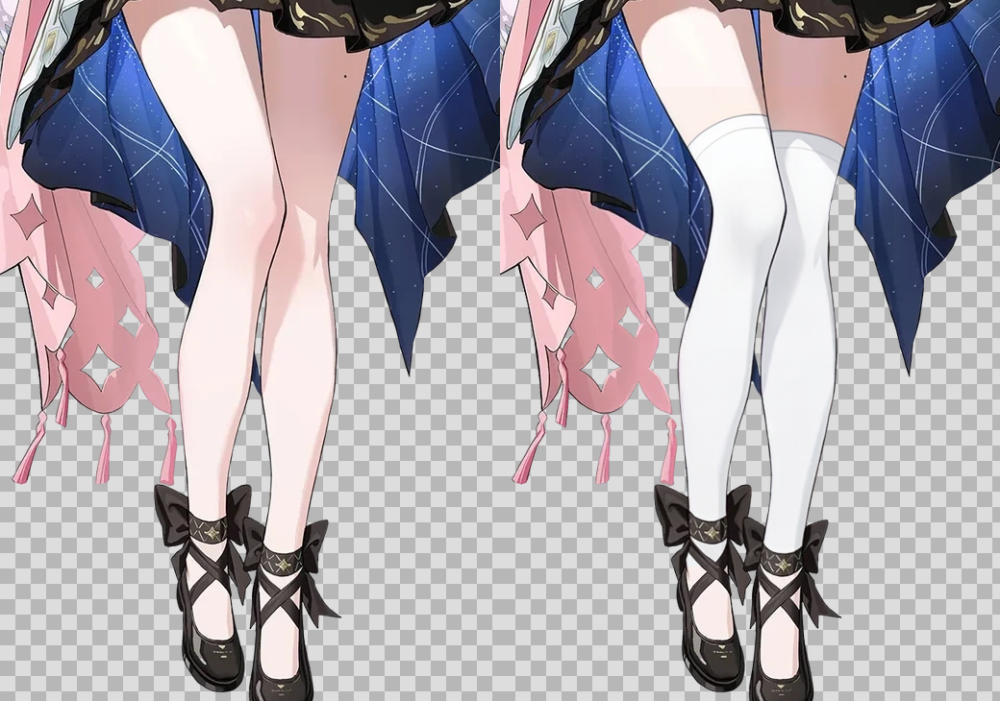</a>
   Before (left) · White over-the-knee socks (right)

1. Duplicate the original. Select both legs from above the knees down to the shoe openings, leaving room for the sock tops.
2. Choose Local edit → Edit objects / materials, with the selection destination. Enter the prompt below.
3. Enable Selection guide, Preserve source transparency and subject alignment. Disable color matching. Preview the selection and generate.
4. Check both sock tops, shoes and pose, then apply. If alignment distorts proportions, turn it off and generate again.

Prompt translation:

> Add white over-the-knee socks to both legs, with the tops above the knees. Keep the leg pose, shoes, existing clothes and transparent background.

The test added white over-the-knee socks while preserving the alpha outline and visible pixels outside the edit mask. The 800×1216 candidate maps back to source coordinates; no manual enlargement is needed.

Selection and panel settings

<table>
  <tr>
    <th width="50%" align="center">Editable area</th>
    <th width="50%" align="center">Panel settings</th>
  </tr>
  <tr>
    <td align="center" valign="top"><a href="../../assets/guide/01-edit-selection.png">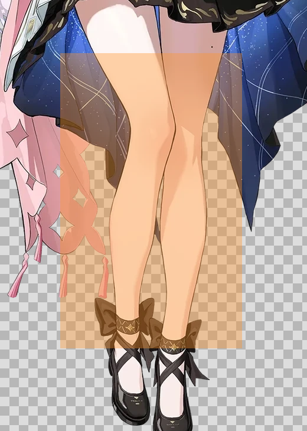</a></td>
    <td align="center" valign="top"><a href="../../assets/guide/01-edit-panel.png">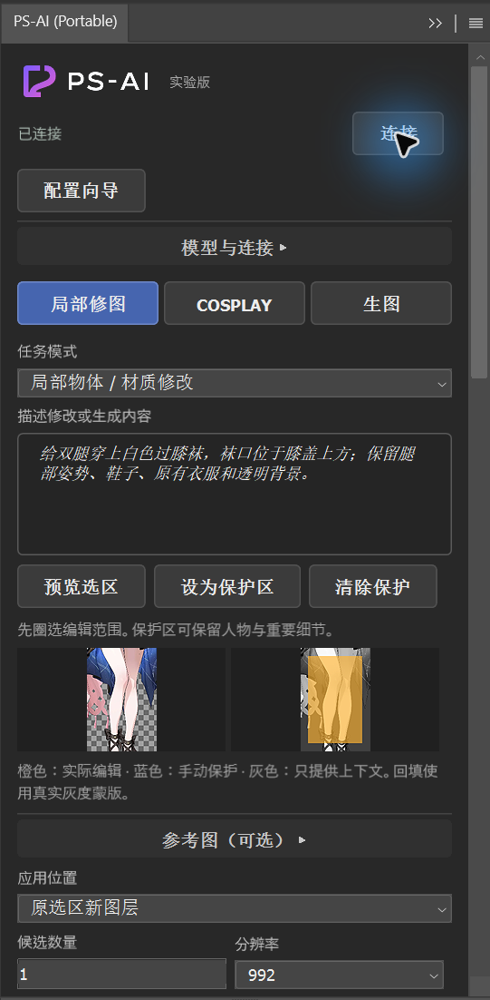</a></td>
  </tr>
</table>

## 02 · Remove

  <a href="../../assets/guide/02-remove-compare.png">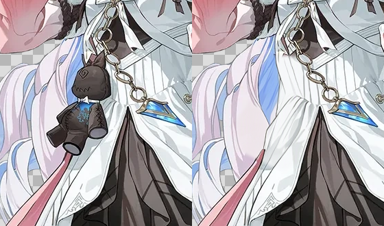</a>
   Before (left) · Plush charm removed (right)

1. Duplicate the original. Lasso the black plush charm on the chest, including its head, body, limbs and a little surrounding white fabric.
2. Choose Local edit → Remove objects, with the selection destination. The development build hides the prompt input and removes selected objects using surrounding material and structure.
3. Enable the selection guide. Disable transparency preservation, alignment and color matching. Preview and generate.
4. Check for black fragments, continuous fabric folds and the retained chain, then apply.

Prompt translation:

> Remove the black plush charm on the chest, including its head and limbs. Continue the white pleated fabric through that area. Keep the metal chain, pose and other clothing.

The prompt and screenshots above document the older test. The development build uses a built-in removal instruction and ignores prompt drafts left by other modes. In the older test, the charm was replaced by white fabric and the chain remained. Complex occlusion may need a second, smaller edit.

Selection and panel settings

<table>
  <tr>
    <th width="50%" align="center">Editable area</th>
    <th width="50%" align="center">Panel settings</th>
  </tr>
  <tr>
    <td align="center" valign="top"><a href="../../assets/guide/02-remove-selection.png">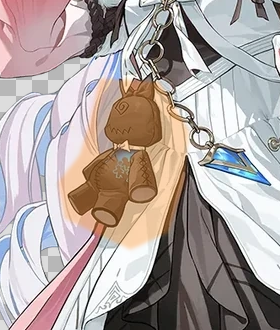</a></td>
    <td align="center" valign="top"><a href="../../assets/guide/02-remove-panel.png">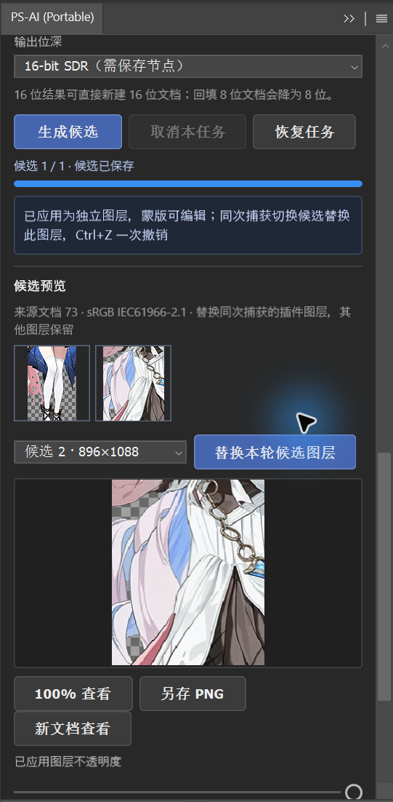</a></td>
  </tr>
</table>

## 03 · Background

  <a href="../../assets/guide/03-background-compare.png">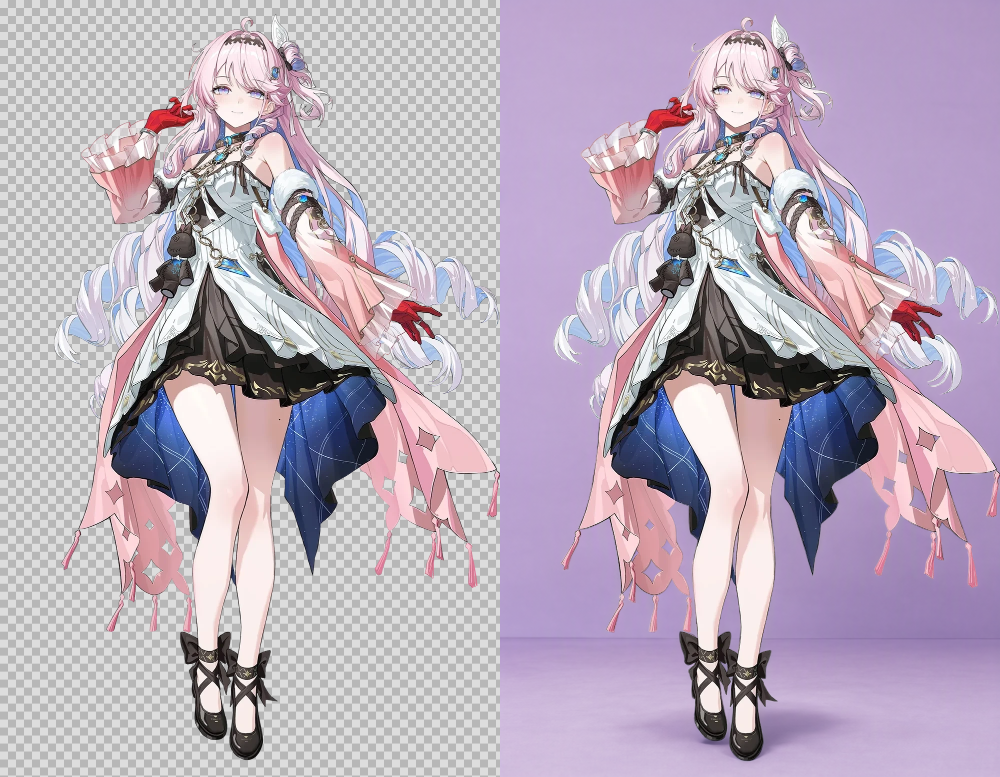</a>
   Before (left) · Lavender studio background (right)

1. Duplicate the transparent sample. Use Photoshop Select Subject or select the character manually. Do not invert in the development build; the v0.4.0 example used an inverted background selection.
2. Choose Local edit → Replace background, with the selection destination. Enter the prompt.
3. The development build disables the guide, transparency preservation, alignment and color matching automatically. Preview: the background should be editable and the opaque character excluded. The old v0.4.0 screenshot enables the guide; see the [background correction](#background-fix) for current behavior.
4. Generate and apply. Check canvas coverage, foot contact, hair edges and shadows. Background mode preserves the selected subject; ordinary local editing still changes the selected area.

Prompt translation:

> Replace only the transparent background with a simple pale lavender photography studio. Use softly lit walls and floor, with a slight contact shadow under the feet. Preserve the character, hair, clothes, pose and framing.

The full background became a lavender studio with a foot shadow. Opaque character pixels retain the source. Partially transparent hair blends with the new background; refine the result mask where needed.

Selection and panel settings

<table>
  <tr>
    <th width="50%" align="center">Editable area</th>
    <th width="50%" align="center">Panel settings</th>
  </tr>
  <tr>
    <td align="center" valign="top"><a href="../../assets/guide/03-background-selection.png">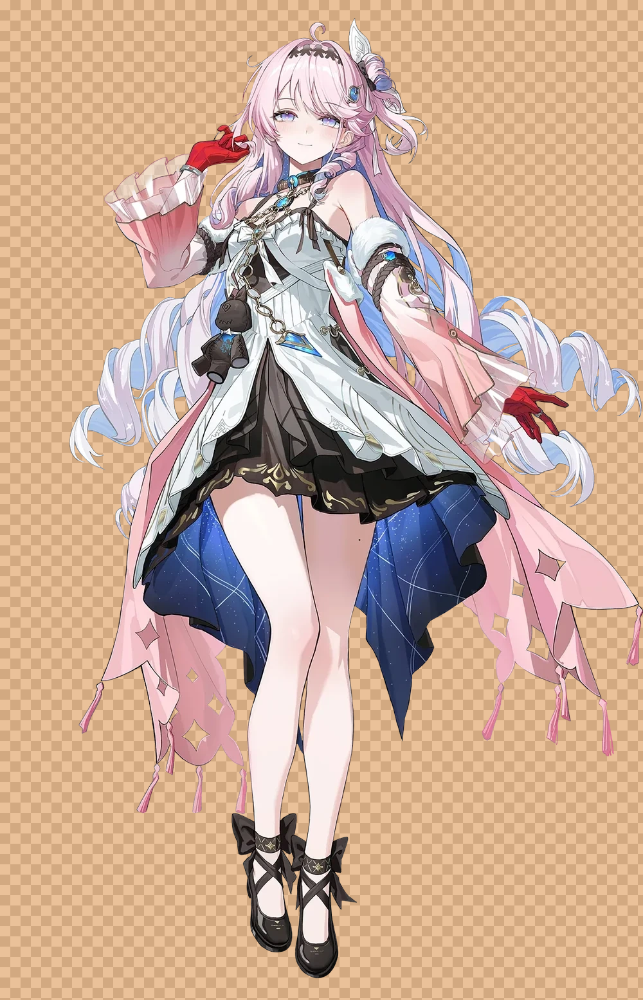</a></td>
    <td align="center" valign="top"><a href="../../assets/guide/03-background-panel.png">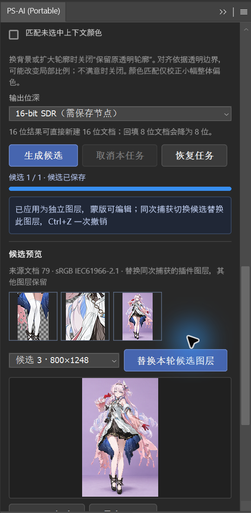</a></td>
  </tr>
</table>

  <a href="../../assets/guide/03-background-workspace.png">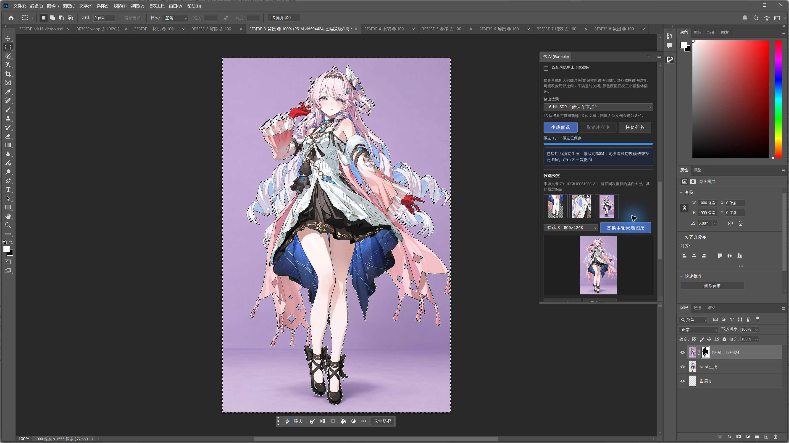</a>
   Original Photoshop capture; click to inspect.

## 04 · Clothing and props

  <a href="../../assets/guide/04-costume-compare.png">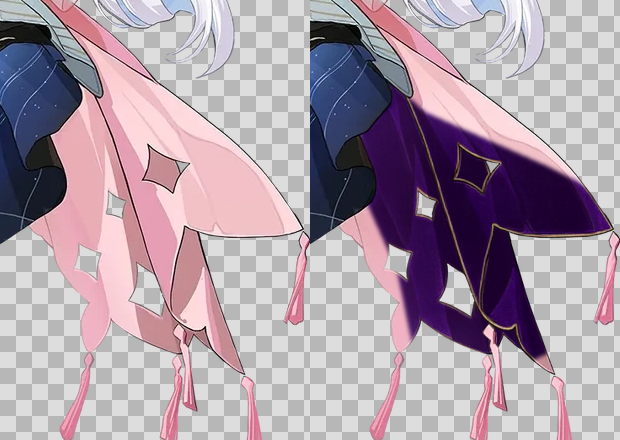</a>
   Before (left) · Deep violet coat tail (right)

1. Duplicate the original. Lasso the lower pink coat tail on the right, covering the entire area intended for the material change.
2. Choose Portrait → Repair clothing / props, with the selection destination. Enter the prompt.
3. Enable the guide and transparency preservation. Disable alignment and color matching. Preview and generate.
4. Check diamond cutouts, trim, folds and the alpha outline, then apply. The unselected upper area stays pink; select the whole garment to recolor it all.

Prompt translation:

> Change only the selected right-hand pink coat tail to deep violet velvet. Keep its folds, diamond cutouts, gold trim and outline. Preserve the pose, other clothing and transparent background.

The selected coat tail became deep violet while retaining trim and cutouts. This verifies clothing editing. Props use the same workflow, but complex weapons and mechanical reconstruction were not separately tested here.

Selection and panel settings

<table>
  <tr>
    <th width="50%" align="center">Editable area</th>
    <th width="50%" align="center">Panel settings</th>
  </tr>
  <tr>
    <td align="center" valign="top"><a href="../../assets/guide/04-costume-selection.png">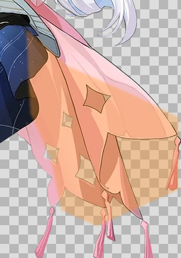</a></td>
    <td align="center" valign="top"><a href="../../assets/guide/04-costume-panel.png">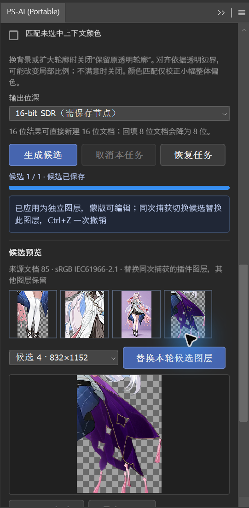</a></td>
  </tr>
</table>

## 05 · Character reference

  <a href="../../assets/guide/05-reference-compare.png">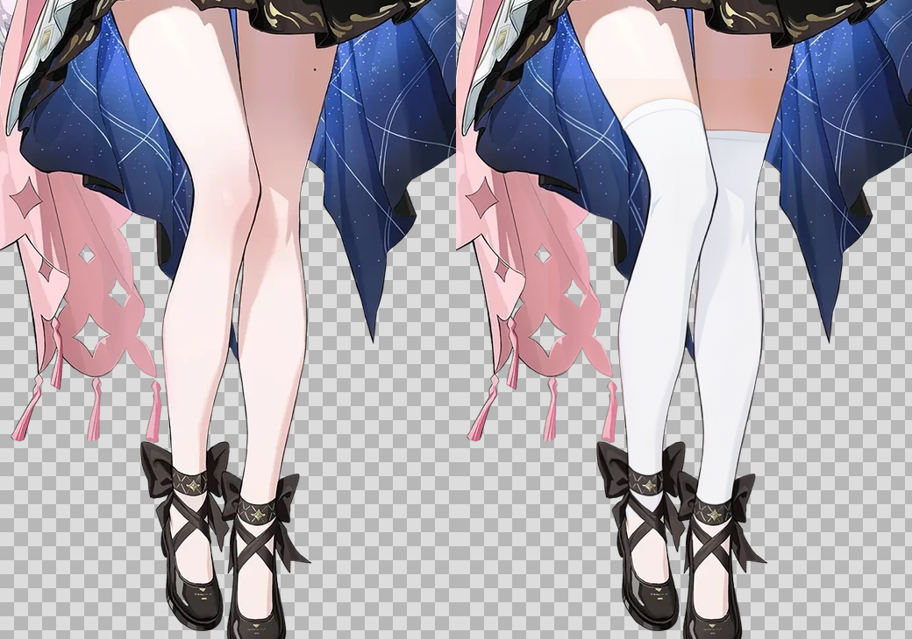</a>
   Before (left) · White socks from the reference (right)

1. Duplicate the original and select both legs. Use the white-socks edit of the same sample: [download the tested reference](../../assets/guide/reference-white-socks-icc.png).
2. Choose Portrait → Character reference. Open the reference section, Choose image, import the PNG and set Reference use to clothing. Enter the prompt.
3. Leave the selection guide off, the default for this mode. Enable transparency preservation; disable alignment and color matching. Preview and generate.
4. Compare sock tops, color and source pose, then apply. Clear reference afterward; standalone assets and text-to-image also require it cleared.

Prompt translation:

> Use the reference's white over-the-knee socks on both selected legs, with the sock tops above the knees. Keep the source character's leg pose, shoes, clothes and transparent background.

The reference transferred the white-socks feature while preserving pose and shoes. This is clothing-reference assistance, not identity locking, exact replication or multi-view consistency.

**If import reports an untagged image:** PS 27 treated one PNG16 with only an sRGB chunk and no embedded ICC as untagged, so validation blocked it. Confirm its true color space, use Edit → Assign Profile on a copy, save with the correct ICC embedded and import again. Do not arbitrarily assign sRGB to unknown sources or rename extensions to bypass validation. Adding a matching sRGB ICC resolved this test without changing compressed pixel data.

The development branch now recognizes an explicit PNG sRGB chunk and static WebP's default sRGB. A temporary working copy gets the profile before Photoshop converts reference pixels; temporary documents close afterward. Native import acceptance is pending, so this does not change the historical result above. Embedded ICC references continue using Photoshop's loaded profile.

Selection and panel settings

<table>
  <tr>
    <th width="50%" align="center">Reference image</th>
    <th width="50%" align="center">Panel settings</th>
  </tr>
  <tr>
    <td align="center" valign="top"><a href="../../assets/guide/reference-white-socks-icc.png">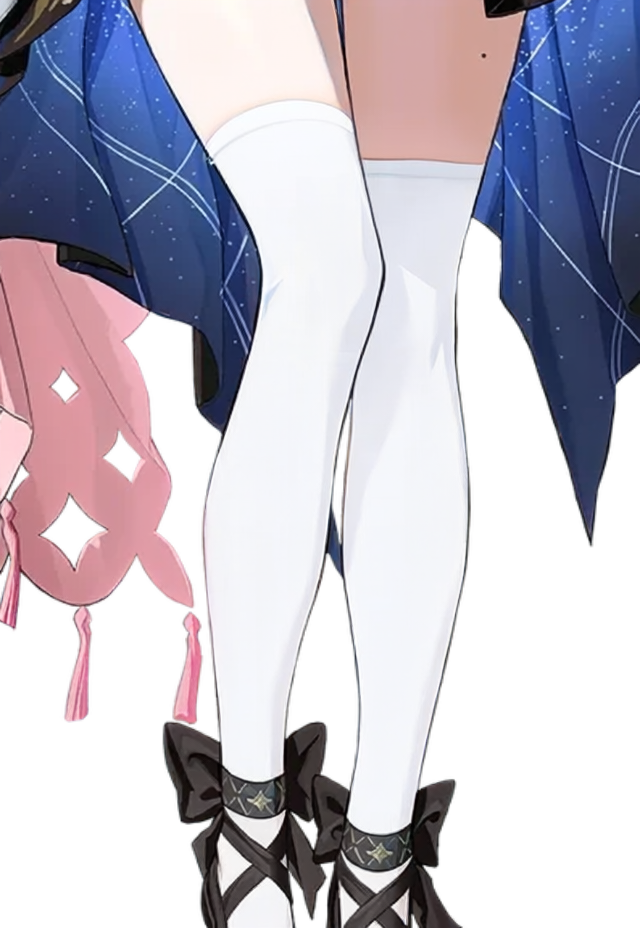</a></td>
    <td align="center" valign="top"><a href="../../assets/guide/05-reference-panel.png">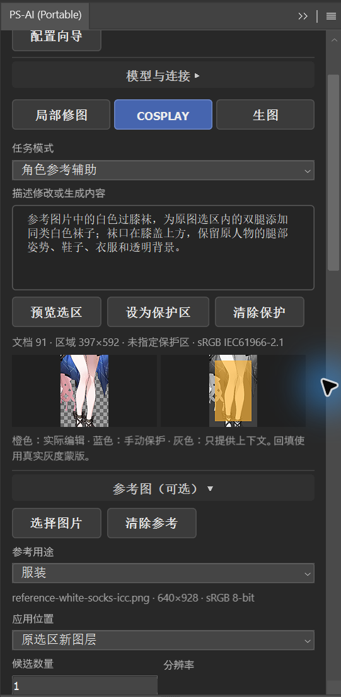</a></td>
  </tr>
</table>

## 06 · Scene

  <a href="../../assets/guide/06-scene-compare.png">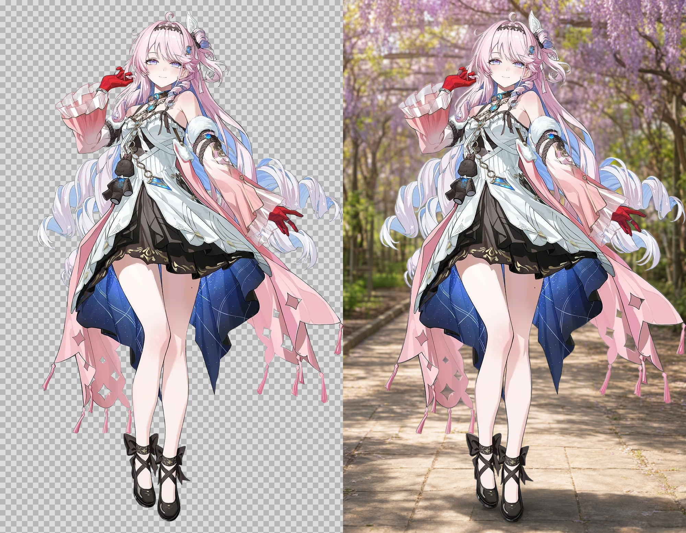</a>
   Before (left) · Wisteria garden scene (right)

1. Duplicate the original and clear unwanted references and protection. Use Photoshop Select Subject or select the person manually; do not invert. The old screenshots show the previous background-selection flow.
2. Choose Portrait → Replace scene, with the selection destination. Enter the prompt.
3. The development build disables the guide, transparency preservation, alignment and color matching automatically. Preview and generate. The old screenshot's guide setting no longer applies; see the [background correction](#background-fix).
4. Apply and inspect the pergola, path perspective, feet and hair edges. The source character's lighting is retained. After applying the new background, select the subject again to try development [Image Blending](#blend), or finish with adjustment layers.

Prompt translation:

> Replace only the transparent background with a wisteria garden path on a sunny afternoon: a distant purple flower pergola, soft green plants and a pale stone path with natural perspective. Place both feet firmly on the path with contact shadows. Preserve the character, clothes, pose and framing.

The garden and path fill the background, rather than a small patch around the legs. Opaque character pixels remain unchanged.

Selection and panel settings

  <a href="../../assets/guide/06-scene-panel.png">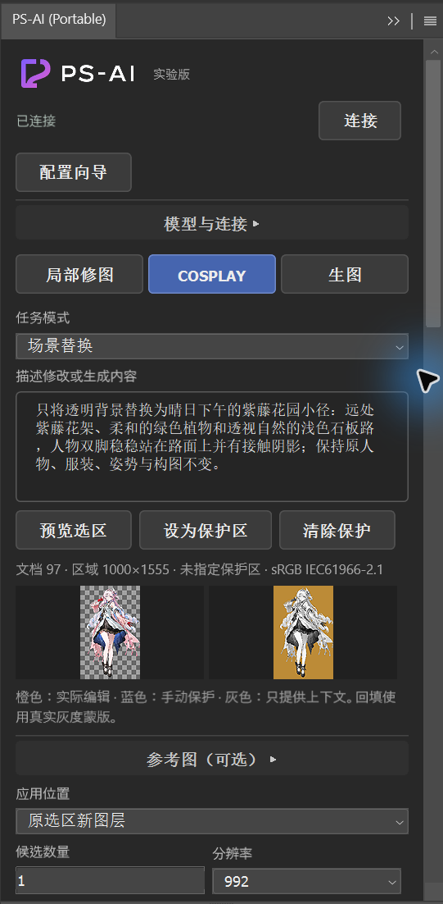</a>
   Click the capture to read the full-resolution panel.

  <a href="../../assets/guide/06-scene-workspace.png">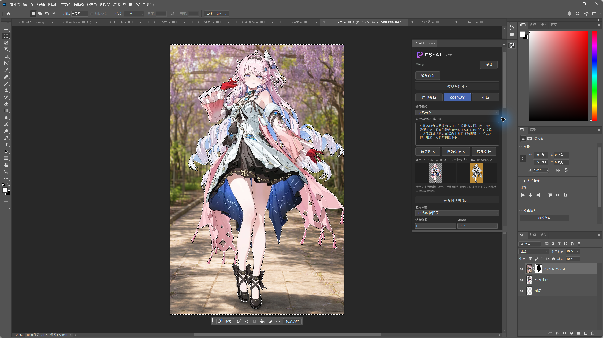</a>
   Original Photoshop capture; click to inspect.

## 07 · Effect

<table>
  <tr>
    <th width="50%" align="center">Standalone asset</th>
    <th width="50%" align="center">Composited in Photoshop</th>
  </tr>
  <tr>
    <td align="center" valign="top"><a href="../../assets/guide/effect-preview.png">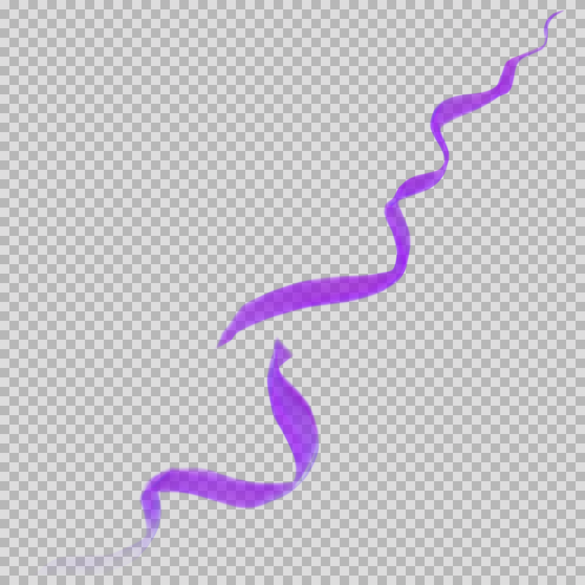</a></td>
    <td align="center" valign="top"><a href="../../assets/guide/07-effect-result.png">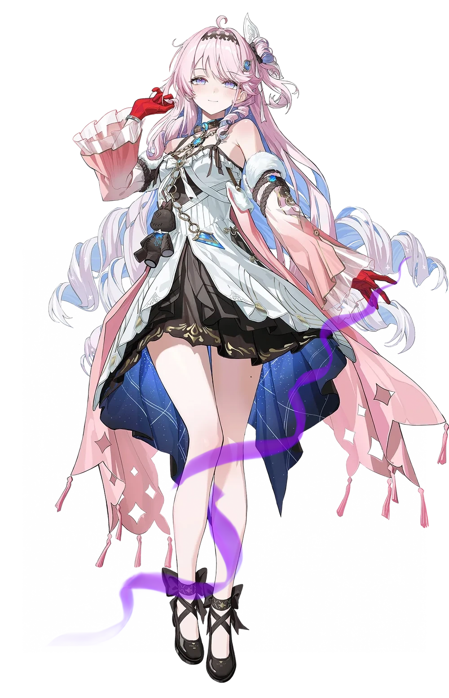</a></td>
  </tr>
</table>

1. Choose Portrait → Effect asset, set New document and clear the reference. A standalone asset needs no character selection.
2. Enter the prompt and generate. Check the open curve, absence of characters and real transparency. Open as new document; this test created a 992×992 sRGB / 16-bit asset.
3. Use Layer → Duplicate Layer to copy the generated layer into a fresh sample copy. Ctrl+T: scale proportionally to 900×900 px, top-left X=50, Y=555 px.
4. Use Normal blending at about 85% opacity. Use a layer mask for front / back occlusion; add glow or other blending only as needed.

Prompt translation:

> A single violet ribbon of magical smoke, an open S curve flowing from lower left to upper right, tapering and fading at both ends. No closed loop or ring. Isolated transparent background, natural translucent edges, no people or text.

The first prompt asked for smoke around the legs with an empty center and produced a closed ring, which was rejected. The explicit open-curve prompt produced the accepted asset, then actually composited in Photoshop. It resembles a translucent violet ribbon, with small curve gaps and faint alpha residue; it still needs finishing.

View the Photoshop workspace

  <a href="../../assets/guide/07-effect-asset-workspace.png">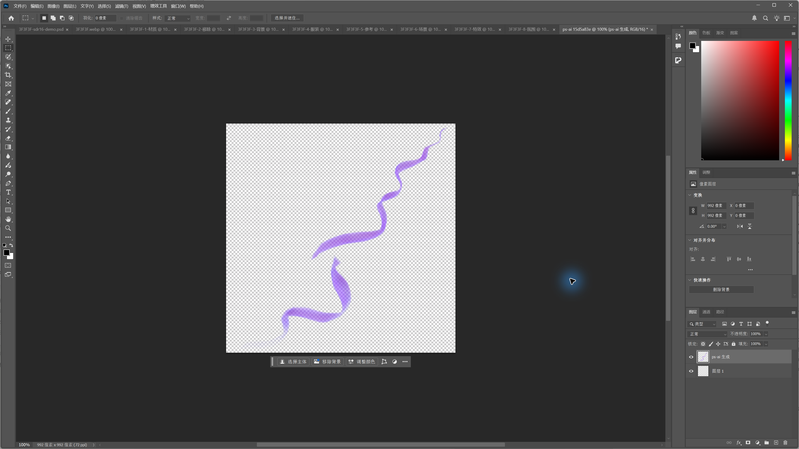</a>
   Original Photoshop capture; click to inspect.

## 08 · Atmosphere

<table>
  <tr>
    <th width="50%" align="center">Standalone asset</th>
    <th width="50%" align="center">Composited in Photoshop</th>
  </tr>
  <tr>
    <td align="center" valign="top"><a href="../../assets/guide/atmosphere-preview.png">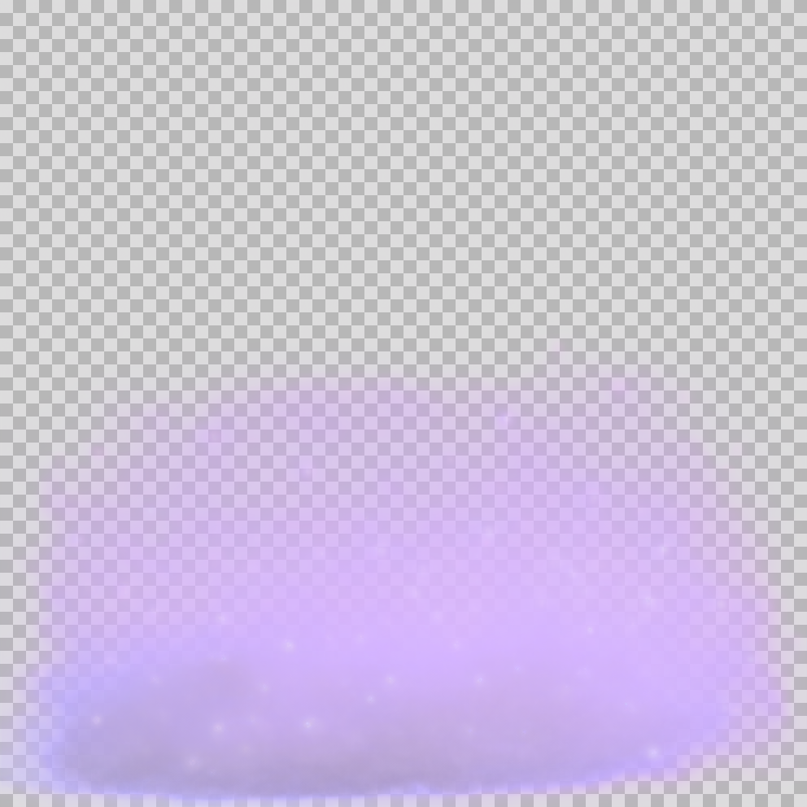</a></td>
    <td align="center" valign="top"><a href="../../assets/guide/08-atmosphere-result.png">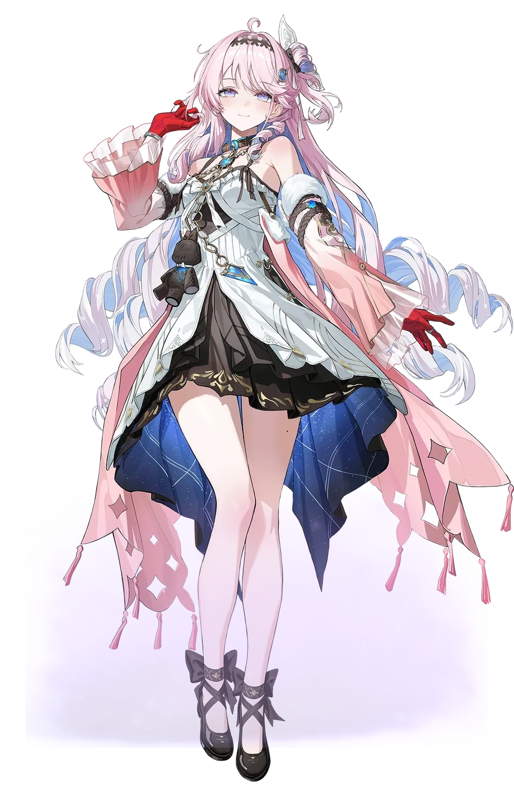</a></td>
  </tr>
</table>

1. Choose Portrait → Atmosphere asset, set New document and clear the reference.
2. Enter the prompt and generate. Check for an empty upper area, bottom mist, no character and no text. Open the 992×992 sRGB / 16-bit asset as a new document.
3. Duplicate its generated layer into a fresh sample copy. Transform proportionally to 900×900 px, top-left X=50, Y=555 px.
4. Use Normal blending at about 35% opacity. Check mist density and the face; reduce opacity or mask unwanted coverage.

Prompt translation:

> Soft pale lavender mist with a few floating light specks, concentrated at the bottom and fading upward, leaving the top empty. Transparent background, no people, no text, no solid backdrop.

The mist stays low and leaves the face clear. It has real alpha, but apparently empty areas retain very low-opacity pixels. Check on a dark background and clean the mask when needed; asking for transparency does not guarantee clean alpha.

Selection and panel settings

  <a href="../../assets/guide/08-atmosphere-panel.png">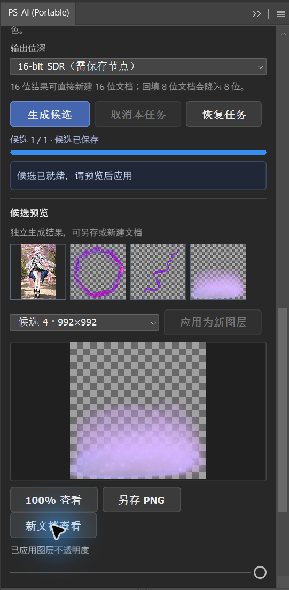</a>
   Click the capture to read the full-resolution panel.

## 09 · Text to image

  <a href="../../assets/guide/generate-preview.png">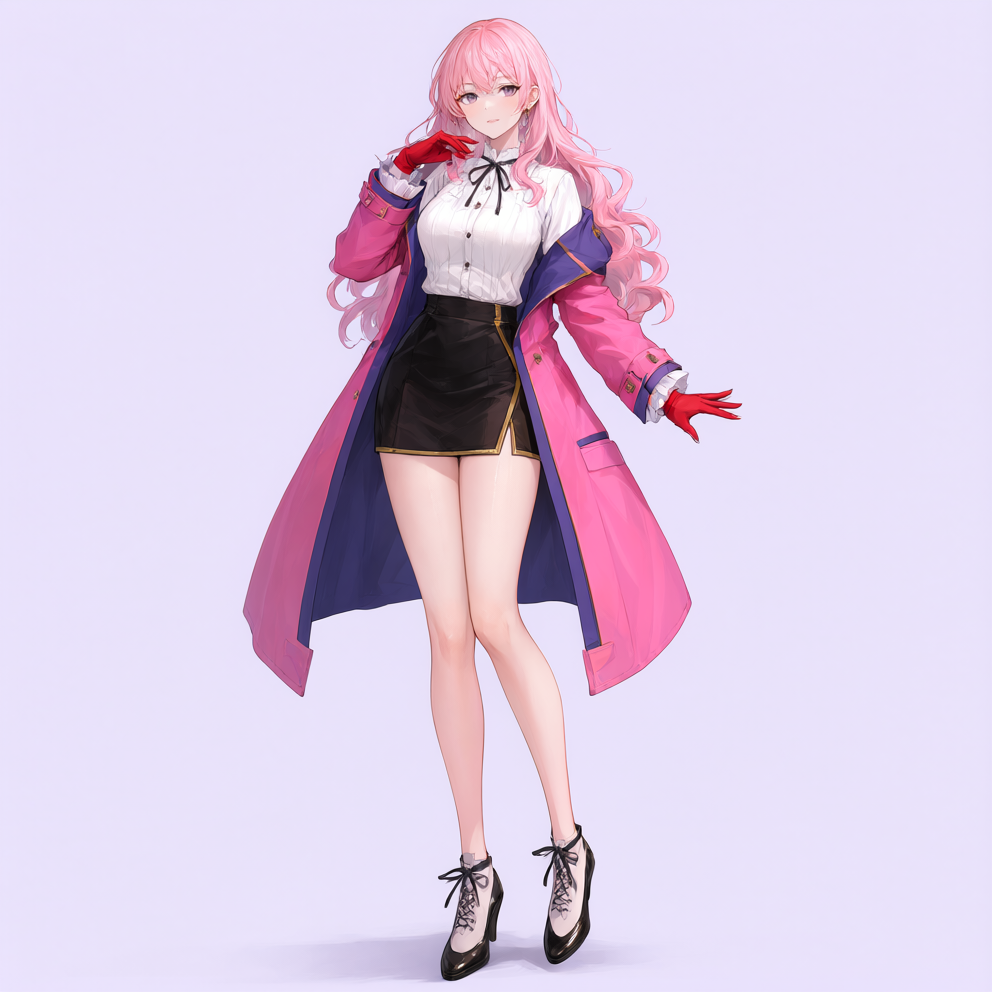</a>
   A new illustration generated from text; the source image is not used as input.

1. Choose Generate → Text to image, set New document and clear the reference.
2. Describe the appearance of 3F3F3F.webp using the prompt below. The source image is not sent as model input; no selection is needed.
3. Use one candidate, resolution 992, 25 steps and locked seed 42. Check full-body framing, both feet, outfit and background.
4. Open as new document to continue in a separate 992×992 sRGB / 16-bit document.

Prompt translation:

> Full-body anime illustration of an adult woman with long pink curls, a white pleated blouse, a pink and navy long coat, a black skirt with gold trim, red gloves and black lace-up heels. One hand raised beside the face, the other extended naturally. Soft detailed anime rendering, one centered character, both feet fully visible, clean pale lavender background, no text.

The result includes pink hair, a white blouse, a pink / navy coat and complete feet. It is a new illustration, without guaranteed identity, pose or accessory matching. Use a selection edit to change clothing on the original.

Selection and panel settings

  <a href="../../assets/guide/09-generate-panel.png">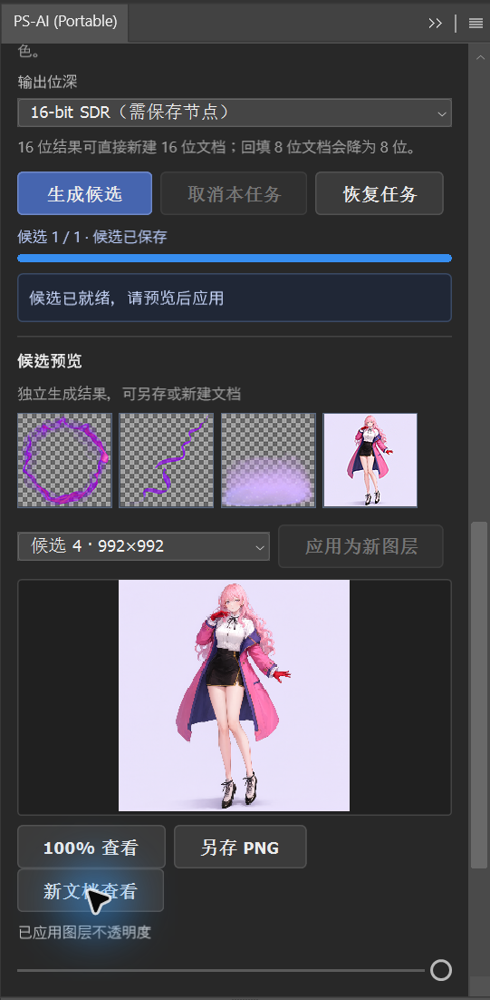</a>
   Click the capture to read the full-resolution panel.

  <a href="../../assets/guide/09-generate-workspace.png">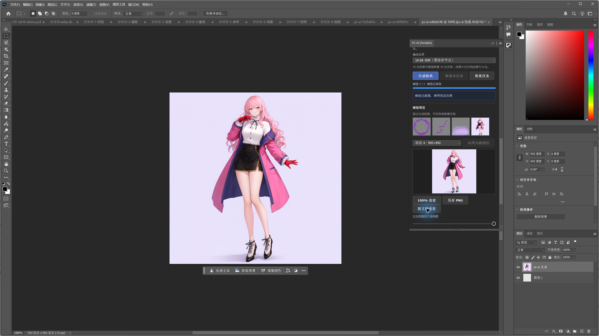</a>
   Original Photoshop capture; click to inspect.

## 10 · Relighting (development build)

Relighting uses a separate large lighting workbench. Original, local illustration and AI result are distinct views. **The illustration expresses lighting intent; the final effect is the actual AI result.** Models receive semantic lighting instructions, without a guarantee of precise multi-light control, physical shadows or material simulation.

1. Work in a saved copy and set protection for details that must remain unchanged. Choose **Portrait → Relighting → Lighting scope**: **Current selection** is the default and requires an edit selection; **Entire image** explicitly edits the full canvas minus protection without changing Photoshop's selection. Include the receiving ground in the selected scope if its shadows should change. Capture reads the visible composite; surrounding context alone never expands the editable mask.
2. Open the workbench and check the actual source name/document ID, scope, profile and original image. A tagged sRGB working copy is labeled with its original document ID. Missing selections are reported before original-file authorization. The main panel's Generate entry also opens this editor; editing lights makes no AI request.
3. Add, select or drag lights. Select a light in the list, then use the sidebar to rename, duplicate, disable, delete or lock it; use Find to locate off-image lights. The limit is eight. Hiding markers does not disable lights. Zoom, pan and fit affect only the view. Workbench undo/redo treats one drag as one action and preserves text-editing shortcuts inside inputs.
4. Choose point, spot or directional, independently of key/fill/rim/custom role. Intensity and Z are relative intentions. Choose either temperature or custom color. Expand advanced light controls for softness and the applicable depth, spot target/cone or directional bearing. Global lighting contains ambient, existing-light handling, shadows and content-preservation intent.
5. Inspect approximate range and color in **Lighting illustration**, then add an optional description. Resolve obvious conflicts or acknowledge them explicitly before submission. Only the workbench's Generate button freezes the scene and submits a request. The primary image is the clean original, without markers, handles or local light patches.
6. Editing can continue during generation. A result from an earlier configuration is marked stale. Cancellation follows the backend's capabilities; a platform request already in progress may still finish and be billed. Changed sources require rereading, not silent rebinding.
7. Inspect the real AI result for identity, text/logos, fabric texture, edges, highlights and shadows. Default output is a new NORMAL complete-result layer with an editable mask. Source pixels remain intact; adjust opacity or undo once. Reapplying a candidate from the same capture replaces the plugin's own result layer.

The workbench briefly closes for recapture or document writes, then returns; PS27 does not support the required writes inside its open dialog. Network waits hold no document modification lock. Configurations are saved locally and reopening checks the source. Only an explicit reread or reuse action binds a new snapshot. Failures retain lighting edits, and saved candidates remain exportable.

Structured relighting disables subject alignment and context color matching so they do not cancel intentional lighting changes; ordinary preferences return when leaving. Transparency uses the existing safe strategy. Unsafe multilayer translucent sources require a merged copy or manual composition after export. Native 16-bit source data is retained separately, but model input remains sRGB8. Platforms output sRGB8; ComfyUI optionally saves SDR16, which is not native 16-bit model precision or a lossless round trip.

Reopening retains the captured scope and edited lighting. To change scope, close the workbench, choose the new Lighting scope in the main panel, reopen and explicitly **Re-read source**. Until reread succeeds, the caption keeps the old scope and generation is blocked. Reread retains the lighting setup and binds a fresh snapshot; failed rereads keep the old source and edits. Draft/history reuse uses the current explicitly chosen source and scope rather than silently changing the range. These scope and authorization repairs have automated mock coverage only; native capture/apply/undo and installed-panel acceptance are still pending for this build.

**Experimental compensation cannot yet be applied.** Numerical diagnostics require aligned, opaque, equal-depth encoded-sRGB data, producing Multiply dark and Screen light maps. These are not independent physical lighting channels and may include AI edits to faces, text or texture. Keep the complete result when decomposition is unreliable; no empty lighting layers are created.

The existing nine-mode screenshots do not validate this workbench. Final source modules passed light interaction, window resizing and 4K eight-light preview-latency checks in a PS27 script. Automated tests, native probes and real inference are recorded separately. Installed-panel behavior and portrait, product-text and fabric quality still require acceptance. See the [development contract](../development/BACKEND.en.md#relighting-workbench) for implementation and measurement conditions.

## 11 · Image Blending (development)

Image Blending adapts a subject already placed in a scene to its surroundings. It reads the whole visible composition and uses lighting, color temperature, contrast, texture and depth of field outside the subject as context. Only the selected subject and its edges are edited, minus manual protection.

1. Prepare the subject and background in a saved copy, then select the subject. Do not select the entire canvas; a cutout on transparency has no environment to match.
2. Choose **Portrait → Image Blending** and preview the range. Areas outside the subject supply context. Protect subject details separately if needed.
3. Generate directly or add an optional instruction, such as “Match the warm window light from the left; preserve facial structure and clothing texture.” A second background reference image is unnecessary.
4. Inspect identity, pose, hair edges, lighting, grain and perspective, then apply as a masked layer. Adjust opacity or undo once as needed.

The full canvas supplies context regardless of the margin setting. Model resolution remains limited, so a small subject may lose detail. Alignment and context color matching do not counteract this mode. Results depend on the model and do not guarantee identity preservation. This is not skin retouching. Offline tests cover the mode; real inference and native Photoshop controls, edges and color still require acceptance.

## Candidates, progress and undo

- **Progress:** loading and text encoding show stages; sampling shows actual steps and percentages, followed by a saved-candidate message. Encoding can take time; avoid repeated submissions.
- **Candidates:** 1–4 run sequentially, incrementing a locked seed. Switch thumbnails or use the list. A screenshot's Candidate 4 can include earlier panel results; each test here submitted one image.
- **Apply:** the first application creates a masked layer. Another candidate from the same capture replaces it. Changes to source dimensions, content or session block stale application.
- **Undo:** Ctrl+Z undoes one application. Opacity has separate undo records; the panel slider does not track native undo.
- **Export:** Save PNG exports the processed candidate at context dimensions. Ordinary edits may use a crop; development blending and background modes use the full canvas as context. Open as new document uses an independent sRGB document. Preview is 8-bit; export keeps the chosen depth.
- **History:** load candidates or reuse parameters. Prepare references, protection and selection again. After a restart, old results can be exported or opened separately, but cannot directly apply to a reopened source.
- **Cancel / reconnect:** cancel targets the current ID and stops later candidates, keeping completed results. Recover task queries the original ID without resubmitting; use the original backend address. If cancellation is unconfirmed, keep querying rather than creating more jobs.

## Parameters and color

| Control | Use |
| --- | --- |
| Resolution | 768, 992 or 1024; edits retain aspect ratio and align to workflow dimensions. |
| Steps | Default 25, range 1–100; higher is not necessarily better. |
| Context margin | Default 15%; surrounding context is not made editable. Development blending, background and scene modes always read the full canvas. |
| Selection guide | Visual guidance. The final Photoshop mask enforces protection. Off by default for reference assistance; disabled for ComfyUI background / scene modes in development. |
| Preserve transparency | Useful for clothing / materials; disabled for background / scene modes in development. Turn off for removal or silhouette expansion too. |
| Subject alignment | Uses alpha bounds to adjust size and position; can change proportions. Automatically disabled for background / scene / blending modes in development. |
| Color matching | Limited overall correction. Off in these tests. Automatically disabled for background / scene / blending modes in development; ordinary preferences return on exit. Old background candidates retain their saved setting. |

16-bit output can be exported as PNG16, opened as RGB16 or applied to a 16-bit document. Applying to an 8-bit source quantizes to 8-bit without changing its depth. Model inputs, references and masks remain 8-bit. Higher-depth output reduces later quantization; it does not imply full 16-bit model precision, HDR or native wide-gamut generation. Finish color and lighting in Photoshop as needed.

## Troubleshooting and limits

| Symptom | Action |
| --- | --- |
| No selection / fully protected edit | Select again, inspect the range preview and clear unwanted protection. Relighting also offers an explicit Entire image scope; after a scope change, re-read the source. |
| Reference fails color checks | Confirm and embed the correct ICC on a copy; see Character reference. |
| Background becomes black or transparent | Generate again using either background mode in the development build; see the [background correction](#background-fix). Select the subject to keep and describe scenery, lighting and the floor if needed. Loading an old candidate does not regenerate it. Do not import a black-and-white mask as a scene reference. |
| White background | Preserve the outline for materials, disable for backgrounds. Inspect source fringe and alpha; standalone assets may need cleanup. |
| Result too small or unfilled | Check selection, context and aspect ratio; try alignment off. In development background modes, select the subject and preview the full-canvas range. Do not bypass size checks by changing workflow dimensions. |
| Source changed; application blocked | Capture and generate again, or export the old result for manual composition. |
| Unsafe semi-transparent multilayer source | Save a copy and merge visible layers before generating, or export and composite manually. |
| Backend, model or depth error | Check service, mappings and optional node. Open technical details, correct and retry. |
| Photoshop exits entirely | Save work, record the stage and examine events / dumps alongside host, GPU, driver and plugin behavior. A successful session is not a permanent crash fix. |

Host diagnostics check selection, protection, masks, undo and rollback in their own documents. Save report exports the result. Runtime logs record plugin stages, not Photoshop crash dumps.

The 2026-10-17 session used Windows Photoshop 27.0, GPU enabled and this sample: all nine modes generated actual outputs; six edits applied to copies; effects, atmosphere and text-to-image opened as 16-bit documents, with the first two additionally composited onto the sample. Source layers in all eight edit / composition copies remain channel-for-channel identical. Visible pixels and alpha outside all six edit masks are unchanged, as is full-canvas alpha in the three preserve-transparency examples. Invisible RGB beneath fully transparent pixels is excluded from appearance comparisons; source layers themselves were checked channel by channel.

Acceptance is limited to these examples. Clothing tested a coat tail; reference tested socks transfer. Complex prop reconstruction, identity consistency, other models, calibrated-display accuracy and long-term stability remain unverified. Photoshop did not exit during this session; that is not a permanent stability guarantee. Reference, effect and atmosphere modes remain experimental. Routine skin retouching is outside scope.

Use a trusted backend. Local ComfyUI also stores inputs and outputs. Check privacy and image permissions before sharing screenshots. Code licensing does not replace model or image licensing; see [compatibility and model sources](../../config/compatibility.json).
