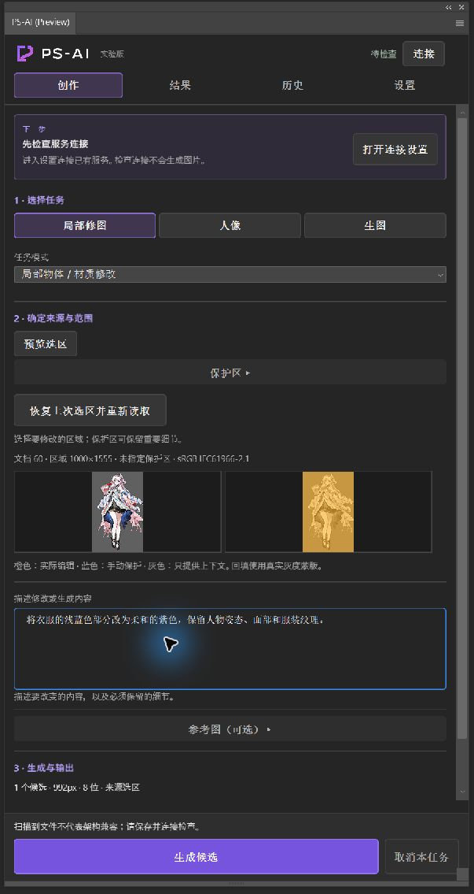
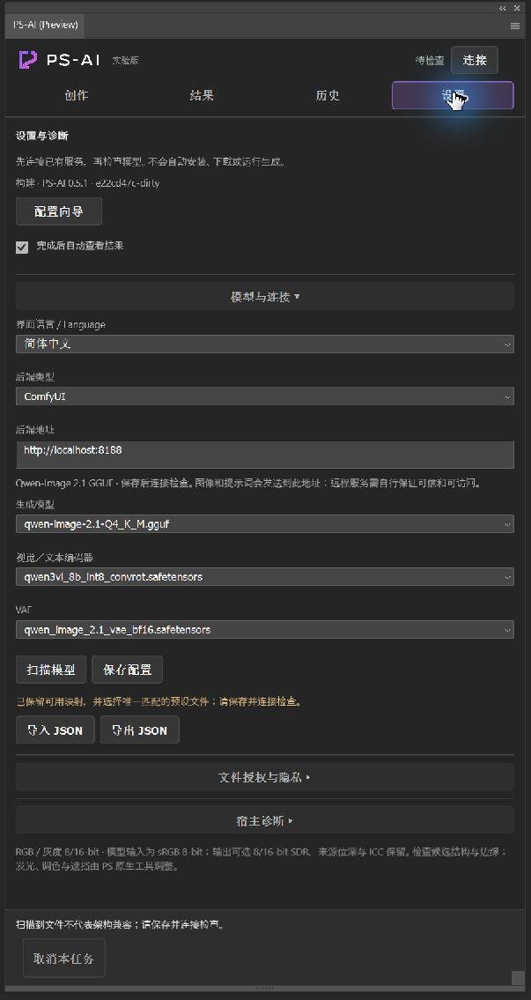
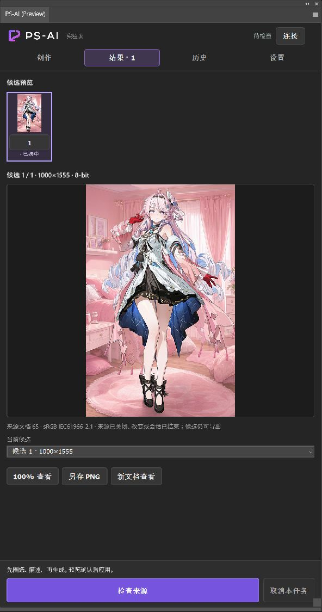

<h1 align="center">PS-AI 使用指南</h1>

<strong>简体中文</strong> · <a href="USER_GUIDE.en.md">English</a> · <a href="../../README.md">返回首页</a>

从一次小范围修改开始：**连接后端 → 读取范围 → 描述并生成 → 检查后应用**。先[安装插件](../../README.md#安装发行包)，再按[从零配置 ComfyUI](../setup/COMFYUI.md#beginner)准备本地后端，或连接[云平台](../setup/PLATFORMS.md)。

> 本指南说明 **0.6.0 未发布源码候选**；公开下载仍为 **0.5.2 实验版，主模型仅支持 GGUF**。请核对下载包与“设置”中的版本／构建标识。下面的历史界面、真实输出与本地合成预览分别标注；0.6.0 的已安装面板、CCX／Portable、完整模式回归和全新机器安装仍待验收。

创作、设置与结果图为发行准备时在 PS27 中的实拍，使用独立 Preview 演示标识：完成来源预览、只读模型扫描和已有历史候选读取，没有提交新生成。布光界面图保留历史 0.5.0 界面。

本地模型按生成模型、视觉／文本编码器和 VAE 三个角色选择，不要求固定文件名或作者。0.6.0 源码按扩展名选择 GGUF 或原生 Safetensors 加载器，仍限兼容 Qwen 2.1 架构和固定采样链；原生路线不需要 GGUF 扩展包。指定 INT8 组合已有真实推理、PNG 与小型 RGB8/16 Photoshop API 检查，完整边界见[原生实测示例](../setup/COMFYUI.md#native-tested)。面板的只读路线提示来自当前文件名；“节点已检查”只说明节点和文件名检查通过，旁边仍提示所选权重未验证。扫描／连接不会读取权重内部结构，也不会自动生成。

## 第一次编辑

1. **连接已有服务。** 启动 ComfyUI，在“设置 → 模型与连接”填写地址、扫描模型并连接。扫描保留仍可用的选择，只补全唯一匹配的预设文件；其他文件手动选。[配置工具](../setup/COMFYUI.md#environment-tools)也可从运行中的服务生成可导入设置，无需重装或重下模型。
2. **准备范围。** 在已保存的图片副本中选择“局部修图 → 局部物体／材质修改”，圈出小区域，点“预览选区”。**橙色可改，蓝色保护，灰色只供参考。**
3. **描述变化。** 例如“把金属饰件改成磨砂银色，保留原有形状”。查看候选数量、分辨率、位深和输出位置摘要；需要时展开“生成与输出”。
4. **生成并检查。** 点底部“生成候选”。生成时保持来源不变；到“结果”检查边缘、颜色、脸和文字，再“应用为新图层”，或另存 PNG。一次 Ctrl+Z 撤回一次应用。

“下一步”根据连接、来源与输入状态给出入口；导航本身不会提交生成。保护、参考和参数按需展开。切换创作／结果／历史／设置保留输入，不会停止任务；打开面板也不会自动启动后端或出图。

连接设置与参数怎么选

| 项目 | 建议 |
| --- | --- |
| 候选 | 每批 1–4 张，依次生成；锁定种子时逐张递增 |
| 分辨率／步数 | 常用 768、992、1024；默认 25 步，增加不保证更好 |
| 上下文边距 | 默认 15%，只增加参考环境；换背景、场景、溶图读取整张画布 |
| 范围辅助图 | 给模型参考，真正边界由 PS 蒙版约束；部分模式自动关闭 |
| 保留原透明轮廓 | 适合衣物、材质修改；扩展或移除轮廓时按需关闭 |
| 对齐／颜色匹配 | 仅在适合时用；不要用颜色匹配抵消有意的布光变化 |

设置 JSON 只迁移地址、模型与语言等配置，不包含 Key、模型文件或图片历史。CCX 与 Portable 数据独立。云平台按[平台指南](../setup/PLATFORMS.md)配置，不向任意导入地址发送 Key。

## 选对模式与范围

| 工作区／模式 | 圈选什么、填写什么 |
| --- | --- |
| 局部修图 · 局部物体／材质修改 | 圈要改的物体，描述新材质、颜色及必须保留的形状 |
| 局部修图 · 移除杂物 | 圈要移除的东西，留适量周边；使用内置指令，无提示词输入 |
| 局部修图 · 换背景 | **选要保留的主体，不要反选**；描述新场景、地面与光线 |
| 人像 · 服装／道具修复 | 圈衣物或道具，避开脸、手等不需改变的区域 |
| 人像 · 角色参考辅助 | 圈编辑区、导入参考，说明借用的外观；不保证身份一致 |
| 人像 · 场景替换 | 同换背景，选主体保留；描述环境、时间与光照 |
| 人像 · AI 素材 | 先选参照主体，再设素材活动范围；“物体与粒子”“光效与氛围”共用一个入口，也可仅文字生成 |
| 生图 · 文字生图 | 描述主体、环境、构图与风格，不使用参考图；默认无需选区 |
| 人像 · [光影重塑](#relight) | 当前选区或明确选择整张图像，在工作台布光 |
| 人像 · [溶图](#blend) | 选已经放进背景的前景主体，主体外须有可见环境 |

要保护脸或文字，先圈出并“设为保护区”，再圈编辑范围（AI 素材默认改为圈参照主体）。保护从可改范围中扣除，羽化保留；普通编辑的上下文不会扩大回填范围。换文档或复用参数后重新准备范围。

同一会话撤销后丢失选区，可点“恢复上次选区并重新读取”：只恢复同一文档和模式的已保存范围，再读取当前像素；不会提交任务或恢复旧候选的应用资格。

**换背景／场景：**读取整张画布，自动关闭透明轮廓保留、主体对齐、颜色匹配；ComfyUI 也关闭范围辅助图。生成后检查发丝、半透明边缘与地面。明显透明的背景候选只能导出；旧记录按自己的保存范围处理。

### 让蝴蝶出现在人物周围，而不是只出现在人物里面

0.6.0 候选源码将特效／氛围合并为 **人像 → AI 素材**。“物体与粒子”适合蝴蝶、花瓣、电弧；“光效与氛围”适合光雾、烟尘。它们是提示预设，不是两个不同模型。

1. 在 Photoshop **选中人物主体**，使用默认的“参考主体 · 独立放置”。
2. 将活动范围设为“主体周围的矩形区域”，调节扩展比例（默认 50%），或明确选择“整张画布”。当前不支持另画一个任意形状的活动区。
3. 选择关系：**前景叠加**可显示在主体内外；**主体遮挡**从素材范围扣掉主体，不会把素材真的移到原图层下。想要前后穿插，需分别生成／手工分层，不自动判断立体环绕。
4. 点“读取主体并预览活动范围”。从左到右检查来源图、主体参照、实际放置图。**最后一张白色区域才是素材允许出现的位置**；保护区也会扣除。
5. 描述例如“几只蓝色发光蝴蝶分布在人物肩膀两侧和头部周围，大小有变化”，生成后先看“仅素材”，再切“叠加预览”。发现残留人物、底色或辅助线时，不要应用。
6. 应用得到带可编辑蒙版的独立素材图层，不重绘或替换原图层。素材 alpha 保留，放置蒙版只应用一次；完全不透明输出保留导出但禁止回填。

叠加预览使用保存的来源，只显示捕获区域，最长边 1280px，不是原生全尺寸验收。另存 PNG／新文档仍是**原始素材**，不混入来源或烘焙放置蒙版。额外角色参考不参与；“新文档”不等于纯文字。旧“参考当前图片与选区”仍可明确选择，保持选区内放置；旧历史也保留原范围，不自动扩大。“仅文字生成独立素材”不读取当前图片。

新主体方式发送 3 张图，平台必须明确声明支持；旧中转或不支持的模型会在上传前拒绝，不静默降级。更新插件时也更新配套中转。ComfyUI、百炼 Qwen 2.1 和 OpenAI Images 的协议已有离线覆盖；Gemini 不支持此透明素材路径。

旧双图图片参考在实际 Qwen 样本中仍残留人物、背景或辅助边界，**未通过视觉验收**。新三图主体方式修正的是输入、范围和回填逻辑，尚无真实模型质量或安装面板验收；不能保证模型只返回干净的蝴蝶。透明像素不是分离成功的证明，插件不会自动抠图、原图相减或重发。下方素材案例仍是纯文字输出后的手工定位合成，不是新路径效果图；现有截图也不展示新素材控件。

## 给画面重新布光

1. 选择“人像 → 光影重塑”，确定“当前选区”或“整张图像”；需要地面投影就把地面也纳入范围。
2. 打开工作台，核对当前合成图。更换背景或文档后点“重新读取当前文档”；已编辑灯光保留。透明抠图可先在副本下加入背景，确保作用范围不透明。
3. 添加、拖动和调整灯光，最多八盏；可复制、禁用、锁定。布光示意仅表达意图，拖动、工作台撤销和隐藏标记都不会生成图片。
4. 明确点击“生成 AI 结果”，检查后应用或导出。生成后修改灯光，旧结果会提示过期。

| 输出／参数 | 用法 |
| --- | --- |
| 光影层（默认） | 从 AI 参考估计光照，叠加在原图上，应用为有蒙版的穿透组，不复制底图 |
| 整图重绘 | 采用模型生成的图片，结构和纹理可能变化，应用为蒙版图层 |
| 光效还原 | 0–1，默认 1；降低减弱效果，0 回到原图 |
| 细节保护 | 0–1，默认 0.65；提高减少细碎变化，也会柔化局部阴影 |

候选的两项参数在松开滑块／确认数值后本地重算，随候选保存，**不用重新生成**。组不透明度也可调整；下方原图改变内容或位置后，旧光影可能不再匹配。

光影方式要求有标签的 sRGB RGB8/16，作用范围不透明。它保留原图作为内容基础，但无法完全分离光照和重绘：大幅错位会留下光斑，硬阴影和细窄轮廓光可能减弱。原始 AI 参考可单独导出，不会自动改成整图重绘。

读取失败时保留灯光与旧候选，不能拿旧来源继续新任务。任务内重开显示该任务绑定的来源。读写时工作台可能短暂关闭再恢复；关工作台不等于取消，请用任务取消按钮。

## 让主体融入背景

1. 先将人物／物体放入背景，选中前景主体；不要全选画布，单独透明抠图没有可参考的环境。
2. 读取当前图片与选区，按需设保护区，描述“匹配左侧窗户暖光”等要求，再生成。
3. 比较原图、融合预览与 AI 参考；检查主体、边缘和细节后应用。背景供参考，回填只改主体减去保护区。

0.5.2 新任务默认“保留细节 · 只应用光影”，生成不含底图副本的光影组；光效还原和细节保护可本地调整，不再次提交。也可明确选择“AI 重绘主体”；旧历史保持其原方式。光影来源要求同布光，不符合时不会自动换方法。

溶图读取整张合成图，自动关闭主体对齐与上下文颜色匹配；ComfyUI 不发灰度辅助图。AI 参考变化弱时，本地算法无法凭空补光；真人结果可能偏弱，光斑和阴影仍需检查。下方旧版溶图案例是 **AI 重绘**，不是新增光影提取的验收图。

查看十一种模式的真实输出与局限

以下使用指定演示图 `3F3F3F.webp` 及其编辑副本。局部图按保存的选区合成，透明区域为灰底；这些是实际生成文件与本地合成预览，**不是 Photoshop 回填实拍**。点击可看大图。

**局部修改：**“把这个玩偶改成一只黑猫玩偶”，显示腰部裁切。

**移除：**补齐腰间玩偶所在位置，接缝与衣服线条仍需检查。

**换背景：**主体保留，生成浅蓝摄影棚与接触阴影。

**服装：**白色过膝袜，显示腿部裁切。

**角色参考 · 失败示例：**来源／参考／合成，局部缩小、错位与接缝，不能直接用。

**场景：**主体置于粉色卧室。

**特效 · 纯文字手工合成：**来源／蓝色闪电素材／手工缩放定位预览。

**氛围 · 纯文字手工合成：**来源／金色粒子／等比放大裁切叠加预览。

**文字生图：**独立生成粉色卧室，没有读取或修改演示人物图。

**光影重塑：**原图／真实 AI 参考／本地光影层预览，左暖右冷。来源为人物与生成房间的合成；光效还原 1、细节保护 0.65，未经额外调色，不代表真人效果。

**溶图 · 旧版 AI 重绘：**舞台环境中主体变暗，背景按范围保留；脸和衣服也有变化。

## 比较、应用和导出

在“结果”点缩略图比较，用“100% 查看”检查细节。“应用为新图层”保留原图层与可编辑蒙版；同次捕获可替换本轮候选层。光影输出为组。一次撤销回退一次应用，不透明度调整单独入历史；PS 撤销后面板滑块不实时同步。

上图在最终分支运行代码中读取已有的真实场景候选；因原来源已关闭或会话结束，只显示导出入口。没有恢复远端任务、重新生成或应用图层，也没有改变旧候选的来源权限。

“另存 PNG”与“新文档查看”保留导出路径；工作图／分析图可能小于原尺寸，原尺寸交付请应用后用 Photoshop 保存。生成时不要修改来源；来源已改、关闭或跨会话时，旧候选可导出，“检查来源”说明不能应用的原因。

## 历史、断线和取消

| 操作 | 会发生什么 |
| --- | --- |
| 点击记录／勾选记录 | 点击查看详情，勾选用于批量清理；每页 20 条，全选覆盖当前筛选的所有页 |
| 读取候选 | 读取本地结果，不生成；应用资格仍由原来源决定 |
| 复用参数 | 复用描述与设置；重新准备选区、保护与参考 |
| 恢复任务 | 先切回原后端类型与地址，再查询保存的原 UUID，不重复提交 |
| 取消 | 取消当前任务并停止后续候选；云端已开始的请求仍可能完成和计费 |
| 清除勾选历史 | 二次确认后清除本地记录与插件候选文件；保留 PS 文档、图层、导出、设置和灯光草稿 |

未确认任务持续显示提醒。连续状态读取失败后保留未知和原 ID，稍后可恢复；未知不等于远端失败。仅未知任务可二次确认“停止本地跟踪”，它不取消远端、不停止计费，重新生成可能重复执行。清历史也不取消任务或清后端；中断清理可“重试本地清理”。

## 色彩、位深与原稿

优先使用 **Photoshop 当前文档 ICC**，包括打开时已有的转换；导入图层的原文件不能代表整个合成图。读取当前文档不会另开原文件选择器。有精确已授权文件时可核对可靠声明；未标记 RGB8/16 仍无法确认时，自动创建保留图层、位深与范围的独立 sRGB 副本，原文档保留。

“**假定 sRGB**”表示近似，可能偏色，不是找回原 ICC。提示随同一会话重读和保存候选保留；应用只绑定该工作副本。参考图不使用此近似：导入时仍需当前 ICC 或所选精确文件的可靠声明；未知参考请在副本中核对并嵌入正确 ICC 后重试。

多次撤销使已知工作副本丢失标签时，仅本次会话仍可核对的来源提供“创建已恢复色彩副本并重新读取”。它保留旧文档与重做历史，创建新来源；旧候选不因此获得新应用资格。没有入口时手动核对副本色彩。旧文件授权管理在“设置 → 文件授权与隐私”，不属于日常读取步骤。

模型与参考输入均为 sRGB8，会损失宽色域和精度；[可选 SDR16](../setup/COMFYUI.md#output-depth)不是原生 16 位生成或 HDR，平台目前输出 sRGB8。回填 8 位文档会降为 8 位，不自动转换原稿。

## 遇到问题

| 情况 | 下一步 |
| --- | --- |
| 缺选区或全被保护 | 重新圈选／清保护，布光也可明确选整图 |
| 工作台仍是旧图 | 重新读取并检查成功；任务内重开保留原任务来源 |
| 半透明多层无法安全应用 | 在副本合并可见层后重新生成，或导出手工合成 |
| 来源已变，不能应用 | 导出旧候选，重新读取当前图开始新任务 |
| 连接、模型或位深错误 | 展开技术详情，对照 [ComfyUI 配置](../setup/COMFYUI.md) |
| 宿主退出 | 保存工作、记录复现与脱敏错误；换安装方式不能保证解决 |

文档上限 4500 万像素、单边 30000；不支持 CMYK、Lab、索引色、多通道、32 位 HDR 或未知色彩的灰度。角色参考、光影、溶图和素材均需逐图检查，云平台真实 Key 出图仍待验证。许可与数据发送说明见[首页](../../README.md#使用前了解)。

“设置 → 宿主诊断 → 图像往返验证”会写入测试文档并检查范围、蒙版、撤销和回滚；先保存工作，分享报告前检查隐私。技术边界见[后端契约](../development/BACKEND.md)与[布光实现](../development/RELIGHT.md)。
